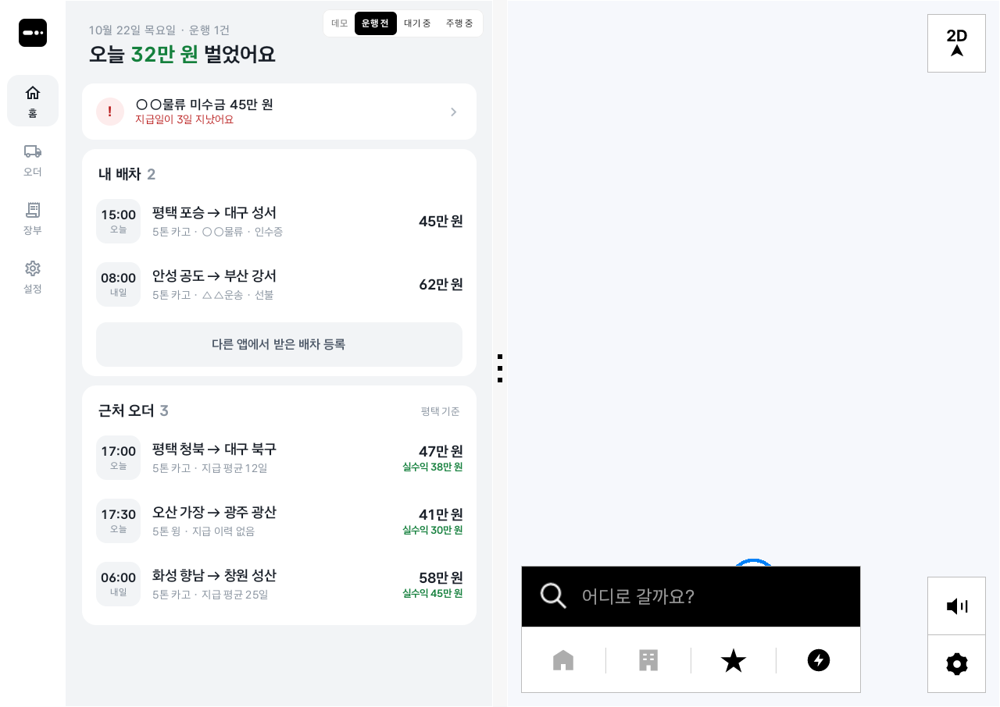
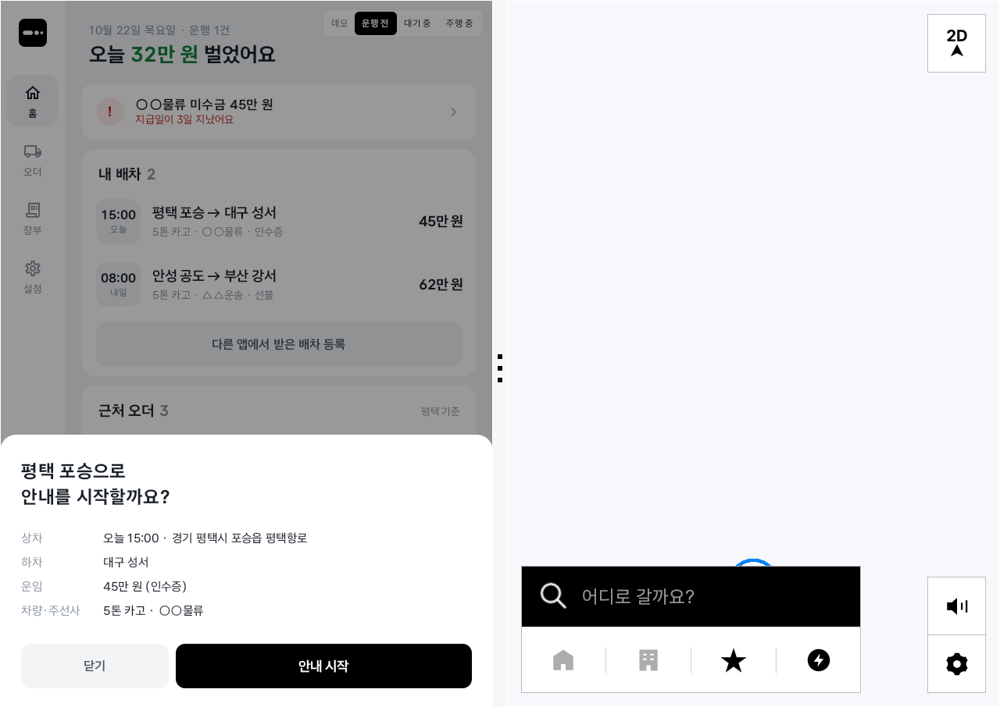
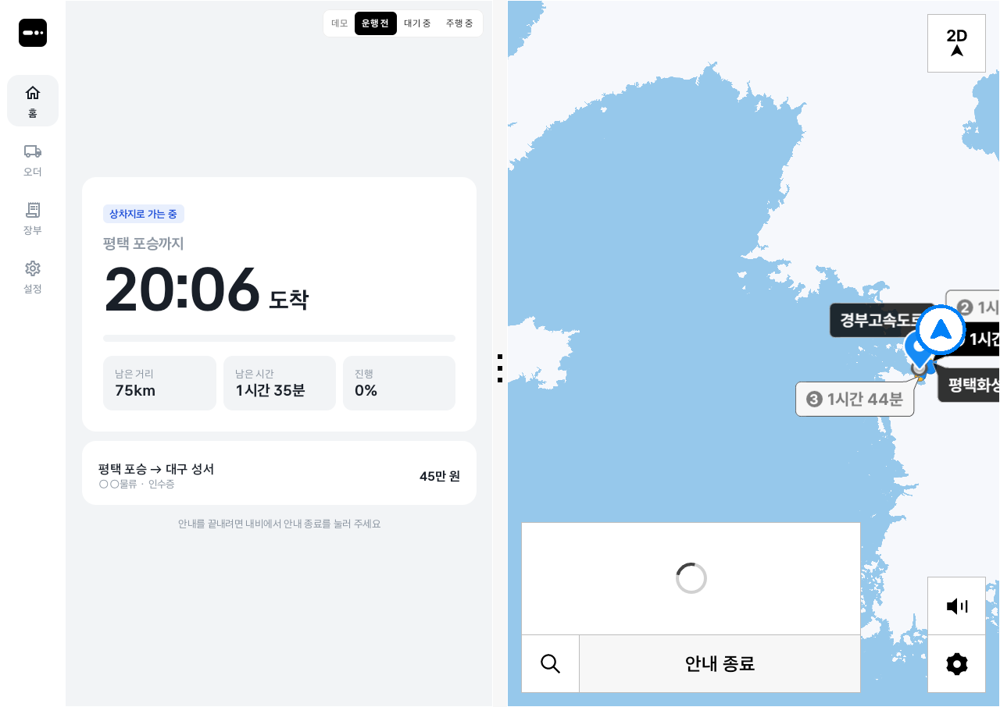
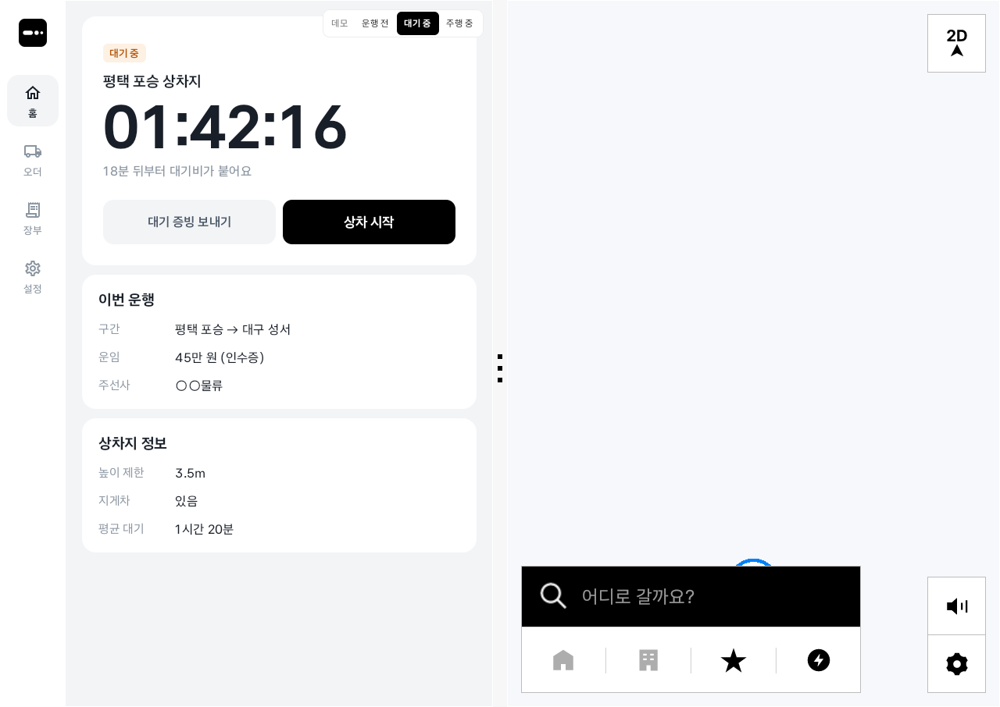

<div align="center">

<picture>
  <source media="(prefers-color-scheme: dark)" srcset="design/logo/icon/ieo_icon_white.svg">
  
</picture>

<br><br>

<picture>
  <source media="(prefers-color-scheme: dark)" srcset="design/logo/wordmark/ieo_wordmark_white.svg">
  
</picture>

### The in-car assistant for truck drivers

**Ieo (이에오)** connects one haul to the next: it finds the next load, guides you there,<br>
times the wait, and keeps the books, right on the car screen.

<br>


[Backend (ieo-server)](https://github.com/SeolHuiGwan9478/ieo-server) · [Planning docs (Korean)](docs/기획서_초안_v0.1.md) · [Brand guide](design/README.md)

</div>

<br>

## Why Ieo

A cargo truck driver's day is a chain of trips. Between them sit hours of lost time: searching freight apps for the next load, waiting at loading docks with no proof of how long, chasing brokers for late payments, and keeping it all in a paper notebook.

Ieo runs on the vehicle itself (Hyundai Motor Group's **Pleos Connect**, Android Automotive). Because it knows the gear, speed and route, it can tell driving from waiting without the driver touching anything, and it talks instead of asking for taps while the truck is moving.

> Built as a solo entry to the Hyundai Motor Group in-vehicle app development contest (2026).

## Screenshots

Ieo sits in the half window next to the car's built-in navigation.

<table>
  <tr>
    <td align="center"><br><sub><b>Home</b>: today's earnings, my trips, nearby loads</sub></td>
    <td align="center"><br><sub><b>Start guidance</b>: one tap hands the route to the car navigation</sub></td>
  </tr>
  <tr>
    <td align="center"><br><sub><b>On the way</b>: arrival time and progress from the navigation</sub></td>
    <td align="center"><br><sub><b>Waiting at the dock</b>: live timer and billable waiting fee</sub></td>
  </tr>
</table>

## Features

| Feature | What it does | Status |
|---|---|---|
| **One-tap guidance** | Sends the pickup point to the car navigation (Pleos NaviHelper) and shows ETA, distance left and progress | Working on the emulator |
| **Load board** | Your trips and nearby loads, with **net profit** (after fuel and tolls) and each broker's average payment days | Screen done, sample data |
| **Waiting timer** | Starts when the truck stops at a site, counts free time, and calculates the waiting fee you can claim | Screen done, sample data |
| **ETA sharing** | Tells the broker and consignee when you will arrive, and again if the ETA changes | Planned |
| **Next load by voice** | Two-thirds into a trip, suggests the next load near the drop-off. Answer "yes" or "next" | Planned |
| **Ledger** | Trips, fuel and tolls recorded automatically from vehicle data; unpaid balances flagged | Planned |

Requirements and priorities for each domain are in [`docs/requirements/`](docs/requirements) (Korean).

## Repository layout

```
ieo-app/
├── android/     In-car app (Kotlin, Jetpack Compose, Pleos Connect SDK)
├── docs/        Product plan and per-domain requirements (Korean)
├── research/    Market research and Pleos SDK notes
├── design/      Logo, brand guide, screenshots
└── tools/       Emulator helpers (vehicle signal simulation)
```

## Getting started

**Requirements:** Android Studio, JDK 21, and the Pleos Connect Emulator (API 34, Automotive).

1. Open `android/` in Android Studio.
2. Install the Pleos Connect Emulator and create an AVD ([official guide](https://document.pleos.ai/docs/connect/guide/getting-started/application-development/setup-connect-sdk-emulator)).
3. Run the `app` configuration.

To build from the command line:

```bash
cd android
./gradlew assembleDebug
```

On the emulator the app runs as Android user 10:

```bash
adb install -r app/build/outputs/apk/debug/app-debug.apk
adb shell am start --user 10 -n com.ieo.app/.MainActivity
```

### Simulating the vehicle

Gear, speed and other signals can be changed from the emulator's Virtual Console:

```bash
adb forward tcp:8088 tcp:8088   # then open http://127.0.0.1:8088/
```

`tools/vehicle-sim.sh` scripts location, speed and gear changes for testing trips.

To see the navigation next to Ieo, drag the handle on the right edge of the app area to split the screen.

## Tech stack

| Area | Stack |
|---|---|
| App | Kotlin 2.4, Jetpack Compose, Material 3 |
| Vehicle | Pleos Connect SDK: Vehicle 2.3.2, NaviHelper 3.0.5; Android `CarPropertyManager` |
| Build | AGP 9.4, Gradle 9.8, compileSdk 37, minSdk 28 |
| Backend | Java 21, Spring Boot 4, PostgreSQL ([ieo-server](https://github.com/SeolHuiGwan9478/ieo-server)) |

## Documentation

- [Product plan](docs/기획서_초안_v0.1.md)
- [Requirements by domain](docs/requirements)
- [Pleos SDK research](research/02_pleos_sdk.md)
- [Brand guide](design/README.md)

Documents are written in Korean.
