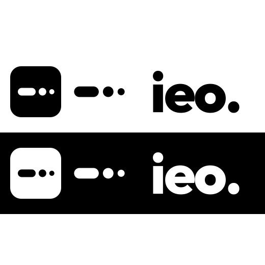

# Ieo 브랜드

한글 서비스명은 **이에오**. 이름은 "이어서·이어짐"에서 왔다. 짐을 내린 곳에서 다음 일이 이어진다는 뜻이고, "이어"를 로마자로 적으면 ieo.



## 로고 파일

모든 파일은 배경이 투명한 SVG이고, 글자는 path로 변환되어 있어 글꼴 설치 없이 똑같이 보임.
파일 이름의 색이 로고(글자·심볼)의 색. **orange는 흰·밝은 배경용, white는 주황·어두운 배경용**.

| 종류 | 흰·밝은 배경 | 주황·어두운 배경 | 용도 |
|---|---|---|---|
| 아이콘 | `logo/icon/ieo_icon_orange.svg` (주황 사각형 + 흰 심볼) | `logo/icon/ieo_icon_white.svg` (흰 사각형 + 주황 심볼) | 앱 아이콘, 프로필 이미지 |
| 심볼 | `logo/icon/ieo_symbol_orange.svg` | `logo/icon/ieo_symbol_white.svg` | 배경 사각형 없이 심볼만 쓸 때 |
| 텍스트 로고 | `logo/wordmark/ieo_wordmark_orange.svg` | `logo/wordmark/ieo_wordmark_white.svg` | 기본 로고 |

- 주황 아이콘은 어두운 배경에서도 그대로 씀
- 아이콘과 텍스트 로고를 붙인 조합(락업)은 쓰지 않음. 둘을 함께 놓아야 하면 따로 배치함
- 이전 시안은 `logo/drafts/`에 버전별로 보관. 직전의 흑백 로고는 `logo/drafts/v4_black_white/`

## 색상 팔레트

컨셉: **주황 브랜드 + 신호등.** 로고, 주요 버튼, 선택된 메뉴처럼 "Ieo"를 나타내는 곳에는 주황을 쓰고, 운행 상황을 알릴 때만 상태색을 씀. 주황은 상태를 뜻하지 않음. Postman의 주황(`#FF6C37`)에서 출발함.

### 브랜드색 (주황)

| 이름 | 값 | 쓰임 |
|---|---|---|
| Orange 50 | `#FFF3EE` | 선택된 메뉴·강조 영역 바탕 |
| Orange 100 | `#FFE2D6` | 눌린 상태, 옅은 강조 |
| **Orange 500** | **`#FF6C37`** | **로고, 앱 아이콘, 시작 화면 바탕, 강조 표시** |
| Orange 600 | `#F25A22` | 주요 버튼 바탕. 흰 글자는 굵게 24sp 이상 (대비 3.3:1) |
| Orange 700 | `#C2410C` | 흰 바탕 위 주황 글자, 선택된 메뉴 글자 (대비 5.2:1) |

### 무채색

화면 바탕과 글자. 홈 같은 목록 화면은 연회색 바탕 위에 흰 묶음을 놓음.

| 이름 | 값 | 쓰임 |
|---|---|---|
| White | `#FFFFFF` | 기본 바탕, 묶음(카드) 바탕, 주황 위 글자 |
| Canvas Gray | `#F2F4F6` | 목록 화면 바탕, 회색 버튼, 시각 칸 |
| Text Strong | `#191F28` | 제목, 금액 |
| Text Mid | `#4E5968` | 회색 버튼 글자 |
| Text Sub | `#8B95A1` | 설명 글자 (웹). 휴대폰은 `#4E5968`. 차량 앱은 차 안에서 흐려 본문 회색과 같은 `#4E5968`(흰 바탕 대비 7.4:1)을 쓴다. 다크 모드는 `#B0B8C1` |
| Gray 100 | `#EDEDED` | 구분선 |
| Black | `#000000` | (지금은 쓰지 않음. 다크 바탕은 Gray950·Gray900) |

### 상태색

라이트 값은 흰 바탕에서 글자로 읽힐 만큼 진하게 잡음. 꼬리표("대기 중")는 옅은 바탕 위에 진한 글자로 씀.

| 상태 | 라이트 모드 | 꼬리표 바탕 | 다크 모드 | 쓰임 |
|---|---|---|---|---|
| 운행 (Blue) | `#1D4ED8` | `#E8EFFD` | `#60A5FA` | 주행 중, ETA, 경로, 다음 배차 안내 |
| 대기 (Yellow) | `#A16207` | `#FEF9C3` | `#FACC15` | 대기 타이머, 청구 가능 대기비 |
| 완료·수익 (Green) | `#15803D` | - | `#4ADE80` | 하차 완료, 실수익, 지급 완료 |
| 경고 (Red) | `#B91C1C` | `#FDECEC` | `#F87171` | 휴게 필요, 미수금, 지급 지연 |

- 대기는 원래 호박색(Amber)이었지만 브랜드 주황과 헷갈려서 노랑 계열로 바꿈

### 사용 규칙

- 주요 버튼(안내 시작, 상차 시작 등)은 Orange 600 바탕에 흰 굵은 글자. 보조 버튼은 회색(Canvas Gray) 바탕
- 주황은 한 화면에서 가장 중요한 동작 하나와 로고에만 씀. 여기저기 칠하지 않음
- 상태색은 한 화면에 두 가지 이하로 씀
- 색만으로 상태를 구분하지 않고 글자("대기 중")나 아이콘을 함께 씀 (색약 사용자 고려)

## 규칙

- 텍스트 로고는 소문자와 마침표를 쓴 **`ieo.`**. 글꼴은 **Outfit ExtraBold(800)**이고 자간을 -0.03em 좁힘
- 문장 안에서는 영문 `Ieo`, 한글 `이에오`로 씀
- 아이콘 의미: 막대는 지금 하는 운행, 점 두 개는 이어지는 다음 일. 멀어질수록 점이 작아짐
- 앱 화면은 시스템 설정을 따른다 (UX-006). 라이트: 흰·연회색 바탕에 진한 글자. 다크: 짙은 회색 바탕에 밝은 글자. 주요 버튼은 둘 다 주황
- 시작 화면(시스템 시작 화면 포함)은 주황 바탕에 흰 로고 (`values-v31/themes.xml`, `ui/splash/SplashScreen.kt`)
- Android 앱 아이콘은 주황 바탕에 흰 심볼 (`android/app/src/main/res/mipmap-anydpi/`)
- Outfit은 SIL Open Font License 1.1이라 로고 제작과 상업적 이용이 가능함

## 다시 만들기

로고를 수정하려면 `scripts/make_brand.py`의 설정값(`TEXT`, `WEIGHT`, `TRACKING`, `ORANGE`)을 고친 뒤 다시 생성함. Outfit 가변 글꼴 파일과 fonttools가 필요함.

```bash
cd design
python3 -m venv .venv && .venv/bin/pip install fonttools
curl -L -o Outfit.ttf "https://github.com/google/fonts/raw/main/ofl/outfit/Outfit%5Bwght%5D.ttf"
.venv/bin/python scripts/make_brand.py Outfit.ttf logo
.venv/bin/python scripts/preview.py logo preview.svg
qlmanage -t -s 1040 -o . preview.svg   # macOS에서 PNG로 변환
```
