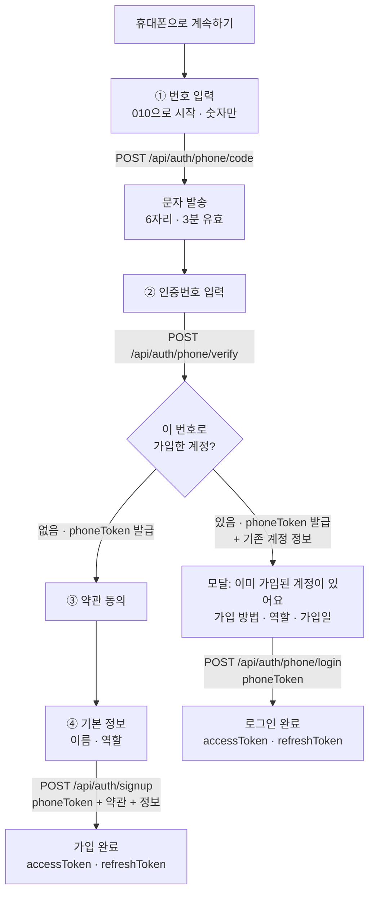
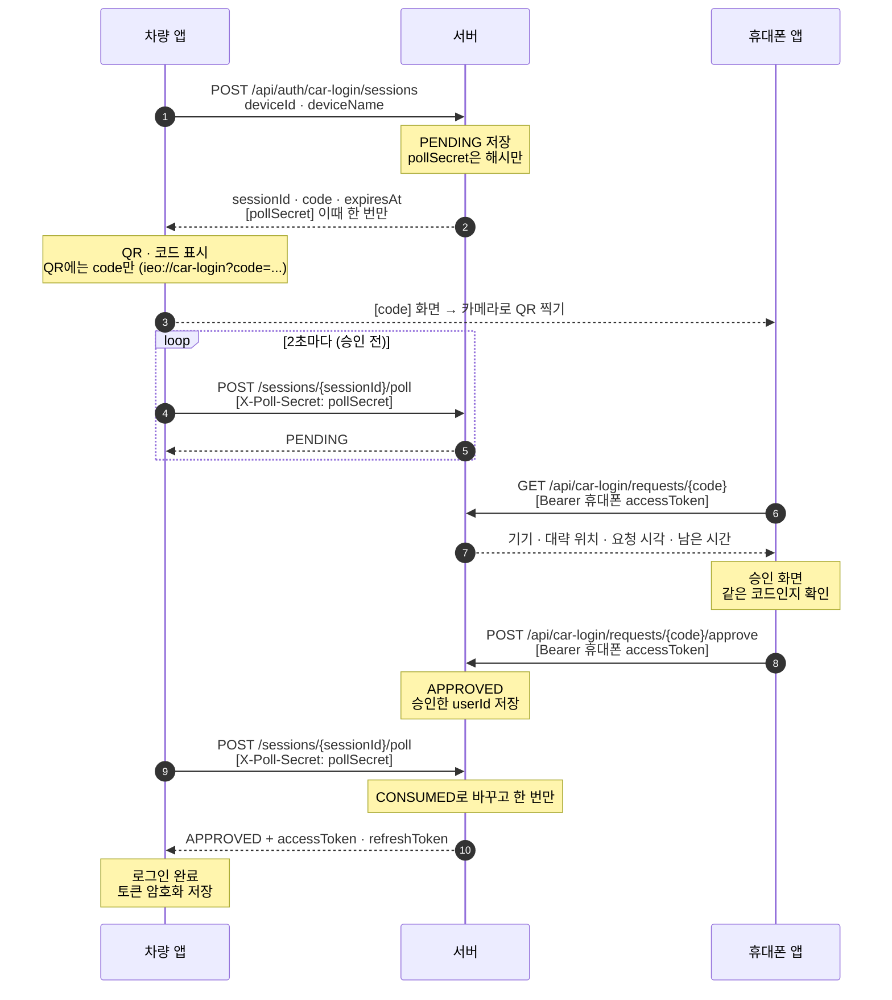
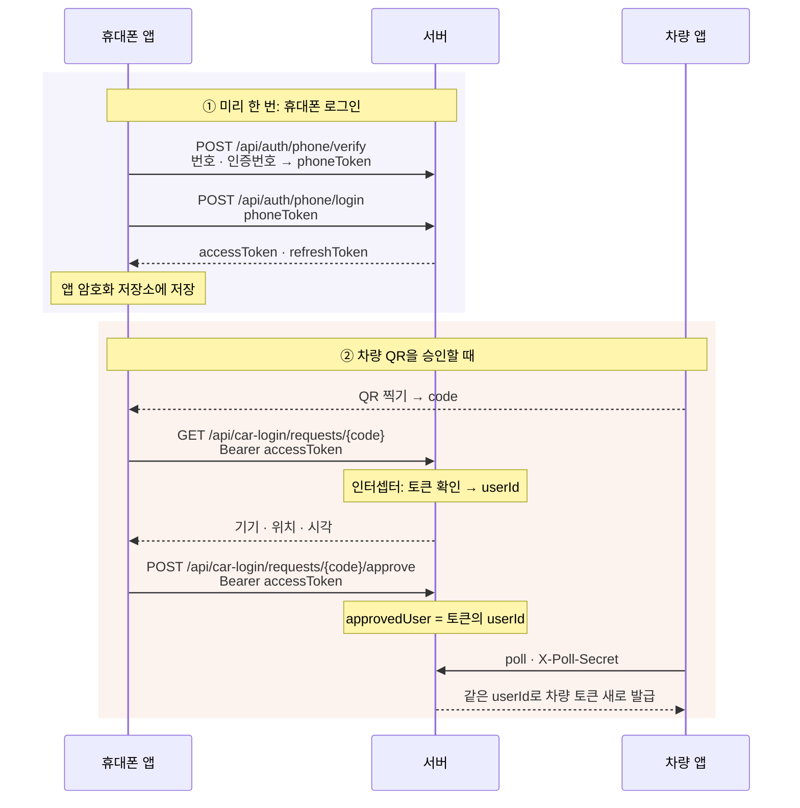
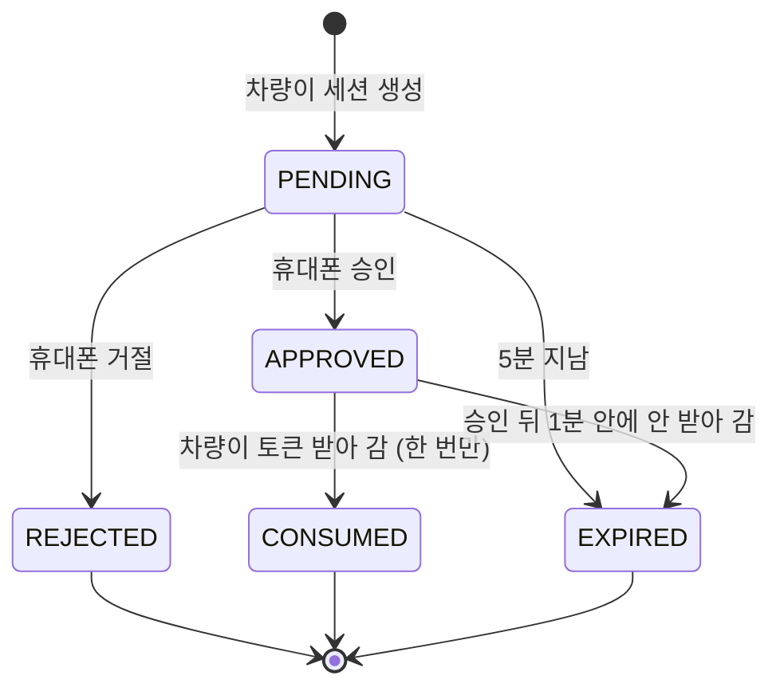
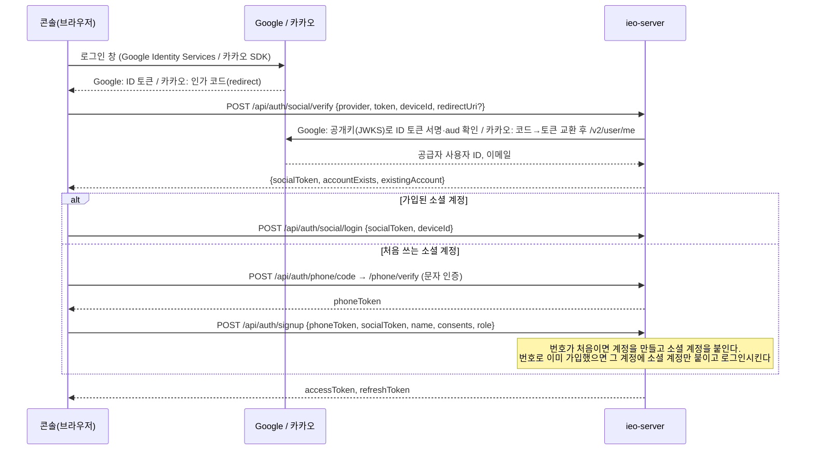

# 01. 로그인 설계: 휴대폰 로그인 · 차량 QR 로그인 · 소셜 로그인

요구사항 [ACC-001](../requirements/08_계정_차량.md)을 서버(`ieo-server`)에 구현한 방식을 정리한다. 다이어그램은 GitHub에서 그대로 보이는 Mermaid로 그렸다.

- 휴대폰 로그인: 모바일 앱에서 휴대폰 번호를 문자로 인증해 가입·로그인한다. **번호가 계정의 열쇠**다.
- 차량 QR 로그인: 차량은 직접 로그인하지 않는다. 차량 화면에 QR을 띄우고, 이미 로그인된 휴대폰이 승인하면 차량이 그 계정으로 로그인된다.
- 소셜 로그인 (주선사 콘솔): Google·카카오 계정으로도 로그인한다. 처음 쓰는 소셜 계정은 **번호 인증까지 마쳐야 가입**되고, 그 뒤로는 소셜 계정만으로 로그인된다 (3장).

## 토큰 정리

| 토큰 | 언제 받나 | 무엇을 증명하나 | 수명 | 어디에 쓰나 |
|---|---|---|---|---|
| `phoneToken` | 인증번호 확인 직후 (로그인 전) | 이 번호의 주인이다 | 10분, 한 번만, 받은 기기에서만 | `/phone/login` 또는 `/signup`에 한 번 |
| `socialToken` | Google·카카오 확인 직후 (로그인 전) | 이 소셜 계정의 주인이다 | 10분, 한 번만, 받은 기기에서만 | `/social/login`, 또는 `/signup`에 `phoneToken`과 함께 한 번 |
| `accessToken` | 로그인·가입·QR 승인 완료 후 | 이 사용자다 | 30분 | 로그인이 필요한 모든 API의 `Authorization: Bearer` |
| `refreshToken` | 위와 같음 | 로그인이 유지되고 있다 | 30일 | `accessToken`이 만료되면 `/refresh` |
| `pollSecret` | 차량 QR 세션 생성 응답 (한 번만) | 이 세션을 만든 차량이다 | 세션과 같음 (5분) | 차량이 승인 여부를 묻고 토큰을 받을 때 `X-Poll-Secret` |

`phoneToken`, `socialToken`, `pollSecret`은 서버에 해시만 저장한다. 액세스·리프레시 토큰은 HS256 JWT이고 `typ` 클레임으로 둘을 구분한다.

---

## 1. 휴대폰 로그인

### 흐름

- `verify`는 계정이 있든 없든 같은 모양으로 답한다: `phoneToken`, `accountExists`, (있으면) `existingAccount`. 앱은 다음 요청만 `/phone/login`이냐 `/signup`이냐로 고른다.
- `code` 요청은 가입 여부와 상관없이 같은 응답(204)을 준다. 번호만 넣어서 가입 여부를 알아낼 수 없게 한다. 계정 정보는 문자 인증을 통과한 뒤 `verify`에서만 준다.
- `signup`·`phone/login` 요청 본문에는 번호가 없다. 어떤 번호인지는 서버가 `phoneToken`으로만 안다.

### phoneToken이 따로 있는 이유

1. 새 번호는 인증 직후 가입할 수 없다. 약관과 기본 정보를 다음 화면에서 받는 동안 "이 번호는 인증됐다"는 증명을 들고 있어야 한다.
2. 아직 계정이 없으니 사용자 ID가 들어가는 액세스 토큰을 줄 수 없다.
3. 가입된 번호도 모달을 보여 준 뒤 사용자가 고르면 로그인한다.
4. 권한이 좁다: 로그인·가입에만, 10분 안에, 한 번만, 받은 기기에서만 쓸 수 있다.

### 제한과 실패 응답

| 상황 | 응답 | 코드 |
|---|---|---|
| 번호 형식 틀림 | 400 | `COMMON_400` |
| 같은 번호 1분 안에 다시 요청 | 429 | `AUTH_429_RESEND` |
| 같은 번호 하루 5번 넘게 요청 | 429 | `AUTH_429_DAILY` |
| 인증번호 틀림 (남은 횟수를 메시지에) | 400 | `AUTH_400_CODE` |
| 5번 틀림 → 10분 잠금 | 429 | `AUTH_429_LOCKED` |
| 3분 지남 / 보낸 적 없음 | 410 | `AUTH_410_CODE` |
| phoneToken 없음·만료·이미 씀·다른 기기 | 401 | `AUTH_401_PHONE` |
| 필수 약관 빠짐 (phoneToken은 그대로 남는다) | 400 | `AUTH_400_CONSENT` |
| 같은 번호로 이미 가입됨 | 409 | `AUTH_409_PHONE` |

### 저장

| 테이블 | 내용 |
|---|---|
| `phone_verifications` | 번호마다 한 줄: 인증번호 해시, 만료, 틀린 횟수, 오늘 보낸 횟수, 마지막 발송, 잠금 해제 시각 |
| `phone_tokens` | phoneToken 해시(PK), 번호, deviceId, 만료 |

같은 번호로 동시에 들어온 요청은 행 잠금으로 순서대로 처리한다. 만료된 기록은 매일 새벽 4시에 지운다. **운영 시 Redis로 옮길 예정**(TTL로 자동 만료, `INCR`·`SET NX`·`GETDEL`).

---

## 2. 차량 QR 로그인

### 세 가지 값

| 값 | 누가 아나 | 어디에 있나 | 쓰는 쪽 | 이걸로 할 수 있는 일 |
|---|---|---|---|---|
| `code` (예: `KX7P-M4QZ`) | 화면을 보는 누구나 | 차량 화면, QR | 휴대폰 | "이 요청을 승인할게"라고 가리키기 |
| `pollSecret` | 차량 앱만 | 차량 앱 메모리 (화면·QR에 안 나옴) | 차량 | 승인된 토큰 받아 가기 |
| 휴대폰 `accessToken` | 휴대폰 앱만 | 휴대폰 앱 저장소 | 휴대폰 | 누가 승인하는지 서버에 알리기 |

- `code`는 "어느 요청인지" 가리키는 공개 번호, `pollSecret`은 "그 요청을 만든 차량이 맞는지" 확인하는 비밀 열쇠다.
- `code`만 알아서는 토큰을 받을 수 없다. 화면을 사진으로 찍어도 소용없다.
- `code`로 남이 승인하면 남의 계정으로 차량이 로그인될 뿐이라 공격하는 쪽에 이득이 없다. 그래서 승인 화면에 "내 차 화면에 같은 코드가 보일 때만 승인하세요"를 띄운다.
- `pollSecret`은 진짜 차량인지 증명하지 않는다. "이 세션을 만든 쪽이 지금 묻고 있다"만 증명한다. 토큰이 나오려면 휴대폰 주인의 승인이 반드시 필요하다.

### 순서

`[ ]` 안이 그 요청에 실려 가는 값이다. `pollSecret`은 차량↔서버, 휴대폰 `accessToken`은 휴대폰↔서버, `code`는 화면→카메라로만 오가고 서로 길이 겹치지 않는다.

### 휴대폰 로그인 토큰이 쓰이는 때

차량에 **누구로** 로그인할지는 승인 요청에 붙은 휴대폰 토큰이 정한다. 휴대폰 토큰이 차량으로 넘어가는 게 아니라, 차량은 같은 사용자로 새로 발급한 자기 토큰을 받는다.

### 상태

`EXPIRED`는 저장하지 않고 저장된 상태와 지금 시각으로 판단한다. 승인 뒤 1분을 따로 주는 건 만료 직전에 승인돼도 차량이 다음 확인 때 받아 갈 수 있게 하려는 것이다.

### API

| API | 호출 | 하는 일 |
|---|---|---|
| `POST /api/auth/car-login/sessions` | 차량 (로그인 전) | 세션 생성. `sessionId`, `code`, `pollSecret`, `qrUrl`, `expiresAt`, `pollIntervalSeconds` |
| `POST /api/auth/car-login/sessions/{sessionId}/poll` | 차량, `X-Poll-Secret` | 상태 확인. 승인된 세션을 처음 물을 때만 토큰을 준다. 상태가 바뀌므로 GET이 아니라 POST |
| `GET /api/car-login/requests/{code}` | 휴대폰, Bearer | 승인 화면 정보 |
| `POST /api/car-login/requests/{code}/approve` | 휴대폰, Bearer | 승인 |
| `POST /api/car-login/requests/{code}/reject` | 휴대폰, Bearer | 거절 |

- `/api/auth/**`는 로그인 전에 부르는 API라 인증 인터셉터에서 뺐고, 나머지 `/api/**`는 Bearer 액세스 토큰이 필요하다.
- `pollSecret`이 틀리거나 없으면 세션이 있는지도 알려 주지 않도록 404를 준다.
- `code`는 0/O, 1/I를 뺀 32글자로 8자리(`XXXX-XXXX`)다. 손으로 칠 때 소문자나 하이픈 없이 쳐도 찾는다.

| 상황 | 응답 | 코드 |
|---|---|---|
| 없는 코드 / pollSecret 틀림 | 404 | `CAR_LOGIN_404` |
| 만료된 요청을 승인·거절 | 410 | `CAR_LOGIN_410` |
| 이미 승인·거절한 요청 | 409 | `CAR_LOGIN_409` |
| 토큰 없이 휴대폰 API 호출 | 401 | `COMMON_401` |

### 저장

`car_login_sessions`: `id`(UUID, sessionId), `code`(유니크), `poll_secret_hash`, `device_id`, `device_name`, `app_version`, `request_ip`, `approx_location`, `status`, `approved_user_id`, `decided_at`, `consumed_at`, `expires_at`. 승인·거절과 토큰 수령은 행 잠금으로 한 번만 처리한다. 만료되고 하루 지난 세션은 새벽 정리 작업이 지운다. 차량이 2초마다 조회하므로 **운영 시 Redis로 가장 먼저 옮길 대상**이다.

---

## 3. 소셜 로그인 (주선사 콘솔)

웹 콘솔(`ieo-web`)의 "Google로 로그인", "카카오로 로그인". 공급자 확인 → `socialToken` → 가입된 소셜 계정이면 로그인, 처음이면 **휴대폰 번호 인증을 거쳐** 가입한다. 번호가 계정의 열쇠라는 원칙은 그대로다.

### 계정과 열쇠

- `social_identities`: `provider`, `provider_user_id`(Google `sub`, 카카오 회원번호), `email`, `user_id`. `(provider, provider_user_id)`가 유니크라 한 소셜 계정은 한 이에오 계정에만 붙는다.
- 소셜로 들어와도 가입은 번호 인증을 거치므로 모든 계정에 번호가 있다. 번호로 오는 주선사 초대·단골 연결도 그대로 받는다.
- 번호로 이미 가입한 사람이 소셜로 처음 들어오면, `/signup`이 새 계정을 만들지 않고 그 계정에 소셜 계정을 붙인 뒤 토큰을 준다 (이름·동의는 바꾸지 않는다).
- 탈퇴하면 `social_identities`를 지운다. 같은 소셜 계정으로 다시 가입할 수 있다.
- 이메일은 공급자가 확인해 준 것만 저장한다 (Google `email_verified`, 카카오는 동의한 경우). 로그인에는 쓰지 않는다.

### 설정과 실패 응답

- `ieo.social.google.client-id`(`GOOGLE_CLIENT_ID`), `ieo.social.kakao.rest-api-key`(`KAKAO_REST_API_KEY`), 선택 `KAKAO_CLIENT_SECRET`. 콘솔 쪽은 `VITE_GOOGLE_CLIENT_ID`(서버와 같은 값), `VITE_KAKAO_JS_KEY`.
- 키가 없는 공급자는 `503 AUTH_503_SOCIAL`. 콘솔은 그 버튼을 "준비 중"으로 보여 준다.
- 공급자 확인 실패 `401 AUTH_401_SOCIAL_PROVIDER`, `socialToken` 없음·재사용·만료·다른 기기 `401 AUTH_401_SOCIAL`, 이미 가입된 소셜 계정으로 가입 `409 AUTH_409_SOCIAL`.
- `/signup`은 `phoneToken`이 필수이고, 소셜로 들어온 경우에만 `socialToken`을 함께 받는다. 이미 다른 계정에 붙은 소셜 계정이면 `409 AUTH_409_SOCIAL`.
- 카카오 `redirectUri`는 인가 코드를 받을 때 쓴 주소와 같아야 한다. 콘솔은 `{origin}/login`을 보낸다.

### 저장

`social_tokens`: `token_hash`(PK), `provider`, `provider_user_id`, `email`, `device_id`, `expires_at`. 쓰면 지우고, 만료된 행은 새벽 정리 작업이 지운다. `phone_tokens`와 함께 Redis로 옮길 대상이다.

---

## 남은 일

- [ ] 세션 생성 횟수 제한 (IP별), IP로 대략 위치 추정
- [ ] 프록시 뒤에서 실제 요청 IP 읽기 (`X-Forwarded-For`)
- [x] 로그인된 차량 목록과 원격 로그아웃 (모바일 M11, 2026-11-10): `car_sessions` 표. 차량에 주는 토큰에만 `csid` 클레임을 넣고, 인증 인터셉터와 `/refresh`가 끊긴 세션을 401로 막는다. 휴대폰 토큰은 기존과 같다. API: `GET /api/users/me/car-sessions`, `POST .../{id}/revoke`, `POST .../current/sign-out` (차량 앱 로그아웃)
- [x] Google·카카오 로그인 (`social_identities`, 3장) — 2026-11-08
- [ ] 로그인된 계정에 소셜 계정 연결·해제 (설정 화면)
- [ ] 문자 업체 연동 (지금은 로그로만 남긴다)
- [ ] 휴대폰 인증·QR 세션 저장소를 Redis로
