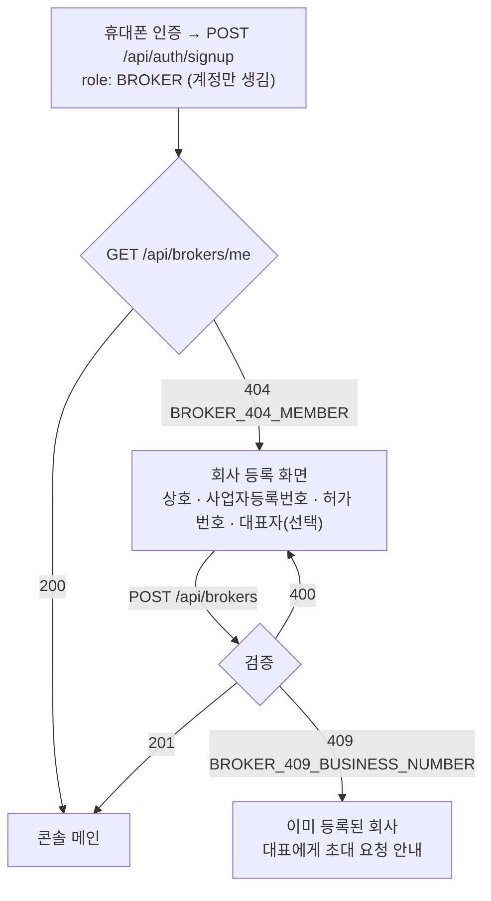
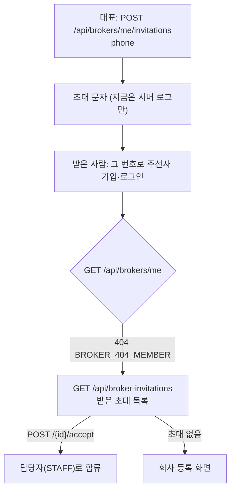

# 주선사 인계에 따른 작업 내용

[02_주선사_인계.md](02_주선사_인계.md)의 "빠진 것"을 채운 기록이다. 작업 순서대로 쌓는다.

- 요구사항: [../requirements/07_주선사.md](../requirements/07_주선사.md)
- 서버 저장소: `ieo-server`

## 진행 현황

| 인계 문서 항목 | 내용 | 상태 |
|---|---|---|
| 2-1 주선사 가입 | 회사 등록 API, 사업자등록번호 검증, 내 회사 조회 | **완료** (2026-11-03) |
| 3 CORS | 웹 콘솔 주소 허용 | **완료** (2026-11-03) |
| 2-2 담당자 관리 | 초대·수락, 직책 변경, 내보내기, 나가기 | **완료** (2026-11-03) |
| 2-3 정산 주기 설정 | 등록 때 입력, 회사 정보·정산 주기 수정, 오더 지급일 기본값 | **완료** (2026-11-04) |
| 2-4 단골 차주 연결 | 번호로 연결 요청·수락(=위치 공유 동의), 해제, 단골에게만 지정 배차 | **완료** (2026-11-04) |
| 2-5 진행 중 운행 확인 | 운행 목록(탭)·상세, 위치·ETA·진행률, 도착·출발 시각, 대기 증빙·인수증 | **완료** (2026-11-05). 위치·ETA는 서버에 저장된 마지막 위치(9장)로 채움. 차량 앱 전송은 원작자, 화주 공유 링크(BRK-022)는 남음 |
| 2-5-1 화물 종류 목록 | 오더에 화물 종류(일반·냉동·냉장·이사·위험물) 고르기, 자세한 품목은 자유 입력 | **완료** (2026-11-05) |
| 2-6 신뢰 지표 | 평균 지급 소요일, 지급 지연·대기비 지급 비율, 평균 대기. 오더 카드·콘솔에 표시, 20건부터 공개 | **완료** (2026-11-05). 새벽 자동 계산은 꺼 둠 (8장) |
| 2-7 정회원 리포트 | 노선별 운임·소요 시간, 상하차지 대기, 내 회사, 함께 일한 차주 리포트 API | **완료** (2026-11-05). 요금제 검사는 2-8에서 (10장) |
| 2-8 요금제 | 주선사 플랜 BASIC·PRO·PRO+, 서버 권한 검사(리포트·담당자 수), 결제 없는 플랜 전환 | **완료** (2026-11-05). 결제·차주 플랜은 남음 (11장) |
| 3 웹 콘솔 (React) | GitHub `SeolHuiGwan9478/ieo-web`. 로그인·가입·회사 등록, 오더, 진행 중 운행, 단골 차주, 담당자, 리포트·신뢰 지표, 설정 — 서버 API 전부 연결 | **1차 완료** (2026-11-06, 12장). 지도·주소 검색은 보류 |
| 콘솔 대시보드 | 홈에 기간별 실적(일·주·월): 오더 등록·완료·취소 건수, 청구·지급·수수료·대기비 합계 그래프. 모든 플랜 | **완료** (2026-11-06, 16장) |
| 청구운임·수수료 | 오더에 거래처(화주)·청구운임, 수수료 = 청구 − 지급, 수수료율로 청구운임 자동 계산, 회사 기본 수수료율. 차주에게는 안 나감 | **완료** (2026-11-06, 17장) |

---

## 1. 주선사 가입과 회사 등록 (BRK-001) — 2026-11-03

### 정한 것

| 질문 | 결정 |
|---|---|
| 가입과 회사 등록을 한 번에 할지 | **나눈다.** 주선사 역할로 가입만 먼저 하고, 로그인한 뒤 회사를 등록한다. 등록한 계정이 대표(`OWNER`)가 된다 |
| 이미 등록된 사업자등록번호 | **409로 막는다.** 새 회사를 만들지 않고 "대표에게 초대를 요청하라"고 안내한다. 합류는 담당자 초대(2-2)에서 만든다 |
| 운송주선사업 허가 번호 | **필수.** 없으면 회사를 등록할 수 없다 |
| 사업자등록번호 확인 수준 | 숫자 10자리 + 국세청 검증 번호 계산식까지. 실제로 있는 사업자인지는 확인하지 않는다 (아래 "남은 것") |

가입을 나눈 이유: 초대받은 담당자는 회사 등록 없이 가입 → 초대 수락으로 합류하면 되어서, 가입 API 하나로 두 경우를 모두 처리할 수 있다. 원래 `AuthService.signUp`의 주석("주선사 소속은 주선사 등록·초대에서 붙인다")과도 맞다.

### 흐름



### API

| Method | Path | 하는 일 | 응답 |
|---|---|---|---|
| `POST` | `/api/brokers` | 회사 등록. 등록한 계정이 대표가 된다 | 201 + 내 회사 |
| `GET` | `/api/brokers/me` | 내 회사와 내 직책 | 200. 소속이 없으면 404 `BROKER_404_MEMBER` |

요청 (`POST /api/brokers`):

```json
{
  "name": "한빛로지스",
  "businessNumber": "123-45-67891",
  "licenseNumber": "제2026-001호",
  "representativeName": "김대표"
}
```

- `businessNumber`는 하이픈·띄어쓰기가 있어도 된다. 숫자만 남겨 저장한다.
- `representativeName`은 비워도 된다.

응답 (두 API 공통):

```json
{
  "id": 1,
  "name": "한빛로지스",
  "businessNumber": "1234567891",
  "licenseNumber": "제2026-001호",
  "representativeName": "김대표",
  "settlementDays": 30,
  "position": "OWNER",
  "positionLabel": "대표",
  "createdAt": "2026-11-03T04:00:00Z"
}
```

콘솔은 `position`으로 대표 전용 메뉴(대기비 정책 바꾸기, 담당자 관리 등)를 보여 줄지 정한다.

### 오류

| 상황 | 응답 | 코드 |
|---|---|---|
| 사업자등록번호 형식 또는 검증 번호가 틀림 | 400 | `BROKER_400_BUSINESS_NUMBER` |
| 허가 번호가 없거나 공백뿐임 | 400 | `COMMON_400` (`fieldErrors`에 `licenseNumber`) |
| 이미 등록된 사업자등록번호 | 409 | `BROKER_409_BUSINESS_NUMBER` |
| 이미 회사에 소속된 계정이 또 등록 | 409 | `BROKER_409_MEMBER` |
| 차주 계정 | 403 | `BROKER_403_ROLE` |
| 회사 소속이 없는데 `GET /me` | 404 | `BROKER_404_MEMBER` |
| 탈퇴한 계정 | 404 | `USER_404` |
| 로그인하지 않음 | 401 | `COMMON_401` |

같은 사업자등록번호로 동시에 등록하면 `brokers.business_number` 유니크 제약이 하나만 남기고, 늦은 쪽은 409를 받는다.

### 사업자등록번호 검증 번호

앞 9자리에 가중치 `1 3 7 1 3 7 1 3 5`를 곱해 더하고, 9번째 자리 × 5의 십의 자리를 한 번 더 더한다. `(10 − 합 % 10) % 10`이 10번째 자리와 같아야 한다. `Broker.normalizeBusinessNumber`에 있다.

### 바뀐 코드 (ieo-server)

| 파일 | 내용 |
|---|---|
| `domain/broker/controller/BrokerController.java` | 새로 만듦. `POST /api/brokers`, `GET /api/brokers/me` |
| `domain/broker/service/BrokerService.java` | 새로 만듦. 회사 등록(`register`), 내 회사 조회(`getMine`) |
| `domain/broker/dto/CreateBrokerRequest.java`, `MyBrokerResponse.java` | 새로 만듦 |
| `domain/broker/entity/Broker.java` | `create`에서 사업자등록번호 정리·검증, 허가 번호 필수 확인 |
| `domain/broker/enums/BrokerMemberPosition.java` | 화면 표기 `label` 추가 (대표 / 담당자) |
| `global/error/ErrorCode.java` | `BROKER_*` 오류 코드 6개 추가 |

**테스트 데이터 변경:** 기존 테스트 11개 파일이 쓰던 사업자등록번호 `1234567890`, `9876543210`은 검증 번호가 맞지 않아서 `1234567891`, `9876543215`로 바꿨다. 기능 변경은 없다.

---

## 2. CORS — 2026-11-03

웹 콘솔이 다른 주소에서 API를 부를 수 있게 했다.

| 환경 | 허용 주소 |
|---|---|
| `local` | `http://localhost:5173` (Vite 기본 포트) |
| `dev`, `prod` | 환경변수 `CORS_ALLOWED_ORIGINS`. 쉼표로 여러 개. 비우면 아무 주소도 허용하지 않는다 |
| `test` | `http://localhost:5173` |

- 설정 키: `ieo.cors.allowed-origins` (`global/config/CorsProperties.java`)
- 적용 범위 `/api/**`, 메서드 GET·POST·PUT·PATCH·DELETE·OPTIONS, 헤더 `Authorization`·`Content-Type`·`X-Poll-Secret`
- 토큰은 쿠키가 아니라 `Authorization` 헤더로 오가므로 자격 증명(쿠키)은 허용하지 않는다.
- 브라우저의 사전 요청(OPTIONS)에는 토큰이 없어서, `AuthInterceptor`가 사전 요청은 통과시키도록 고쳤다.

---

## 3. 담당자 관리 (BRK-001 담당자 여러 명) — 2026-11-03

### 정한 것

| 질문 | 결정 |
|---|---|
| 초대 전달 | **번호로 초대 → 그 번호로 로그인한 계정이 콘솔에서 수락.** 링크·코드 방식은 쓰지 않는다 (링크가 넘어가면 다른 사람이 합류할 수 있어서) |
| 초대 유효기간 | 7일. 대표는 취소, 받은 사람은 거절할 수 있다 |
| 대표 수 | 여러 명 허용. **마지막 대표는 강등·내보내기·나가기·탈퇴할 수 없다** |
| 내보낸 담당자 | 기록은 남기고 `removedAt`만 찍는다. 그 계정은 다른 회사에 다시 들어갈 수 없다 (탈퇴 후 다시 가입) |
| 스스로 나가기 | 허용. 처리는 내보내기와 같다 |
| 담당자 수 제한 | 지금은 없음. 요금제(12)를 만들 때 붙인다 (무료 1명, 정회원 10명) |

내보낸 담당자 기록을 지우지 않는 이유: 오더가 등록한 담당자(`Order.createdBy`)를 참조하고, 담당자 기록이 계정당 한 줄(`BrokerMember`의 PK = `users.id`)이라 회사 이력을 여러 개 둘 수 없다. 회사를 옮길 수 있게 하려면 PK를 바꿔야 하고, 담당자를 쓰는 오더·대기비 정책 코드를 모두 고쳐야 한다.

### 흐름



### API

**우리 회사 (`/api/brokers/me`)** — 보기는 담당자 모두, 바꾸기는 대표만

| Method | Path | 하는 일 | 권한 |
|---|---|---|---|
| `GET` | `/members` | 지금 소속된 담당자 (이름, 번호, 직책, 합류일, `me`) | 담당자 |
| `PATCH` | `/members/{userId}` | 직책 변경 `{ "position": "OWNER" \| "STAFF" }` | 대표 |
| `POST` | `/members/{userId}/remove` | 내보내기 | 대표 |
| `POST` | `/leave` | 스스로 나가기 | 담당자 |
| `GET` | `/invitations` | 수락을 기다리는 초대 (만료 제외) | 담당자 |
| `POST` | `/invitations` | 번호로 초대 `{ "phone": "01012345678" }` → 201 | 대표 |
| `POST` | `/invitations/{id}/cancel` | 초대 취소 | 대표 |

**받은 초대 (`/api/broker-invitations`)** — 아직 소속이 없는 주선사 계정

| Method | Path | 하는 일 |
|---|---|---|
| `GET` | `/api/broker-invitations` | 내 번호로 온, 수락을 기다리는 초대 (회사 이름, 만료 시각) |
| `POST` | `/api/broker-invitations/{id}/accept` | 수락. 담당자(STAFF)가 되고 내 회사 정보(`MyBrokerResponse`)를 돌려준다 |
| `POST` | `/api/broker-invitations/{id}/decline` | 거절 |

### 오류

| 상황 | 응답 | 코드 |
|---|---|---|
| 대표가 아닌데 초대·직책 변경·내보내기·초대 취소 | 403 | `BROKER_403_OWNER` |
| 마지막 대표를 강등·내보내기·나가기·탈퇴 | 409 | `BROKER_409_LAST_OWNER` |
| 같은 번호로 대기 중인 초대가 이미 있음 | 409 | `BROKER_INVITATION_409_DUPLICATE` |
| 이미 우리 회사 담당자인 번호를 초대 | 409 | `BROKER_INVITATION_409_MEMBER` |
| 만료·취소·이미 처리된 초대 | 409 | `BROKER_INVITATION_409_CLOSED` |
| 내 번호로 온 초대가 아님 / 다른 회사 초대 취소 | 404 | `BROKER_INVITATION_404` |
| 다른 회사 담당자를 바꾸거나 내보냄 | 404 | `BROKER_MEMBER_404` |
| 차주로 가입된 번호가 수락 | 403 | `BROKER_403_ROLE` ("차주로 가입된 번호는 주선사 담당자가 될 수 없습니다.") |
| 이미 다른 회사 소속인데 수락 | 409 | `BROKER_409_MEMBER` |
| 회사에서 나온 계정이 회사 기능·수락·회사 등록 | 403 | `BROKER_403_REMOVED` |

- 초대할 때는 그 번호가 가입했는지, 차주인지, 다른 회사 소속인지 알려 주지 않는다. 주선사에게 남의 가입 정보가 새지 않게, 수락할 때 막는다.
- 직책 변경·내보내기·나가기·초대는 회사 행을 잠그고(`BrokerRepository.findByIdForUpdate`) 처리한다. 대표 둘이 동시에 서로를 내려도 대표가 0명이 되지 않는다.

### 바뀐 코드 (ieo-server)

| 파일 | 내용 |
|---|---|
| `domain/broker/entity/BrokerInvitation.java` | 새로 만듦. 초대 (회사, 번호, 초대한 대표, 상태, 응답 시각). 만료는 `createdAt + 7일`로 계산 |
| `domain/broker/enums/BrokerInvitationStatus.java` | 새로 만듦. PENDING·ACCEPTED·DECLINED·CANCELED·EXPIRED(저장 안 함) |
| `domain/broker/entity/BrokerMember.java` | `removedAt`, `isActive()`, `changePosition()`, `remove()` 추가 |
| `domain/broker/service/BrokerMemberService.java` | 새로 만듦. 담당자 목록·직책·내보내기·나가기, 초대·취소, 탈퇴 시 처리 |
| `domain/broker/service/BrokerInvitationService.java` | 새로 만듦. 받은 초대 목록·수락·거절 |
| `domain/broker/controller/BrokerMemberController.java`, `BrokerInvitationController.java` | 새로 만듦 |
| `domain/broker/repository/*` | 초대 저장소 추가, 소속 중인 담당자만 세는 메서드, 회사 행 잠금 |
| `domain/broker/service/BrokerService.java` | 나온 계정은 회사 등록·내 회사 조회에서 403 |
| `domain/dispatch/service/BrokerOrderService.java`, `domain/wait/service/WaitPolicyService.java` | 나온 담당자는 오더·대기비 정책을 쓸 수 없게 막음 |
| `domain/user/service/UserService.java` | 탈퇴 시 회사에서 나가기(마지막 대표면 탈퇴 막음), 그 번호로 온 초대 삭제 |
| `global/error/ErrorCode.java` | 오류 코드 8개 추가 |

**DB:** `broker_invitations` 테이블과 `broker_members.removed_at` 컬럼이 새로 생긴다. local·dev는 `ddl-auto: update`라 자동으로 붙는다.

---

## 4. 정산 주기와 회사 정보 수정 (BRK-003, BRK-001) — 2026-11-04

### 정산 주기가 쓰이는 곳

차주 장부의 지급 예정일(LEDG-020)이다. 결제 방식이 인수증이면 **인수증 서명일 + 정산 주기**, 선불·착불이면 운행일이다. 장부는 아래 순서로 일수를 고른다 (`LedgerRecorder.settlementDays`).

1. Ieo 오더에서 온 운행 → 오더의 `expectedPaymentDays`
2. 직접 등록한 운행에 주선사를 지정 → 그 회사의 `settlementDays`
3. 둘 다 아님 → 30일

이전에는 오더 등록 때 `expectedPaymentDays`가 필수라, 회사 정산 주기는 직접 등록한 운행에만 쓰였다.

### 정한 것

| 질문 | 결정 |
|---|---|
| 오더와 연결 | **회사 정산 주기를 오더 지급일의 기본값으로 쓴다.** 오더 등록 때 `expectedPaymentDays`를 비우면 회사 값으로 채우고, 넣으면 그 오더만 그 값을 쓴다 |
| 처음 입력 | 회사 등록(`POST /api/brokers`) 때 `settlementDays`를 **선택**으로 받는다. 비우면 30일 |
| 수정 권한·범위 | **대표만**, 0~365일 (오더 지급일 범위와 같다). 0일은 인수증 받은 날 지급 |
| 이미 만들어진 장부 | **소급하지 않는다.** 지급 예정일이 계산된 장부는 그대로 두고, 아직 인수증 서명 전인 운행은 서명할 때의 값으로 계산된다 |
| 회사 정보 수정 | 정산 주기와 묶어 `PATCH /api/brokers/me` 하나로 만든다 (콘솔 "회사 설정" 화면). 사업자등록번호는 바꿀 수 없다 |

DSP-001은 지급 예정일을 오더 필수 항목으로 적고 있다. API에서는 선택이 됐지만, 비우면 회사 값이 들어가서 저장되는 오더에는 항상 값이 있다.

### API

| Method | Path | 하는 일 | 권한 |
|---|---|---|---|
| `POST` | `/api/brokers` | 회사 등록. `settlementDays` 선택 (비우면 30) | 주선사 계정 |
| `PATCH` | `/api/brokers/me` | 회사 정보·정산 주기 수정. 보낸 항목만 바꾼다 | 대표 |
| `POST` | `/api/broker/orders` | 오더 등록. `expectedPaymentDays`를 비우면 회사 정산 주기 | 담당자 |

요청 (`PATCH /api/brokers/me`, 모두 선택):

```json
{
  "name": "한빛물류",
  "licenseNumber": "제2026-009호",
  "representativeName": "김대표",
  "settlementDays": 45
}
```

- 보내지 않은(null) 항목은 그대로 둔다.
- 상호·허가 번호는 빈 값으로 바꿀 수 없다. 대표자 이름은 빈 문자열(`""`)을 보내면 지운다.
- `businessNumber`를 보내도 무시한다.
- 응답은 `GET /api/brokers/me`와 같은 `MyBrokerResponse`다.

### 오류

| 상황 | 응답 | 코드 |
|---|---|---|
| 정산 주기가 0~365일 밖 (등록·수정) | 400 | `BROKER_400_SETTLEMENT_DAYS` |
| 상호를 빈 값으로 | 400 | `COMMON_400` |
| 허가 번호를 빈 값으로 | 400 | `BROKER_400_LICENSE` |
| 담당자(STAFF)가 수정 | 403 | `BROKER_403_OWNER` |

### 바뀐 코드 (ieo-server)

| 파일 | 내용 |
|---|---|
| `domain/broker/entity/Broker.java` | 정산 주기를 받는 `create`, `rename`·`changeLicenseNumber`·`changeRepresentativeName` 추가, 정산 주기 0~365일 검사 (이전에는 음수만 막고 `IllegalArgumentException`) |
| `domain/broker/dto/CreateBrokerRequest.java` | `settlementDays` (선택) |
| `domain/broker/dto/UpdateBrokerRequest.java` | 새로 만듦 |
| `domain/broker/service/BrokerService.java`, `controller/BrokerController.java` | `PATCH /api/brokers/me` (대표만) |
| `domain/dispatch/service/BrokerOrderService.java` | 오더 지급일을 비우면 회사 정산 주기로 채움 |
| `global/error/ErrorCode.java` | `BROKER_400_SETTLEMENT_DAYS` |

---

## 5. 단골 차주 연결 (BRK-002) — 2026-11-04

### 무엇인가

주선사가 자주 일하는 차주를 "단골"로 묶어 두는 기능이다. 친구 요청처럼 주선사가 요청하고 차주가 한 번 수락하면 연결된다. **위치와는 상관없이** 차주가 차량 앱을 켰을 때(정차 중) 받은 요청이 보인다.

연결되면 두 가지가 생긴다.

1. **지정 배차:** 그 차주 한 명에게만 보이는 오더를 보낼 수 있다 (DSP-006).
2. **위치 공유:** 그 차주가 **우리 회사 운행을 하는 동안** 콘솔에서 위치를 볼 수 있다 (진행 중 운행, 2-5에서 만든다).

단골이 아니어도 오더 마켓에 공개로 올린 오더는 누구나 보고 요청할 수 있다. 단골은 일을 잡기 위한 조건이 아니다.

### 정한 것

| 질문 | 결정 |
|---|---|
| 동의 방식 | **수락 = 그 회사에 대한 위치·운행 정보 공유 동의.** 수락 화면에 "○○물류 일을 하는 동안 내 위치와 도착 예정 시각이 ○○물류에 공유돼요"를 보여 주고, 수락 시각(`linkedAt`)을 동의 기록으로 남긴다. 가입 때의 `BROKER_SHARE` 동의와는 별개 |
| 미가입 번호 | **허용.** 요청을 번호로 저장하고, 그 번호로 가입한 차주에게 보인다. 주선사에게는 언제나 "요청했어요"만 보여, 그 번호가 가입했는지·차주인지 알 수 없다 (담당자 초대와 같은 원칙) |
| 요청 유효기간 | 7일. 주선사는 취소, 차주는 거절할 수 있다 |
| 누가 요청·해제 | 회사 담당자 누구나 (대표만이 아님). 오더 등록처럼 매일 하는 일이라서 |
| 해제 | **주선사·차주 모두 언제든.** 이미 확정된 배차와 진행 중인 운행은 그대로. 해제 뒤에는 새 지정 배차가 막히고 위치도 안 보인다. 다시 요청하면 다시 연결할 수 있다 |
| 지정 배차 | **단골 차주에게만.** 없는 차주와 단골 아닌 차주를 같은 오류로 막는다. 이미 올린 지정 오더는 해제해도 그대로 |
| 위치 공개 범위 (2-5에서 적용) | ① 단골이 우리 운행 중 → 위치 + 상태 + ETA. ② 단골이 다른 회사 일 중 → 아무것도 안 보임. ③ 단골 아닌 차주가 마켓 오더로 우리 운행 중 → 상태 + ETA만, 위치는 안 보임 (BRK-002 "연결된 차주의 위치만") |
| 탈퇴 | 차주가 탈퇴하면 그 번호의 요청과 연결을 지운다. 확정된 배차·운행은 오더와 운행에 남는다 |

### 흐름

```
주선사 콘솔                                   차량 앱 (김기사, 정차 중)
POST /api/brokers/me/driver-invitations  ─▶  GET /api/driver-links/invitations
  {"phone": "01012345678"}                      "한빛로지스에서 단골 차주로 연결을 요청했어요"
                                                 [수락] [거절]
                                          ◀─  POST /api/driver-links/invitations/{id}/accept
GET /api/brokers/me/drivers                     (수락 = 한빛로지스에 위치 공유 동의)
  → 김기사, 경기82사1234, 5톤 카고
POST /api/broker/orders                    ─▶  김기사에게만 보이는 지정 오더
  {"targetDriverId": 김기사 userId, ...}
```

### 상태

`PENDING`(대기 중) → `LINKED`(연결됨) / `DECLINED`(거절) / `CANCELED`(취소), `LINKED` → `UNLINKED`(해제). `EXPIRED`(만료)는 저장하지 않고 요청 시각 + 7일로 판단한다. 요청과 연결을 테이블 하나(`broker_driver_links`)에 둔다. 다시 연결하면 새 행이 생긴다.

### API

주선사 콘솔 (회사 담당자):

| Method | Path | 하는 일 | 응답 |
|---|---|---|---|
| `GET` | `/api/brokers/me/drivers` | 단골 차주 목록. 기본 차량(번호판·톤수·차종) 포함. `driverUserId`를 오더 `targetDriverId`로 쓴다 | 200 |
| `POST` | `/api/brokers/me/drivers/{linkId}/unlink` | 단골 해제 | 204 |
| `GET` | `/api/brokers/me/driver-invitations` | 보낸 요청 중 대기 중인 것 | 200 |
| `POST` | `/api/brokers/me/driver-invitations` | 번호로 연결 요청 `{"phone": "01012345678"}`. 미가입 번호여도 201 | 201 |
| `POST` | `/api/brokers/me/driver-invitations/{linkId}/cancel` | 요청 취소 | 204 |
| `POST` | `/api/broker/orders` | `targetDriverId`가 단골이 아니면 400 `ORDER_400_TARGET` | — |

차량 앱 (차주 계정):

| Method | Path | 하는 일 | 응답 |
|---|---|---|---|
| `GET` | `/api/driver-links/invitations` | 내 번호로 온 요청 (회사 이름, 만료 시각) | 200 |
| `POST` | `/api/driver-links/invitations/{linkId}/accept` | 수락 → 연결 | 200 + 연결 |
| `POST` | `/api/driver-links/invitations/{linkId}/decline` | 거절 | 204 |
| `GET` | `/api/driver-links` | 내가 연결된 회사 | 200 |
| `POST` | `/api/driver-links/{linkId}/unlink` | 해제 | 204 |

### 오류

| 상황 | 응답 | 코드 |
|---|---|---|
| 같은 번호로 대기 중인 요청이 있음 | 409 | `DRIVER_LINK_409_DUPLICATE` |
| 이미 우리 단골인 차주 | 409 | `DRIVER_LINK_409_LINKED` |
| 만료·거절·취소된 요청을 처리, 이미 해제된 연결을 해제 | 409 | `DRIVER_LINK_409_CLOSED` |
| 다른 회사의 요청·연결, 내 번호로 온 게 아닌 요청 | 404 | `DRIVER_LINK_404` |
| 차주가 아닌 계정이 차량 앱 API 호출 | 403 | `DRIVER_LINK_403_ROLE` |
| 단골이 아닌(또는 없는) 차주를 지정 배차 | 400 | `ORDER_400_TARGET` |

### 차량 앱 쪽 (2026-11-05 반영됨)

- 정차 중(주행 화면이 아닐 때)에 받은 요청을 홈에 창으로 띄우고 수락·거절·나중에를 고른다. 주행 중에는 창을 감추고, 주행이 끝나면 다시 받는다.
- 수락 창 문구: "○○ 일을 하는 동안 내 위치와 도착 예정 시각이 ○○에 공유돼요. 연결되면 ○○가 나에게만 보이는 배차를 보낼 수 있어요. 설정에서 언제든 해제할 수 있어요." 그리고 수락 기한.
- 설정 탭 "단골 주선사" 칸: 받은 요청(다시 열기)과 연결된 회사(해제, 확인 창).
- 코드: 차량 앱 `ui/links/`, `domain/link/`, `data/link/` (docs/design/05_차량앱_구조.md)

### 바뀐 코드 (ieo-server)

| 파일 | 내용 |
|---|---|
| `domain/broker/entity/BrokerDriverLink.java` | 새로 만듦. 요청·수락·거절·취소·해제, 7일 만료 |
| `domain/broker/enums/DriverLinkStatus.java` | 새로 만듦 |
| `domain/broker/repository/BrokerDriverLinkRepository.java` | 새로 만듦 |
| `domain/broker/service/BrokerDriverService.java`, `controller/BrokerDriverController.java` | 새로 만듦. 주선사 쪽 |
| `domain/broker/service/DriverLinkService.java`, `controller/DriverLinkController.java` | 새로 만듦. 차주 쪽 |
| `domain/broker/dto/InviteDriverRequest.java`, `SentDriverInvitationResponse.java`, `LinkedDriverResponse.java`, `DriverLinkResponse.java` | 새로 만듦 |
| `domain/dispatch/service/BrokerOrderService.java` | 지정 배차는 단골 차주에게만 |
| `domain/user/service/UserService.java` | 탈퇴할 때 그 번호의 요청·연결 삭제 |
| `global/error/ErrorCode.java` | `DRIVER_LINK_*` 5개, `ORDER_400_TARGET` |

---

## 6. 진행 중 운행 확인 (BRK-020, 021) — 2026-11-05

### 무엇인가

콘솔의 "지금 우리 일을 하고 있는 차들" 화면이다. 화주가 "어디쯤이에요?"라고 물으면 담당자가 운행 상태와 상하차지 도착·출발 시각을 보고 답하고, 운행이 끝나면 대기 증빙과 전자인수증을 받아 간다.

### 정한 것

| 질문 | 결정 |
|---|---|
| 위치·ETA | 서버에 저장된 **운행의 마지막 위치**(`trip_positions`, 9장)에서 읽는다. 위치는 단골일 때만, `etaAt`·`progressPercent`는 모두에게. 위치가 아직 안 왔거나 상하차지에 머무는 중이면 null. 2026-11-05 오후에 채움 (처음엔 보류였다, 아래 "보류했던 것") |
| 보여 줄 운행 | **우리 회사 오더로 배차된 운행(`IEO_DISPATCH`)만.** 차주가 직접 등록하면서 우리 회사를 고른 운행은 뺀다 (아래 "열린 질문") |
| 목록 탭 | 진행 중(기본) · 예정 · 끝남(완료·취소). 최근 배차 순, 페이지. 필요한 값은 콘솔을 만들면서 더한다 |
| 도착·작업 시작·출발 시각 | **바로 보인다.** 진행 상황이라서 |
| 대기 시간·대기비 | **차주가 대기 증빙 링크를 만든 뒤에만.** 차주가 시각을 고치기 전에 금액이 먼저 보이면 다툼이 생길 수 있다 |
| 전자인수증 | **수하인이 서명했거나 차주가 종이 인수증 사진을 올린 뒤에만** |
| 내려받기 | 증빙(`/w/토큰`)·인수증(`/r/토큰`) 페이지 경로를 준다. 콘솔에서 인쇄하기 좋은 페이지로 열고 브라우저에서 PDF로 저장. 서버 PDF는 나중에 |
| 위치·번호 공개 | 2-4 규칙 그대로. **단골 차주일 때만** `locationVisible`·`driverPhone`. 단골이 아니면 상태와 시각만 |
| 화주 공유 링크 (BRK-022) | **위치가 들어온 뒤에 만든다.** 링크의 핵심이 위치·ETA라서, 지금 만들면 빈 링크가 된다. 그 전에는 대기 증빙 링크를 화주에게 그대로 보낼 수 있다 |

### 대기 기록이 콘솔까지 오는 흐름

```
차량 앱 (자동)                              서버                         콘솔
상하차지 반경 안 3분 정차 ─ arrive ─▶  WaitRecord.arrivedAt  ─────▶  도착 시각 (바로)
"상차 시작" (음성·버튼) ── work-start ▶  workStartedAt       ─────▶  작업 시작 (바로)
반경 밖·시속 20km 1분 ─── depart ───▶  departedAt          ─────▶  출발 시각 (바로)
"대기 증빙 보내" ──────── proof ────▶  WaitProof(/w/토큰)  ─────▶  대기 시간·대기비·증빙 링크
```

차량 앱은 GPS로 도착·떠남을 **앱 안에서** 판단하고 서버에는 시각만 보낸다. 그래서 대기 측정은 되지만 "지금 어디쯤"은 서버도 콘솔도 모른다.

### API

| Method | Path | 하는 일 | 응답 |
|---|---|---|---|
| `GET` | `/api/brokers/me/trips?tab=IN_PROGRESS\|SCHEDULED\|FINISHED&page=0&size=20` | 우리 회사 운행 목록. tab 기본 `IN_PROGRESS`, size 최대 100 | 200 `{items, totalCount, page, size}` |
| `GET` | `/api/brokers/me/trips/{tripId}` | 운행 하나 (목록 항목과 같은 모양) | 200 |

응답 항목 (목록·상세 같음):

| 필드 | 내용 |
|---|---|
| `id`, `orderId`, `status`, `statusLabel` | 운행·오더 번호, 상태 (출발 전, 상차지로 이동 중, 상차지 도착, 운송 중, 하차지 도착, 완료, 취소) |
| `driverUserId`, `driverName`, `driverPhone`, `linkedDriver` | 차주. 번호는 단골일 때만 |
| `plateNumber`, `tonnage`, `tonnageLabel` | 운행에 쓴 차량 |
| `locationVisible`, `location`, `etaAt`, `progressPercent` | 위치를 볼 수 있는 차주인지(단골). `location`은 `{lat, lng, recordedAt}`(차에서 잰 시각)이고 단골일 때만. `etaAt`(잰 시각 + 내비 남은 시간)과 `progressPercent`(이번 구간 0~100)는 모두에게. 길 안내 중이 아니면(상하차지에 있을 때) 둘 다 null |
| `fare`, `paymentType`, `paymentTypeLabel` | 오더 운임·결제 방식 |
| `pickup`, `dropoff` | 상하차지 이름·주소·좌표·예정 시각, `waitStatus`(WAITING·WORKING·DONE), `arrivedAt`·`workStartedAt`·`departedAt`, `edited`(차주가 시각을 고침), `waitProof`(증빙을 만든 뒤에만: `path`, `issuedAt`, `expiresAt`, 대기·대기비 대상·작업·체류 분, `chargeableAmount`) |
| `receipt` | 서명 또는 종이 사진 뒤에만: `status`(SIGNED·PHOTO·DELIVERED), `signerName`, `signedAt`, `hasPaperPhoto`, `issueNote`, `path`, `expiresAt`(운행 완료 7일 뒤) |
| `startedAt`, `completedAt`, `canceledAt`, `createdAt` | 시각 |

### 오류

| 상황 | 응답 | 코드 |
|---|---|---|
| 다른 회사 운행, 직접 등록 운행, 없는 운행 | 404 | `TRIP_404` |
| 회사 소속이 없는 계정 (차주 포함) | 404 | `BROKER_404_MEMBER` |
| 회사에서 나온 담당자 | 403 | `BROKER_403_REMOVED` |

### 보류했던 것: 위치·ETA (원작자가 같은 날 서버 쪽을 만들어 풀림)

주선사가 위치를 못 보는 게 전제는 아니다. 요구사항(BRK-020, 07 목적)과 2-4 동의 설계는 위치를 보는 걸 전제로 한다. 아직 아래 셋이 없을 뿐이다.

1. **차량 앱:** 운행 중 현재 위치를 서버로 보내기 (GPS는 이미 읽고 있다)
2. **서버:** 받은 위치 저장 (`LocationPoint`, 01 운행 데이터)
3. **콘솔:** 지도에 표시 (응답 칸은 만들어 둠)

원작자에게 물어볼 것:

원작자 답 (2026-11-05, 자세한 건 9장):

- [x] 위치를 얼마나 자주 보낼지 → **출발한 운행에서만, 운행 중 5분마다** (TRIP-013). 끊기면 쌓았다가 묶어서
- [x] 위치 기록을 쌓을지, 마지막 위치만 둘지 → **마지막 위치 한 줄만** (`trip_positions`). 운행이 끝나면 지운다. 보관 기간 없음
- [x] ETA를 앱에서 계산할지, 서버에서 할지 → **앱은 내비 남은 거리·시간만 보내고, 서버가 `잰 시각 + 남은 시간`으로 계산** (`TripPosition.eta()`). 휴게 시간 반영(TRIP-020)은 아직
- [x] 탈퇴할 때 위치 기록 삭제 → 위치는 운행이 끝날 때 지워지므로 따로 쌓인 게 없다. 진행 중 운행이 있는 채로 탈퇴할 수 있다면 그 운행의 위치만 남는다 (`TripLocationService.clear`)
- [ ] 대기 증빙의 위치 이력 지도(WAIT-020) → **열려 있음.** 마지막 위치만 두기로 해서 이력이 없다. 지도가 필요해지면 대기 기록 쪽에 진입·이탈 지점만 따로 남기는 걸 검토
- [x] 위치 받는 서버 API → **원작자가 만들었다** (`POST /api/trips/{id}/locations`). 차량 앱 쪽 전송은 아직

→ 같은 날 오후 `BrokerTripResponse`의 `location`·`etaAt`·`progressPercent`를 채웠다 (`BrokerTripService`가 `TripPositionRepository.findAllById`로 운행들의 마지막 위치를 한 번에 읽는다). 주선사 취소(`DispatchCanceller`)에도 `clear`를 넣었다. 남은 것은 차량 앱 전송(원작자)과 화주 공유 링크(BRK-022, TRIP-023처럼 하차 24시간 뒤 만료).

### 열린 질문: 차주가 직접 등록한 운행

차주가 다른 앱·전화로 받은 일을 직접 등록하면서 Ieo 주선사를 고를 수 있다(`CreateTripRequest.brokerId`). 지금 콘솔에서 빼 둔 이유:

- 직접 등록은 주선사가 있는지만 확인한다. 거래한 적 없는 회사를 골라도 등록되므로, 보여 주면 배차하지 않은 운행이 콘솔에 섞인다.
- 운임·결제 방식은 차주가 장부용으로 적은 값이라 주선사가 아는 값과 다를 수 있고, 주선사가 볼 거라고 차주가 예상하지 못한다.

넣는다면 후보: **단골 차주**가 **그 회사를 골라** 등록한 운행만, **운임은 숨기고** 보여 준다. 직접 등록은 원작자 영역이라 같이 정한다.

### 바뀐 코드 (ieo-server)

| 파일 | 내용 |
|---|---|
| `domain/broker/controller/BrokerTripController.java`, `service/BrokerTripService.java` | 새로 만듦. 목록·상세, 대기 기록·증빙·인수증을 묶음 조회 |
| `domain/broker/dto/BrokerTripResponse.java`, `BrokerTripStopResponse.java`, `BrokerTripPageResponse.java` | 새로 만듦 |
| `domain/broker/enums/BrokerTripTab.java` | 새로 만듦. 탭별 운행 상태 |
| `domain/trip/repository/TripRepository.java` | 회사·출처·상태로 운행 페이지 조회 |
| `domain/wait/repository/WaitRecordRepository.java`, `WaitProofRepository.java` | 여러 운행·기록 묶음 조회 |
| `domain/delivery/repository/DeliveryProofRepository.java`, `ProofPhotoRepository.java` | 여러 운행 인수증, 종이 사진 있는 인수증 묶음 조회 |

---

## 7. 화물 종류 목록 (DSP-001, REC-004 준비) — 2026-11-05

### 무엇인가

오더의 화물 종류가 자유 입력("음료 파레트", "냉동 닭", "이삿짐")이라, 차주가 "냉동·이사는 빼고"처럼 조건으로 거를 수 없었다. 화물 종류를 **정해진 목록에서 고르는 칸**(`cargoCategory`)으로 새로 두고, 자세한 품목은 지금의 자유 입력(`cargoType`)에 그대로 적는다.

```
cargoCategory: COLD (냉동·냉장)   ← 거르는 데 쓴다
cargoType:     "냉동 닭 300박스"   ← 사람이 읽는 품목. 인수증에 나온다
```

### 정한 것

| 질문 | 결정 |
|---|---|
| 목록 | 일반(`GENERAL`), 냉동·냉장(`COLD`), 이사(`MOVING`), 위험물(`HAZARDOUS`). 처음에는 작게, 필요하면 늘린다 |
| 자유 입력 | `cargoType` 이름 그대로, 필수 그대로. 인수증 품목(POD-004)에 쓰고, 차량 앱·인수증 페이지를 고치지 않아도 된다 |
| 냉동·냉장과 차종 | 화물이 냉동·냉장이면 차종도 냉동·냉장(`REFRIGERATED`)이어야 한다. 아니면 400. 냉동 차에 일반 화물은 허용 |
| 위험물 | 표시만. 차주 운송 자격 확인 기능이 없어서 |
| 기존 오더 | 컬럼 기본값으로 **일반**을 채운다 (`@ColumnDefault`). 로컬·개발 DB는 `ddl-auto: update`라 자동으로 컬럼이 생긴다 |
| 응답 | `cargoCategory`와 `cargoCategoryLabel`("냉동·냉장")을 같이 준다 |
| 업계 비교 | 화물맨도 일반·이사 같은 큰 구분 + 화물 정보 자유 입력이라 같은 구조. 냉동·냉장은 차종과 겹쳐 보이지만, 차종은 **차**, 이 값은 **짐**이라 남긴다 (냉동 차로 일반 화물을 나르는 오더가 있고, 냉동 화물만 빼고 싶은 차주가 있다) |
| 거르기 | 배차 추천의 "제외 화물"(REC-004, 2026-11-08)이 이 값으로 거른다. 차주 추천 설정의 `excludedCargoCategories`에 든 종류는 추천 후보에서 빠진다. 오더 마켓·콘솔은 거르지 않는다 |

### API

| Method | Path | 바뀐 점 |
|---|---|---|
| `POST` | `/api/broker/orders` | `cargoCategory` 필수 추가. 빠지면 400 `ORDER_400`, 냉동·냉장인데 차종이 냉동·냉장이 아니면 400 `ORDER_400` |
| `GET` | 오더 응답 전부 (주선사 목록·상세, 차주 오더 마켓) | `cargoCategory`, `cargoCategoryLabel` 추가 |

### 차량 앱 쪽 (원작자)

- 오더 목록에 화물 종류를 보여 준다 (2026-11-08). 일반이 아닌 종류(냉동·냉장, 이사, 위험물)만 오더 탭·홈 근처 오더·다음 배차 추천 카드·수락 창에 태그로 붙이고(위험물은 눈에 띄는 색), 오더 상세 "화물" 줄 앞에 적는다. 예: "냉동·냉장 · 냉동 닭 300박스 · 4.2톤 · 지게차". 일반은 대부분이라 붙이지 않는다.
- ~~제외 화물 설정 화면은 배차 추천 선호 조건을 만들 때.~~ 만들었다 (2026-11-08, 설정 탭 "다음 배차 추천").

### 바뀐 코드 (ieo-server)

| 파일 | 내용 |
|---|---|
| `domain/dispatch/enums/CargoCategory.java` | 새로 만듦 |
| `domain/dispatch/entity/Order.java` | `cargoCategory` 필수, 기존 행 기본값 일반, 냉동·냉장 차종 검사 |
| `domain/dispatch/dto/CreateOrderRequest.java`, `OrderResponse.java`, `service/BrokerOrderService.java` | `cargoCategory` 받고 주기 |
| `scripts/seed-local.py` | 시드 오더를 일반으로 |

## 8. 주선사 신뢰 지표 (BRK-030~032) — 2026-11-05

### 무엇인가

차주가 오더를 고를 때 그 주선사가 **돈을 제때 주는 회사인지** 숫자로 보여 준다. 별점이 아니라 차주 장부와 대기 기록으로 계산해서 조작하기 어렵다.

```
○○물류 · 평균 지급 12일 · 지급 지연 8% · 대기비 지급 90% · 평균 대기 35분
```

| 지표 | 계산 | 재료 |
|---|---|---|
| 평균 지급 소요일 (`avgPaymentDays`) | 운행일 ~ 차주가 "받음"을 누른 날(한국 날짜)의 평균. 받은 건만 | `LedgerEntry.workDate`, `paidAt` |
| 지급 지연 비율 (`latePaymentPercent`) | 지급 예정일이 지난 건 중 예정일보다 늦게 받았거나 아직 못 받은 건 (%) | `LedgerEntry.expectedPaymentDate`, `paidAt` |
| 대기비 지급 비율 (`waitFeePaidPercent`) | 운임 지급 예정일이 지난 대기비 중 받은 것 (%) | `ExtraIncome.paidAt` |
| 평균 대기 (`avgWaitMinutes`) | 이 회사 운행의 진입 ~ 작업 시작 평균 (분) | `WaitRecord` |

### 정한 것

| 질문 | 결정 |
|---|---|
| 어떤 결제를 셀까 | 지급 소요일·지연은 **인수증 결제만**. 선불·착불은 현장에서 바로 받아 평균을 0일 쪽으로 끌어서 뺀다 |
| 어떤 운행을 셀까 | **우리 회사 오더로 배차된 운행(`IEO_DISPATCH`)만.** 차주가 직접 등록한 운행은 아무 회사나 고를 수 있어 경쟁사 지표를 깎는 데 쓸 수 있다 |
| 지급 소요일 시작점 | **운행일.** 차주가 체감하는 "일 끝나고 며칠 만에 받았나". 지급 예정일은 차주가 고칠 수 있어 기준으로 불안하다 |
| 아직 못 받은 건 | 예정일이 지났으면 **지연**. 빼면 정작 잡아야 할 미지급이 안 보인다. "받음"을 잊는 문제는 연체 음성 알림(LEDG-022)이 상기시킨다 |
| 기간 | **최근 180일** (운행일·진입 시각 기준). 정산이 30~60일 걸려 상하차지 통계(90일)보다 길게 |
| 공개 기준 | 기간 안에 **끝난 운행 20건 이상** (BRK-032). 모자라면 `published: false`, 값은 모두 null. 계산값은 저장해 두고 응답에서만 숨긴다 |
| 비율 표기 | 0~100 정수(%). 요구사항 데이터 모델의 `latePaymentRatio`·`waitFeePaidRatio`를 `…Percent`로 |
| 보는 곳 | 차주 오더 마켓 목록·상세(`brokerMetrics`, DSP-011). 배차 추천(BRK-031)은 추천을 만들 때 같은 값을 쓴다. 주선사 콘솔은 우리 회사 지표 |
| 주선사에게 보이는 범위 | 차주에게 보이는 것과 같은 **회사 전체 숫자만.** 차주별로 쪼개면 누가 "못 받음"으로 남겼는지 드러난다. 20건 미만이면 주선사에게도 숨긴다 |
| 이의 제기 | 지금은 없음 (남은 것) |

### 계산 방식

상하차지 통계(`SiteStats`)와 같은 **캐시 테이블** `broker_metrics`(PK = 회사 id). 더해 가지 않고 매번 처음부터 다시 계산한다 (`BrokerMetricsCalculator`).

| 다시 계산하는 때 | 부르는 곳 |
|---|---|
| 운행 완료 → 장부 생성 | `LedgerRecorder.recordTrip` |
| 인수증 서명 → 지급 예정일 다시 잡음 | `LedgerRecorder.onDeliveryProofSigned` |
| 운임·대기비 받음 / 되돌리기, 장부 수정 | `LedgerService.setPaid`, `setExtraIncomePaid`, `update` |
| 작업 시작, 대기 시각 수정 | `WaitService.startWork`, `edit` |
| 매일 새벽 4:40 전체 | `BrokerMetricsCalculator.recalculateAll` (**자동 실행 꺼 둠**) |

- 부르는 쪽 트랜잭션 안에서 계산해서 방금 누른 "받음"이 바로 반영된다. 직접 등록 운행·회사 없는 운행이면 아무것도 안 한다.
- 지급 예정일은 **날짜만 지나도** 지연이 된다. 이건 새벽 전체 계산이 맡는데, 서버의 다른 새벽 작업(상하차지 통계, 인증 기록 정리)처럼 `@Scheduled`를 주석으로 꺼 두었다. 켜기 전까지는 그 회사에 다음 변경이 있을 때 반영된다. 처음부터 다시 계산하는 방식이라 서버 여러 대에서 같이 돌아도 결과는 같다.
- 처음 검토 때는 "읽을 때 오늘 계산한 값이 아니면 다시 계산"도 붙이려 했지만 뺐다. 오더 마켓은 읽기 전용 트랜잭션이라 저장하려면 새 트랜잭션을 열어야 하고, 같은 회사를 동시에 처음 계산할 때 충돌 처리까지 필요해진다. 새벽 자동 실행을 켜는 쪽이 단순하다.

### API

| Method | Path | 설명 |
|---|---|---|
| `GET` | `/api/brokers/me/metrics` | 우리 회사 지표. 담당자 누구나 |
| `GET` | `/api/orders`, `/api/orders/{id}` (차주) | 오더마다 `brokerMetrics` 추가. 주선사 쪽 오더 응답에는 null |

```json
{
  "published": true,
  "sampleCount": 34,
  "minSampleCount": 20,
  "avgPaymentDays": 27,
  "latePaymentPercent": 50,
  "waitFeePaidPercent": 50,
  "avgWaitMinutes": 90,
  "calculatedAt": "2026-11-05T04:10:00Z"
}
```

- 끝난 운행이 없어 계산한 적 없는 회사는 `sampleCount: 0`, `calculatedAt: null`.
- 공개돼도 해당 건이 없는 지표는 null (예: 인수증 결제가 없으면 `avgPaymentDays`).

### 오류

| 상황 | 응답 |
|---|---|
| 소속 없는 계정(차주 포함) | 404 `BROKER_404_MEMBER` |
| 내보내진 담당자 | 403 `BROKER_403_REMOVED` |

### 보류한 것: 받은 날 선택 (원작자와 맞출 것)

지금 장부의 "받음"은 **누른 순간**이 받은 시각으로 남는다 (`LedgerEntry.markPaid(now)`). 차주가 장부를 몰아서 정리하면 실제로는 제때 받았는데 지표에는 지연으로 잡힌다.

```
운행 11/05, 지급 예정일 12/05, 실제 입금 12/01
차주가 12/15에 장부 정리하며 "받음" → 소요 40일·지연 1건으로 계산됨 (실제는 26일·정상)
```

제안 (장부는 원작자 영역이라 같이 정한 뒤 진행):
- "받음"에 **받은 날짜**(선택, 기본 오늘)를 받는다. 미래·운행일 이전은 거부
- 받은 날(`paidOn`)과 누른 시각(`paidAt`)을 따로 둔다. 지표는 받은 날로, 누른 시각은 이의 제기 때 확인용
- 대기비 "받음"도 같이
- 날짜를 안 보내면 오늘이라 지금 차량 앱은 그대로 동작. 날짜 고르는 화면은 차량 앱(정차 중에만) 쪽 작업

### 차량 앱 쪽 (원작자)

- 오더 카드에 `brokerMetrics`를 보여 준다 (2026-11-08). 오더 탭·홈 근처 오더·다음 배차 추천 카드·수락 창에 "지급 평균 12일" 태그(15일 이하 초록, 20일 넘으면 자주), `published`가 false면 "기록 쌓는 중". 오더 상세 "주선사 기록" 줄에 전체 지표. 대기는 상하차지 탓인 경우가 많아 "이 회사 운행 평균 대기"로 적는다.

### 바뀐 코드 (ieo-server)

| 파일 | 내용 |
|---|---|
| `domain/broker/entity/BrokerMetrics.java`, `repository/BrokerMetricsRepository.java` | 새로 만듦. 캐시 테이블 |
| `domain/broker/service/BrokerMetricsCalculator.java` | 새로 만듦. 다시 계산, 새벽 전체 계산(꺼 둠) |
| `domain/broker/service/BrokerMetricsService.java`, `dto/BrokerMetricsResponse.java` | 새로 만듦. 읽기, 20건 미만 숨김 |
| `domain/broker/controller/BrokerController.java` | `GET /api/brokers/me/metrics` |
| `domain/dispatch/dto/OrderResponse.java`, `service/DispatchService.java` | 차주 오더 응답에 `brokerMetrics` |
| `domain/ledger/service/LedgerRecorder.java`, `LedgerService.java`, `domain/wait/service/WaitService.java` | 원본이 바뀔 때 다시 계산 호출 |
| `TripRepository`, `LedgerEntryRepository`, `ExtraIncomeRepository`, `WaitRecordRepository` | 지표용 조회 |

---

## 9. 운행 위치·진행률 (TRIP-011~013) — 2026-11-05, 원작자가 만듦

6장에서 보류한 위치·ETA를 서버가 받기 시작했다. **`BrokerTripResponse`의 `location`·`etaAt` 채우기는 주선사 담당이 한다.** 아래 서비스를 불러서 쓰면 된다. 차량 앱이 아직 보내지 않아서 실제 값은 앱 작업 뒤에 들어온다.

### 로컬 DB가 PostgreSQL로 바뀌었다 (꼭 읽기)

배차 추천의 근처 검색을 PostGIS(`geography`)로 하기로 해서, `local` 프로필이 H2 파일 DB 대신 **내 컴퓨터의 PostgreSQL `ieo` DB**를 쓴다. 풀받은 뒤 처음 한 번:

```bash
brew install postgresql@18 postgis
brew services start postgresql@18
createdb ieo
psql -d ieo -c 'CREATE EXTENSION IF NOT EXISTS postgis'
```

- 접속은 내 맥 계정, 비밀번호 없음. 다르면 `DB_URL`, `DB_USERNAME`, `DB_PASSWORD`로 바꾼다
- 예전 `data/ieo` H2 데이터는 옮기지 않는다. 서버를 띄운 뒤 `python3 scripts/seed-local.py <로그 파일>`로 다시 넣는다
- `scripts/reset-sms-limit.sh`도 psql로 바뀌었다 (서버를 켠 채로 돌려도 된다)
- ~~테스트(`./gradlew test`)는 그대로 메모리 H2라서 PostgreSQL이 없어도 돈다~~ → 테스트도 PostgreSQL로 바뀌었다 (12장)
- **Windows (주선사 담당 PC):** `username: ${USER}` 기본값이 Windows에는 없는 환경변수라 그대로는 서버가 안 뜬다. 프로젝트 루트의 `.env.example`을 `.env`로 복사해 `DB_USERNAME`(설치판은 보통 `postgres`)·`DB_PASSWORD`를 적으면 `local` 프로필이 읽는다 (`spring.config.import: optional:file:.env[.properties]`, `.env`는 커밋되지 않음). PostGIS는 Stack Builder로 설치하고 `CREATE EXTENSION postgis`
- **Windows에서 원작자 테스트 1건 실패:** `TripLocationControllerTest`의 "묶음에서 가장 늦게 잰 위치만 남기고…"가 `Instant` 끝자리(Windows 시계는 100ns, DB는 µs)로 실패한다. 맥에서는 통과. 테스트에서 `now`를 `truncatedTo(ChronoUnit.MICROS)`로 잘라 고쳤다 (2026-11-05 저녁)

### 무엇을 저장하나

`trip_positions`: **운행마다 한 줄**, 새 위치가 오면 덮어쓴다. 지나온 경로는 남기지 않고, 운행이 끝나면(하차 완료·하차지 이탈·인수 서명·차주 취소) 지운다.

| 컬럼 | 뜻 |
|---|---|
| `trip_id` | 운행 (PK, FK) |
| `lat`, `lng` | 마지막 위치 |
| `recorded_at` | 차에서 잰 시각. 이것보다 오래된 위치는 버린다 |
| `remain_meters`, `remain_seconds` | 내비 남은 거리·시간. 상하차지에 머무는 동안·내비 안내가 없으면 비어 있다 |
| `route_meters` | 이번 구간(상차지까지 또는 하차지까지)의 처음 남은 거리. 진행률의 분모 |

- 진행률 = (route − remain) / route. ETA = recorded_at + remain_seconds
- 운송 중 진행률이 50%를 처음 넘으면 주선사에게 도착 예정 시각 문자를 보낸다. 예전에 내던 `TripProgressed` 이벤트는 받는 곳이 없어 없앴다 (2026-11-11)

### 콘솔 응답 채우는 법

```java
tripLocationService.latest(tripId)          // Optional<TripPosition>
    .map(p -> /* p.getLat(), p.getLng(), p.progressPercent(), p.eta() */)
```

- 위치는 지금 규칙대로 단골(`locationVisible`)일 때만, `etaAt`은 모두에게
- 상하차지에 있을 때는 `eta()`가 비어 있다 (남은 거리를 비우므로). 그때는 상태만 보여 주면 된다
- ~~주선사가 취소한 운행(`DispatchCanceller`)은 위치가 지워지지 않는다~~ → 주선사 담당이 넣었다 (2026-11-05 오후)

### 차량 앱 → 서버

```
POST /api/trips/{tripId}/locations          204
{"points": [{"recordedAt": "2026-11-05T01:00:00Z", "lat": 36.35, "lng": 127.38,
             "remainMeters": 200000, "remainSeconds": 9000}]}
```

끊겼던 동안의 위치는 최대 240개까지 묶어서 보낸다. 끝난 운행이면 받기만 하고 버린다.

## 10. 운행 데이터 리포트 (BRK-040~044) — 2026-11-05

### 무엇인가

주선사가 **실제로 달린 결과**를 숫자로 본다. 화물맨 정회원은 오더에 적힌 호가·물동량을 보여 주는데, Ieo는 완료된 운행의 실제 운임·소요 시간·대기 시간을 준다. 화주 견적, 대기비 청구 근거, 어느 차주와 계속 일할지 정할 때 쓴다.

데이터가 적어도 "완료 운행 3건 기준"처럼 건수를 같이 주니 시드 데이터로도 화면이 동작한다. 2차 PT 시연(BRK-045)은 아래 "남은 것".

### 리포트 네 가지

| API | 내용 | 범위 |
|---|---|---|
| `GET /api/brokers/me/reports/routes` | 노선마다 운임 평균·중앙값·최소·최대, 평균 소요 시간(출발~하차 완료), 건수, 월별 추이 | **모든 회사**의 Ieo 배차 완료 운행 |
| `GET /api/brokers/me/reports/sites` | 상하차지마다 평균·최대 대기, 평균 작업 시간, 기록 수 | **우리 회사 운행이 들른 곳**만 보이고, 평균은 그곳의 **모든 회사** 기록으로 |
| `GET /api/brokers/me/reports/company` | 등록 오더 수, 배차·완료·취소 수(주선사·차주 취소 나눠서), 평균 배차 확정 시간(오더 등록→확정), 대기비 청구 가능액 합계, 차량별 이행률 | 우리 회사 |
| `GET /api/brokers/me/reports/drivers` | 함께 일한 차주마다 배차·완료·취소·늦은 취소 수, 정시 도착률 | 우리 회사 |

- 공통: `from`·`to`(한국 날짜, 양 끝 포함). 비우면 오늘까지 최근 90일, 최대 1년. 담당자 누구나.
- 직접 등록한 운행(MANUAL)은 어디에도 안 센다 (아무 회사나 고를 수 있어서).

### 정한 것

| 질문 | 결정 |
|---|---|
| 노선 묶는 단위 | 상하차지 **주소의 앞 두 단계**(시·도 + 시·군·구). "경기도 평택시 포승읍 …" → "경기 평택시", "대구광역시 달서구 …" → "대구 달서구". 상하차지 id로 묶으면 같은 공단의 옆 창고가 다른 노선이 돼 건수가 안 모인다. 행정구역 코드가 생기면 바꾼다 (`BrokerReportService.area`) |
| 노선·상하차지는 전체 데이터 | "이 노선 실제 평균 운임"은 다른 회사 운행도 섞여야 값이 되고, 그게 정회원이 돈 내는 이유. 어느 회사·차주 운행인지는 안 나온다 (BRK-044) |
| 표본 기준 (BRK-044) | 노선·상하차지는 건수가 **`ieo.report.min-samples` 미만이면 숨김.** 기본(운영) 10, 로컬 1, 테스트 2. 데이터가 적은 동안 시연이 되게 설정으로 뺐다. 응답에 `minSamples`를 같이 줘서 화면이 "10건부터 보여요"를 쓸 수 있다 |
| 내 회사의 "운행 수" 기준 | **배차된 시점**(운행 생성)이 기간 안인 것. 그래서 기간 안에 배차돼 아직 진행 중인 운행도 `dispatchedCount`에 든다. 노선 리포트만 완료 시점 기준 |
| 차량별 이행률 | 완료 / (완료 + 취소). 취소는 누가 했든 센다 (그 차량의 배차가 깨진 것). 끝난 운행이 없으면 null |
| 차주 리포트의 취소 | **차주가 취소한 것만** `canceledCount`·`lateCancelCount`(상차 예정 2시간 이내, `Cancellation.isLate`) |
| 정시 도착 | 상차지 예정 시각 **+30분 안에 진입**하면 정시. 상하차 가능 시간에 보통 폭이 있어서. 상차지 진입 기록이 있는 완료 운행만 센다 (`onTimeBase`) |
| 차주 이름·번호 | 단골이 아니어도 우리 일을 했으면 이름은 보인다 (이미 배차 때 본 사이). 번호는 단골일 때만 (2-4 규칙) |
| 계산 방식 | 캐시 없이 **조회할 때 계산.** 리포트는 가끔 열고 기간이 매번 달라 미리 계산해 둘 수 없다. 느려지면 그때 |
| 내려받기 (BRK-041) | 서버는 JSON만. CSV는 콘솔에서 만든다 |
| 요금제 | PRO 이상만. BASIC은 403 `PLAN_403_UPGRADE` (11장) |

### 응답 예 (노선)

```json
{
  "from": "2026-08-08", "to": "2026-11-05", "minSamples": 10,
  "routes": [{
    "pickupArea": "경기 평택시", "dropoffArea": "대구 달서구", "tripCount": 34,
    "avgFare": 452000, "medianFare": 450000, "minFare": 380000, "maxFare": 560000,
    "avgDurationMinutes": 310,
    "months": [{"month": "2026-09", "tripCount": 12, "avgFare": 440000}, {"month": "2026-10", "tripCount": 15, "avgFare": 458000}]
  }]
}
```

### 오류

| 상황 | 응답 |
|---|---|
| 시작일 > 종료일, 1년 넘는 기간 | 400 `COMMON_400` |
| 소속 없는 계정 | 404 `BROKER_404_MEMBER` |
| 내보내진 담당자 | 403 `BROKER_403_REMOVED` |
| BASIC 플랜 | 403 `PLAN_403_UPGRADE` (11장) |

### 바뀐 코드 (ieo-server)

| 파일 | 내용 |
|---|---|
| `domain/broker/dto/report/*` | `ReportPeriod`(기간 검사), 리포트 응답 4개 |
| `domain/broker/service/BrokerReportService.java` | 계산. `area()`가 노선 단위 |
| `domain/broker/controller/BrokerReportController.java` | `/api/brokers/me/reports/{routes,sites,company,drivers}` |
| `TripRepository`, `OrderRepository`, `CancellationRepository`, `WaitRecordRepository` | 리포트용 조회 |
| `application.yml`, `-local.yml`, `-test.yml` | `ieo.report.min-samples` 10 / 1 / 2 |

## 11. 요금제 — 주선사 플랜 (12장 PLAN-001~004, BILL-007) — 2026-11-05

### 무엇인가

회사마다 플랜 하나를 갖고, **서버가 플랜을 보고 기능을 허락하거나 막는다.** 결제는 아직 없다. 요구사항대로 2차 PT는 결제 없이 플랜 전환만 시연한다 (BILL-007 테스트 모드).

요구사항 12장은 주선사를 무료·정회원 두 단계로 적었지만, **BASIC·PRO·PRO+ 세 단계**로 만들었다. 가격은 미정이라 코드만 있다.

| | BASIC (베이직) | PRO (프로) | PRO_PLUS (프로 플러스) |
|---|---|---|---|
| 오더·배차·운행 확인·대기 증빙·인수증·신뢰 지표 | O | O | O |
| 담당자 (대표 포함) | 1명 | 10명 | 무제한 |
| 운행 데이터 리포트 (`REPORTS`, 10장) | | O | O |
| 함께 일한 차주 이행 기록 (`DRIVER_RECORDS`) | | O | O |
| 화주 공유 링크 (기능 아직 없음) | 월 20건 | 무제한 | 무제한 |
| 오더 템플릿 (기능 아직 없음) | 5개 | 무제한 | 무제한 |
| 리포트 내려받기 `REPORT_EXPORT`, 외부 API `API_ACCESS` (기능 아직 없음) | | | O |

**지금 실제로 검사하는 건 리포트와 담당자 수** 둘이다. 나머지는 플랜 정의(`BrokerPlan`)에만 있고 기능이 생길 때 검사를 붙인다.

### 정한 것

| 질문 | 결정 |
|---|---|
| 범위 | **주선사만.** 차주 플랜은 아래 "정해야 할 것" |
| 저장 | `broker_subscriptions` (회사 PK, 플랜, 시작 시각). **줄이 없으면 BASIC** — 기존 회사는 전부 BASIC으로 시작 (PLAN-001). 플랜별 기능·한도는 DB가 아니라 enum(`BrokerPlan`)에 둔다. JSON으로 두면 지금은 고치기만 번거롭다 |
| 플랜 바꾸기 | **대표만** `PUT /api/brokers/me/plan {"plan":"PRO"}`. 결제가 없어 바로 적용. 결제(BILL-001)가 붙으면 결제 성공 뒤에 `BrokerPlanService.change`를 부르고 기간·상태 컬럼을 더한다 |
| 권한 알려 주기 (PLAN-002) | `GET /api/brokers/me`의 `plan`: `plan`, `planLabel`, `features[{code,label}]`, `limits{members, shareLinksPerMonth, orderTemplates}` (null = 무제한), `startedAt`. 콘솔은 `features`로 메뉴를 잠그고, 서버는 API마다 다시 검사한다 |
| 막힐 때 (PLAN-003) | 403 `PLAN_403_UPGRADE`, 메시지 "운행 데이터 리포트은(는) 프로 플랜부터 쓸 수 있어요. 지금은 베이직 플랜이에요." 콘솔은 업그레이드 안내 화면으로 |
| 담당자 수 | 초대 보낼 때 **담당자 + 대기 중인 초대**가 한도 이상이면 403 `PLAN_403_MEMBER_LIMIT`. 초대를 받은 뒤 회사가 플랜을 내렸으면 수락할 때도 막는다 (담당자 수만 본다) |
| 플랜 내리기 (PLAN-004) | 데이터는 안 지운다. 담당자 10명인 회사가 BASIC으로 내리면 **담당자를 내보내지 않고 새 초대만 막는다.** 리포트는 바로 막히지만 데이터는 그대로라 다시 올리면 보인다 |
| 무료 체험 (PLAN-005), 한도 알림 (PLAN-006) | 안 함. 결제·알림(09장) 뒤 |

### API

| Method | Path | 설명 |
|---|---|---|
| `PUT` | `/api/brokers/me/plan` | 플랜 바꾸기 (대표만). 응답은 `GET /me`와 같음 |
| `GET` | `/api/brokers/me` | `plan` 추가 |
| `GET` | `/api/brokers/me/reports/*` | PRO 이상 |
| `POST` | `/api/brokers/me/invitations`, `/api/broker-invitations/{id}/accept` | 담당자 한도 검사 |

### 오류

| 상황 | 응답 |
|---|---|
| 플랜에 없는 기능 | 403 `PLAN_403_UPGRADE` |
| 담당자 한도 | 403 `PLAN_403_MEMBER_LIMIT` |
| 담당자가 플랜 변경 | 403 `BROKER_403_OWNER` |
| 없는 플랜 이름, 빈 값 | 400 |

### 정해야 할 것: 차주 플랜

요구사항 12장에는 차주 플랜도 있다 (베이직 무료 / 프로 월 9,900원 / 프로 플러스 월 19,900원 — 장부 전체 기간, 대기 증빙 PDF·주선사 전송, 세금계산서, 고급 배차 필터 등). 이번에는 만들지 않았다. 막아야 할 기능이 전부 **차량 앱·원작자 영역**(장부, 대기 증빙, 세금계산서, 배차 추천)이라서다.

정할 것:

- [ ] **차주도 플랜제로 할지.** 기획서 원칙은 "오더 열람·배차는 무료, 돈과 직결되는 기능(세금계산서·대기 증빙·장부 전체)에 과금"인데, 차주 유입이 먼저인 단계에서 차주 과금을 언제 켤지
- [ ] 한다면 **어떤 기능부터 막을지.** 후보: 장부 지난달 이전(LEDG), 대기 증빙 PDF·주선사 전송(WAIT-021·022), 세금계산서(LEDG-040)
- [ ] 플랜 코드는 주선사와 같은 `BASIC / PRO / PRO_PLUS`를 쓰고, 기능 목록만 차주용 enum을 따로 둘지
- [ ] 저장은 `driver_subscriptions`(차주 PK)로 따로 둘지, 요구사항처럼 `Subscription(ownerType, ownerId)` 하나로 합칠지. 합치면 지금 `broker_subscriptions`를 옮겨야 한다
- [ ] 차량 앱이 권한 목록(PLAN-002)을 어디서 받을지 — `GET /api/me` 같은 응답에 붙여야 하고 원작자 작업

### 바뀐 코드 (ieo-server)

| 파일 | 내용 |
|---|---|
| `domain/broker/enums/BrokerPlan.java`, `BrokerFeature.java` | 플랜·기능·한도 정의 |
| `domain/broker/entity/BrokerSubscription.java`, `repository/BrokerSubscriptionRepository.java` | 회사당 플랜 한 줄 |
| `domain/broker/service/BrokerPlanService.java` | 플랜 조회, 기능·담당자 수 검사, 바꾸기 |
| `domain/broker/dto/BrokerPlanResponse.java`, `ChangePlanRequest.java`, `MyBrokerResponse.java` | 응답에 플랜 |
| `BrokerService`, `BrokerController` | `PUT /me/plan` |
| `BrokerMemberService.invite`, `BrokerInvitationService.accept` | 담당자 한도 |
| `BrokerReportService` | PRO 이상 |
| `global/error/ErrorCode.java` | `PLAN_400`, `PLAN_403_UPGRADE`, `PLAN_403_MEMBER_LIMIT` |

## 12. 웹 콘솔 시작 — `ieo-console` (03 어드민 인계) — 2026-11-05

### 정한 것

| 질문 | 결정 |
|---|---|
| 위치·저장소 | 로컬 `C:\dev\ieo\ieo-console`, GitHub **`SeolHuiGwan9478/ieo-web`** (2026-11-06 첫 push) |
| 스택 | Vite + React 19 + TypeScript, npm. 라우팅 React Router 7, 서버 통신 fetch 래퍼 + TanStack Query 5, 폼 react-hook-form, 스타일 Tailwind CSS 4 |
| UI | 차량 앱 디자인 가이드(`design/README.md`) 그대로. 색은 `src/index.css`의 `@theme`에 토큰으로. 컴포넌트 라이브러리 없이 카드·버튼·입력칸·꼬리표만 직접 (`src/components/ui.tsx`) |
| 로그인 | **휴대폰 인증만** (서버 추가 작업 없음). `deviceId`는 처음 접속 때 UUID를 만들어 localStorage에, 토큰도 localStorage. 401이면 refresh 한 번 하고 재시도, 그래도 안 되면 로그인 화면으로 |
| 가입 | 계정이 없으면 이름 + 동의(이용약관·개인정보 필수, 마케팅 선택)로 `role: BROKER` 가입 → 소속이 없으니(`BROKER_404_MEMBER`) 회사 등록 화면 → 등록하면 대표 |
| 지도 | **보류.** 진행 중 운행은 위치(위도·경도·잰 시각)·ETA·진행률을 글자로 보여 준다. 지도는 필요해지면 (카카오 지도 키 필요) |
| 공개 페이지 (인수증 서명, 대기 증빙) | 서버의 정적 HTML(`/r/`, `/w/`)을 그대로 쓴다. 콘솔에 안 넣는다 |
| 로컬 연결 | 콘솔이 서버를 직접 부른다 (CORS). 주소·포트는 양쪽 다 **커밋되지 않는 `.env`**로 바꾼다: 콘솔 `VITE_API_BASE`·`VITE_PORT`, 서버 `server.port`·`ieo.cors.allowed-origins`. 담당자 PC는 8080·5173을 다른 프로젝트가 써서 8081·5174를 쓴다 |

### TanStack Query가 하는 일

서버에서 받은 데이터를 **화면 밖에서 기억(캐시)**해 두는 라이브러리. 목록을 봤다가 상세로 갔다가 돌아오면 캐시를 먼저 보여 주고 뒤에서 새로 받는다. 로딩 중·오류·다시 불러오기 상태를 직접 `useState`로 관리하지 않아도 된다. 변경(`useMutation`) 뒤에는 관련 캐시를 무효화해서(`invalidateQueries`) 목록이 알아서 갱신된다.

### 만든 화면 (2026-11-06, 서버와 붙여 확인)

| 화면 | 경로 | API |
|---|---|---|
| 로그인 (번호 → 인증번호 → 로그인/가입) | `/login` | `/api/auth/phone/*`, `/signup` |
| 회사 등록 | `/register` | `POST /api/brokers` |
| 홈: 모집 중 오더·진행 중 운행·단골 수·신뢰 지표 한 줄 + **기간별 실적 그래프 (16장)** + 진행 중 운행·모집 중 오더 목록 | `/` | `GET /api/brokers/me/dashboard`, 오더·운행·단골·지표 조회 |
| 오더 목록 (모집 중/확정/마감 탭, 대기 요청 수) | `/orders` | `GET /api/broker/orders` |
| 오더 등록 (이전 상하차지 고르기, 좌표 직접 입력, 단골 지정) | `/orders/new` | `POST /api/broker/orders` |
| 오더 상세: 배차 요청 목록(15초마다 갱신)·확정, 배차 취소(사유·재모집), 내리기 | `/orders/:id` | `/requests`, `/confirm`, `/cancel`, `/close` |
| 진행 중 운행 (진행 중/출발 전/끝남 탭, 30초마다 갱신) | `/trips` | `GET /api/brokers/me/trips` |
| 운행 상세: ETA·진행률·마지막 위치(글자), 상하차지 예정·진입·작업·이탈, 대기 증빙·인수증 링크 | `/trips/:id` | `GET /api/brokers/me/trips/{id}`, 공개 페이지 `/w/`, `/r/` |
| 단골 차주: 연결 목록·해제, 번호로 요청·취소 | `/drivers` | `/api/brokers/me/drivers`, `/driver-invitations` |
| 담당자: 목록·직책·내보내기, 초대·취소, 나가기, 플랜 한도 표시 | `/members` | `/api/brokers/me/members`, `/invitations`, `/leave` |
| 리포트: 내 회사·노선·상하차지·차주 (기간 선택), 신뢰 지표. PRO 미만은 업그레이드 안내 | `/reports` | `/api/brokers/me/reports/*`, `/metrics` |
| 설정: 회사 정보·정산 주기(대표), 대기비 정책(대표), 플랜(대표) | `/settings` | `PATCH /api/brokers/me`, `/wait-policy`, `/plan` |

- 서버 응답에 표기가 없는 enum(오더 상태, 요청 상태, 대기 상태, 인수증 상태, 운송 형태, 확정 방식)만 콘솔이 번역한다 (`src/api/types.ts`). 나머지는 서버의 `xxxLabel`.
- 지도는 보류. 운행 위치는 위도·경도·잰 시각 글자로. 오더 등록의 상하차지 좌표도 직접 입력이다 (주소 검색·지도는 나중에).

### 남은 것 (콘솔)

- [ ] 상하차지 주소 검색·지도 (카카오 지도 키 필요). 지금은 좌표를 손으로 적는다
- [ ] 받은 담당자 초대 수락 화면 (`/api/broker-invitations`): 초대받은 번호로 로그인하면 지금은 회사 등록 화면만 나온다
- [ ] 리포트 CSV 내려받기 (BRK-041), 화주 공유 링크 (BRK-022)
- [ ] 배포 주소 정하기 → 서버 CORS에 추가

---

## 13. 테스트 DB와 상하차지 좌표가 바뀌었다 (배차 추천 준비) — 2026-11-05, 원작자가 만듦 (꼭 읽기)

배차 추천(03)의 "하차지 반경 안 상차지 찾기"를 PostGIS가 하도록 바꾸면서 두 가지가 바뀌었다. **풀받은 뒤 아래를 한 번 해야 서버와 테스트가 돈다.**

### 1) 테스트가 H2 대신 PostgreSQL `ieo_test` DB를 쓴다

H2는 PostGIS 함수(`ST_DWithin`)를 모른다. Docker 없이 쓰도록 로컬 PostgreSQL에 테스트 전용 DB를 하나 더 만든다.

```bash
createdb ieo_test
psql -d ieo_test -c 'CREATE EXTENSION IF NOT EXISTS postgis'
```

- 테스트는 시작할 때 테이블을 새로 만들고 끝나면 지운다. **`ieo`나 배포 DB를 가리키게 하지 않는다**
- 접속 정보는 `TEST_DB_URL`, `TEST_DB_USERNAME`, `TEST_DB_PASSWORD` 환경변수 (기본: `localhost:5432/ieo_test`, 내 맥 계정, 비밀번호 없음)
- **Windows:** `${USER}`가 없어서 그대로는 접속이 안 된다. IntelliJ 실행 설정이나 터미널에서 `TEST_DB_USERNAME=postgres`, `TEST_DB_PASSWORD=...`를 넣는다 (`.env`는 local 프로필만 읽는다)
- H2 의존성(`h2`, `h2console`)을 뺐다. H2 전용 예외를 보던 테스트 1건(`TripRepositoryTest`)은 Hibernate `ConstraintViolationException`을 보게 고쳤다

### 2) `sites`의 `lat`, `lng` 두 칸이 `location geography(Point, 4326)` 한 칸이 됐다

- `Site.getLat()`, `getLng()`는 그대로 있다 (location에서 꺼내 준다). DTO·콘솔 응답은 바뀌지 않는다
- 반경 찾기는 `SiteRepository.findWithin(lat, lng, meters, limit)`(가까운 순). 예전 `findInBox`는 없어졌다
- 모집 중 오더를 상차지 반경으로 찾는 `OrderRepository.findOpenNear(...)`가 생겼다 (배차 추천이 쓴다)
- **이미 데이터가 있는 `ieo` DB는 새 서버를 띄우기 전에 한 번:** `psql -d ieo -f scripts/sites-geography.sql` (lat·lng를 location으로 옮기고 두 칸을 지운 뒤 GIST 인덱스를 만든다. 여러 번 돌려도 된다). 안 돌리면 서버가 `location` NOT NULL 칸을 못 만들어 뜨지 않는다
- 새로 만드는 DB(배포 포함)는 서버가 `location` 칸을 만든다. 인덱스만 위 스크립트로 만든다

### 같이 바뀐 것 (주선사 쪽 코드에 영향 없음)

- `Order.fits(vehicle)`: 차종이 같고 톤수가 오더 이상인지. `checkRequestable`과 `DispatchService`가 이것을 쓴다
- `Tonnage`에 톤수별 기본 연비(`defaultKmPerLiter`, 가안)를 붙였다
- 배차 추천 API(`/api/trips/{tripId}/recommendations`, `/api/recommendation-preference`)는 차주용이다. 설계: [04_배차추천.md](04_배차추천.md)

## 14. 차주 앱 알림: 배차 확정·마감·만료 (09 알림) — 2026-11-06, 원작자가 만듦 (꼭 읽기)

주선사가 확정하거나 오더를 내리면 차주 차량 앱에 바로 알림이 간다. 차량 앱은 서버에 SSE 연결(`GET /api/notifications/stream`)을 붙잡고 있고, 서버가 그 연결로 밀어 준다. Pleos에는 푸시 SDK가 없고 Google 서비스(FCM)도 확인되지 않아 SSE로 했다.

### 배차 코드가 바뀐 곳 (주선사 쪽 영향)

- `DispatchRequest.decline()` → **`decline(Instant now)`, boolean을 돌려준다.** 아직 기다리던(만료 전) 요청을 마감했으면 true
- `DispatchConfirmer.declineWaiting(orderId, exceptRequestId, now)`를 새로 만들었다. 확정할 때 나머지 요청과 **`BrokerOrderService.close`(오더 내리기)가 이것을 쓴다.** 마감한 요청마다 `DispatchDeclined` 이벤트를 낸다
- 확정하면 `DispatchConfirmed`, 차주가 요청하면(자동 확정이 아닐 때) `DispatchRequested(requestId, expiresAt)` 이벤트를 낸다. 이벤트는 `domain/dispatch/event`
- **주선사 쪽에서 요청을 마감·확정하는 코드를 새로 만들면 위 두 메서드를 거쳐야 차주에게 알림이 간다.** `request.decline(...)`을 직접 부르면 알림이 안 간다

### 알림 도메인 (`domain/notification`)

| 것 | 하는 일 |
|---|---|
| `Notification` (`notifications` 테이블) | 보낸 알림: 받는 사용자 id, 종류(`DISPATCH_CONFIRMED`·`DECLINED`·`EXPIRED`), 배차 요청, 시각. 문장은 배차 요청에서 만들어 저장하지 않는다. 같은 요청·같은 종류는 한 번만 |
| `NotificationService` | 이벤트를 받아 배차와 같은 트랜잭션에서 저장하고, 커밋된 뒤 연결된 앱으로 보낸다 |
| `DispatchExpiryTimer` | 요청 + 10분에 한 번 확인해 만료 알림. 메모리 타이머라 서버를 다시 켜면 잃고, 앱이 다시 붙을 때 놓친 만료를 채운다 (서버가 재시작했다면 앱도 다시 붙으므로 그때 채워진다) |
| `NotificationHub` | 연결된 앱 목록. 20초마다 빈 줄(하트비트), 30분이면 닫고 앱이 다시 붙는다 |

API: `GET /api/notifications?after={id}`(없으면 최근 20건), `GET /api/notifications/stream`(SSE, `event: notification`, `id` = 알림 id, `Last-Event-ID` 머리나 `after`로 이어 받기).

### 배포 때 주의

- **서버가 한 대일 때만 맞다.** 여러 대로 늘리면 Redis pub/sub 같은 것으로 서버끼리 알림을 나눠야 한다
- 로드밸런서가 응답 시간을 자르면(GCP HTTP(S) LB 백엔드 제한시간 기본 30초) SSE가 30초마다 끊긴다. 백엔드 제한시간을 30분 이상으로 올린다
- 하트비트·만료 확인은 `@Scheduled`가 아니라 `TaskScheduler`로 돈다 (일 배치 스케줄러는 여전히 주석)

### 아직 안 한 것

- 주선사·수하인 문자(ETA, 대기 증빙 보내기, 인수증 전달)와 발송 기록(NOTI-002~007)
- 거절·만료 뒤 다음 추천 후보 안내 (REC-023 뒷부분)

## 15. 오피넷 경유가 키 — 2026-11-06, 원작자가 만듦

배차 추천 실수익의 경유가가 오피넷 시도별 평균으로 바뀌었다. 주선사 코드에 영향은 없다. `.env`에 `OPINET_API_KEY`가 없어도 서버는 뜨고 설정값 1,600원으로 계산한다. 테스트도 키 없이 돈다.

## 16. 콘솔 대시보드 — 기간별 실적 (일·주·월) — 2026-11-06

### 무엇인가

홈 화면이 리포트와 겹쳐 보여서(둘 다 숫자 몇 개) 역할을 나눴다. **홈 = 지금 처리할 것 + 기간별 실적 그래프**, **리포트 = 노선·상하차지·차주별 깊은 분석(PRO)**. 홈에 있던 회사 정보 카드는 설정에, 신뢰 지표 카드는 숫자판 한 칸으로 줄였다.

### 정한 것

| 질문 | 결정 |
|---|---|
| 플랜 | **모든 플랜이 본다.** 내 회사 숫자뿐이고 가볍다 (리포트처럼 PRO 검사를 하지 않는다) |
| 칸 단위 | `unit=DAY·WEEK·MONTH`. 주는 **월요일부터**, 월은 1일부터. 기간 양 끝에 걸친 칸은 start·end를 기간 안으로 자른다 |
| 기본 기간 | from을 비우면 일은 30일, 주는 12주, 월은 이번 달 포함 6개월. 최대 1년 (`ReportPeriod`와 같은 검사) |
| 세는 기준 | 오더는 **등록한 날**, 완료는 **완료한 날**, 취소는 **취소한 날**. 리포트의 "배차된 시점" 기준과 다르다 (그래프는 그 일이 일어난 날에 찍혀야 해서) |
| 금액 | **지급 합계**(`fareTotal`) = 그 칸에 완료된 운행의 지급운임 (차주에게 줄 돈), **대기비 합계** = 그 완료 운행들의 대기 증빙 금액. 2026-11-06 오후에 **청구 합계·수수료**가 더해졌다 (17장) |
| 안 넣은 것 | 실제 지급 완료 금액(차주 장부의 "받음")과 화주 입금. 받음은 원작자 영역이고 8장의 "받은 날 선택" 보류와 묶여 있다 |
| 제외 | 직접 등록 운행(MANUAL)은 리포트와 같은 이유로 뺀다. 빈 칸도 0으로 채운다 |
| 그래프 | Recharts 3. 건수(오더·완료·취소 묶음 막대)와 금액(청구·지급·수수료 묶음 막대)을 **따로** 그린다 (단위가 달라 한 축에 못 넣는다). 색은 dataviz 검증기로 색약 구분·대비 확인: 오더 `#2563EB`, 완료 `#F25A22`, 취소 `#7C3AED`, 대기비 `#0891B2` |

### API

`GET /api/brokers/me/dashboard?unit=MONTH&from=2026-06-01&to=2026-11-06` (담당자 누구나)

```json
{
  "unit": "MONTH", "unitLabel": "월", "from": "2026-06-01", "to": "2026-11-06",
  "total": { "start": "2026-06-01", "end": "2026-11-06", "orderCount": 12, "completedCount": 9, "canceledCount": 1, "fareTotal": 3600000, "waitFeeTotal": 40000 },
  "buckets": [
    { "start": "2026-06-01", "end": "2026-06-30", "orderCount": 0, "completedCount": 0, "canceledCount": 0, "fareTotal": 0, "waitFeeTotal": 0 },
    { "start": "2026-11-01", "end": "2026-11-06", "orderCount": 3, "completedCount": 2, "canceledCount": 0, "fareTotal": 800000, "waitFeeTotal": 20000 }
  ]
}
```

오류: 잘못된 unit·기간 400 `COMMON_400`, 소속 없음 404 `BROKER_404_MEMBER`.

### 콘솔 (`src/pages/HomePage.tsx`)

- 단위 토글(일·주·월) + 날짜 두 칸 + 빠른 선택(최근 7일·30일·12주·6개월·12개월). 기간을 바꾸면 TanStack Query 키가 바뀌어 다시 받는다
- 합계 다섯 칸(오더 등록·완료·취소·운임·대기비) → 건수 그래프, 금액 그래프. 막대에 올리면 칸의 날짜 범위와 값이 뜬다
- Windows 담당자 PC의 미리보기(폭 800)에서 확인. 넓은 화면에서는 두 그래프가 나란히

### 테스트 DB (원작자 13장을 Windows에서 돌리려면)

원작자가 테스트를 H2에서 **PostgreSQL `ieo_test`**로 바꿨다 (13장). Windows는 `${USER}`가 없어서 `application-test.yml`이 **`.env`의 `DB_USERNAME`·`DB_PASSWORD`를 대신 읽도록** 했다 (`TEST_DB_*`가 있으면 그게 우선). pgAdmin에서 `ieo_test` DB를 만들고 `CREATE EXTENSION postgis`를 한 번 하면 `./gradlew test`가 된다. 그리고 **새 서버를 띄우기 전에 `ieo` DB에 `scripts/sites-geography.sql`을 한 번 돌려야 한다** (13장).

### 바뀐 코드

- ieo-server: `domain/broker/enums/DashboardUnit`, `dto/BrokerDashboardResponse`, `service/BrokerDashboardService`, `controller/BrokerDashboardController`, `OrderRepository.findAllByBrokerIdAndCreatedAtBetween`, `TripRepository.findAllByBrokerIdAndSourceAndStatusAnd{CompletedAt,CanceledAt}Between`, `application-test.yml`(.env 대체), 테스트 `BrokerDashboardControllerTest` (3개)
- ieo-console: `src/api/dashboard.ts`, `src/pages/HomePage.tsx`, `recharts` 의존성

---

## 17. 청구운임·수수료 — 주선사의 진짜 숫자 — 2026-11-06

### 무엇인가

주선사는 화주에게 일을 받아(예: 60만 원) 차주에게 배차하고(45만 원) 그 차액(15만 원)이 수익이다. 그런데 오더에는 차주에게 주는 운임 하나만 있어서 대시보드 "운임 합계"가 매출이 아니라 **나갈 비용**이었다. 그래서 오더에 **거래처(화주)와 청구운임**을 넣고, **수수료 = 청구운임 − 지급운임**을 오더·운행·대시보드에 보여 준다.

### 법·경쟁사 조사 (2026-11-06, 기능을 넣기 전에 확인)

| 확인한 것 | 결론 |
|---|---|
| 주선사 마진이 합법인가 | 운송주선업 자체가 화주·차주 사이에서 수수료를 받는 업이라 **합법**. 현행법에 수수료 상한은 없다 |
| 법 제26조③ (2024.7 시행) + 시행규칙 38조의3 | 주선사는 운송주선약관에 **수수료 부과 기준**을 적어야 한다. 건별로 청구·지급·수수료를 남기면 이 근거가 된다 |
| 법 제26조② | 화주에게 받은 화물을 수수료 받고 다른 주선사에 다시 맡기는 것 금지 (DSP-003 재위탁 경고와 같은 맥락) |
| 플랫폼법 (법률 제21970호, 2027-09-23 시행) | **Ieo(플랫폼)** 가 화물운송계약 건당 중개수수료를 받는 것 금지, 운송플랫폼사업 등록제. 주선사 수수료는 건드리지 않는다. Ieo는 월정액이라 이미 맞다 (12 요금제) |
| 주선수수료 **15% 상한** 개정안 (2026-03-16 이개호 의원 발의) | 계약 금액의 15% 초과 금지 + 과태료. **아직 발의 단계.** 통과되면 주선사가 건별 수수료율을 봐야 하므로 이 기능이 필수가 된다 |
| 업계 프로그램 (물류넷·차세로·차도리·로지스링크·올비즈) | 배차 입력이 전부 **청구운임(화주)·지급운임(차주)·수수료** 세 칸이고, 저장하면 매출·매입으로 분개. 물류넷 문서: "수수료 = 청구운임에서 지급운임을 뺀 금액, 운송·주선사의 수익". 용어를 여기에 맞췄다 ("마진"이라 하지 않는다) |
| 차주 앱 (화물맨·24시콜) | 차주에게는 **차주운임만** 보인다. 화주 운임은 절대 안 나간다 → `OrderResponse.billing`은 주선사 응답(`forBroker`)에만 채운다 |

> 참고: [15% 상한제 발의](https://www.cvinfo.com/news/articleView.html?idxno=30873), [플랫폼법 해설(세종)](https://www.shinkim.com/kor/media/newsletter/3494), [법률신문 등록제](https://www.lawtimes.co.kr/news/articleView.html?idxno=227437), [물류넷 배차관리](https://www.truck.kr/docs/trans), [차세로](http://chasero.co.kr/27). 법 원문·개정안 처리 상태는 국가법령정보센터·의안정보시스템에서 다시 확인할 것 (변호사 검토 아님).

### 정한 것

| 질문 | 결정 |
|---|---|
| 용어 | **지급운임**(차주, 기존 `fare`) · **청구운임**(화주, `billedFare`) · **수수료**(`fee` = 청구 − 지급) · **수수료율**(`feeRate`, %) · **거래처**(`customerName`) |
| 수수료율 기준 | **수수료 ÷ 청구운임** (화주 계약 금액 기준). 15% 상한안의 "계약 금액의 15%"와 같은 기준. 예: 지급 450,000 · 청구 600,000 → 수수료 150,000 = 25% |
| 자동 계산 | 지급운임과 수수료율을 넣으면 **청구운임 = 지급운임 ÷ (1 − 수수료율)**, **1,000원 단위 반올림**. 예: 450,000 · 12.5% → 514,286 → 514,000. 식은 서버 `Order.billedFareFor`와 콘솔 `billedFareFor`에 같은 모양으로 있다 |
| 회사 기본 수수료율 | 설정에 `defaultFeeRate`(0~99.9%). 오더 폼의 수수료율 칸에 미리 들어간다. 0이면 자동 계산 안 함. 100%는 나눌 수 없어 400 `BROKER_400_FEE_RATE` |
| 청구운임 입력 | 선택. 직접 적으면 그 값, 비우고 수수료율만 주면 서버가 계산, 둘 다 비우면 수수료 없음(`billing.billedFare` null). 콘솔은 수수료율 → 청구운임을 채워 주고, 청구운임을 손으로 고친 뒤에는 다시 안 건드린다 |
| 차주 | `GET /api/orders/{id}`, 차주 오더 목록 응답에 `billing`이 **없다** (null). 운행(`Trip.fare`)에는 지급운임만 복사된다. 테스트로 고정 |
| 대시보드 | 완료 운행 중 청구운임을 적은 건(`pricedCount`)만 `billedTotal`·`feeTotal`에 더한다. 대기비는 화주에게 받아 차주에게 가는 돈이라 수수료에 안 넣는다 |
| 안 한 것 | 거래처 관리(화주 목록·연락처), 미수·미지급 정산, 거래명세서·세금계산서, 15% 넘는 건 경고. 경쟁사의 "정산" 부분으로 다음 단계 |

### API

- `POST /api/broker/orders` 요청에 `billedFare`, `feeRate`, `customerName` (전부 선택). 응답(주선사용 오더 전부)에 `billing: { customerName, billedFare, fee, feeRate }`
- `GET /api/broker/trips…` 운행 응답에 `billedFare`, `fee`, `feeRate` (오더에 청구운임이 있을 때만)
- `GET/PATCH /api/brokers/me`에 `defaultFeeRate`, `POST /api/brokers`에도 선택으로
- 대시보드 칸·합계에 `pricedCount`, `billedTotal`, `feeTotal`
- DB: `orders.billed_fare`, `orders.customer_name`, `brokers.default_fee_rate numeric(4,1) default 0` — `ddl-auto: update`가 만든다 (운영은 `validate`라 배포 전 컬럼 추가 필요)

### 콘솔

- 오더 등록 "운임과 결제": 지급운임 · 수수료율 · 청구운임 · 거래처. 청구운임 칸 아래에 수수료와 실제 수수료율이 바로 보인다
- 오더 목록에 수수료 열, 오더 상세·운행 상세에 청구운임·수수료 (차주에게는 안 보인다는 표시)
- 설정 "회사 정보"에 기본 수수료율
- 홈 대시보드 합계 일곱 칸(오더·완료·취소·청구·지급·수수료·대기비), 금액 그래프는 청구(파랑)·지급(주황)·수수료(보라) 묶음 막대

### 바뀐 코드

- ieo-server: `Order`(billedFare·customerName·fee()·feeRate()·billedFareFor), `CreateOrderRequest`, `OrderResponse.Billing`·`forBroker`, `BrokerOrderService`, `BrokerTripResponse`, `Broker.defaultFeeRate`·`validateFeeRate`, `CreateBrokerRequest`·`UpdateBrokerRequest`·`MyBrokerResponse`·`BrokerService`, `ErrorCode.BROKER_INVALID_FEE_RATE`, `BrokerDashboardResponse`·`BrokerDashboardService`, `TripRepository`(완료 운행에 order 같이 읽기), `scripts/seed-local.py`(시드 오더 2건에 청구운임). 테스트: `DispatchControllerTest` +1(수수료율 계산·차주 차단), `BrokerControllerTest`(기본 수수료율), `BrokerDashboardControllerTest` +1
- ieo-console: `api/orders.ts`(Billing·billedFareFor·feeRateOf), `api/broker.ts`, `api/trips.ts`, `api/dashboard.ts`, `OrderNewPage`, `OrderDetailPage`, `OrdersPage`, `TripDetailPage`, `SettingsPage`, `HomePage`

---

## 18. 자주 쓰는 노선과 재위탁 의심 — 2026-11-10

서버만 만들었다. 웹 화면은 웹 담당이 붙인다.

**노선 템플릿 (DSP-004)** — 상하차지·화물·차량·운임을 저장해 두고 오더 등록 폼에 불러온다. 회사 단위로 저장해 담당자끼리 같이 쓴다. 시간·거래처·지정 차주는 저장하지 않는다.

| API | 설명 |
|---|---|
| `GET /api/broker/order-templates` | 회사의 노선, 최근 저장한 것 먼저 |
| `POST /api/broker/order-templates` | 저장. 본문은 오더 등록과 같고 `name`(1~40자)을 더한다. 시간·거래처·지정 차주는 빼고 보낸다. 회사당 50개까지 |
| `DELETE /api/broker/order-templates/{id}` | 지우기 (204). 다른 회사 것은 404 |

응답의 `pickup`/`dropoff`에는 상하차지 `id`가 있으니 오더를 올릴 때 `{"siteId": id}`로 보내면 된다. 나머지 값은 폼에 채우고 시간만 받는다.

**재위탁 의심 (DSP-041)** — 다른 주선사가 먼저 올린 모집 중 오더와 상차지·하차지가 각각 500m 안이고 상차 시간대가 겹치면 새 오더에 표시만 한다(`Order.reconsignmentSuspectOf`). 오더 등록은 막지 않는다. 우연히 같은 화물을 받는 경우가 있어서다. 주선사 화면에는 보이지 않고 운영자가 `GET /api/admin/suspected-orders`로 본다 (03 어드민 인계).

**차주 목록이 바뀐 것** (웹에는 영향 없음) — `GET /api/orders`에 거르기 `pickupDate`·`minFare`·`paymentType`·`dropoffArea`가 생겼고, `distanceM`은 도로 거리 어림(직선 × 1.3)으로 바뀌었다. 오더 응답에 `routeAverageFare`(같은 시·구 노선의 Ieo 완료 운행 평균 운임, 90일·10건 이상일 때만)가 붙는다.

## 19. 철회한 오더 다시 요청, 오류 문구 말투 — 2026-11-11

- **차주가 철회했거나 만료된 오더를 다시 요청할 수 있다 (DSP-020).** 예전에는 (오더, 차주)마다 요청이 한 줄뿐이라 철회 뒤 다시 누르면 409였다. 이제 다시 요청할 때마다 줄이 새로 생긴다
  - `GET /api/broker/orders/{id}/requests`는 **차주마다 가장 최근 요청만** 준다. 철회한 옛 줄은 빠지고, 다시 요청한 줄이 그 시각 순서로 들어온다. `requestId`가 바뀌므로 화면이 예전 id를 들고 있다가 확정하면 404·409가 날 수 있다. 목록을 다시 받은 뒤 확정한다
  - 확정 뒤 취소한 오더는 같은 차주가 다시 요청할 수 없다 (`DISPATCH_409_DUPLICATE`, "배차를 취소한 오더는 다시 요청할 수 없어요.")
  - DB: 유니크 제약 `uk_dispatch_requests_order_driver`를 지우고, 대기 중(PENDING) 요청만 하나로 막는 부분 인덱스로 바꿨다. **배포 전에 `scripts/dispatch-requests-pending-unique.sql`을 운영 DB에 한 번 돌린다**
- **서버 오류 문구를 "~어요" 말투로 바꿨다.** 예: "이미 배차를 요청한 오더예요.", "주선사 계정만 오더를 관리할 수 있어요." 코드(`code`)는 그대로다. 웹이 문구를 그대로 비교하는 곳이 있으면 `code`로 바꾼다
- 차주 오더 응답에 `reportedByMe`(차주가 이미 신고했는지)가 붙었다. 주선사 응답에서는 늘 false라 웹은 쓸 일이 없다

## 20. 대기 증빙은 운행에 하나, 누른 순간과 위치 — 2026-11-11

차주 쪽(원작자) 변경이라 웹이 할 일은 거의 없다. 응답 모양이 바뀐 곳만 적는다.

- **대기 증빙 링크가 운행에 하나가 됐다 (WAIT-020).** 예전에는 상차지·하차지마다 링크가 따로였다. 이제 `BrokerTripStopResponse.waitProof.path`는 상차지·하차지 모두 **같은 링크**다. 필드 모양은 그대로라 콘솔 코드는 바꾸지 않아도 된다. 같은 링크가 두 번 보이는 게 어색하면 운행 단위로 한 번만 보여 주면 된다
- **공개 증빙 응답이 바뀌었다:** `GET /api/public/wait-proofs/{token}`이 `{ plateNumber, brokerName, stops: [{ siteAddress, record, events }], issuedAt }`이다. 예전의 `siteAddress`, `record` 한 개는 없어졌다. 이 응답을 쓰는 페이지는 서버의 `static/wait-proof.html`(`/w/{token}`)뿐이고 같이 고쳤다
- **events (WAIT-025):** 기사님이 확인하거나 누른 순간만 `{ type: ARRIVED|WORK_STARTED|DEPARTED, at, distanceMeters, source: CONFIRM_TOUCH|CONFIRM_VOICE|BUTTON|VOICE|AUTO, sentLate }`. 좌표는 내보내지 않고 상하차지와의 거리만 준다
- **차주 API 추가:** `POST /api/trips/{id}/wait-proof`, `POST /api/trips/{id}/wait-proof/send`. 예전 상하차지별 주소(`/stops/{type}/wait/proof`)도 같은 링크를 돌려준다
- **운영 DB:** 새 서버를 올리기 전에 `scripts/wait-proofs-per-trip.sql`을 한 번 돌린다. 한 운행에 링크가 둘 있었으면 주선사에게 보낸 것을 남기고 나머지는 지운다 (지워진 링크는 더 열리지 않는다)

## 21. 배차 추천 단순화, 화물 종류 5개 추가 — 2026-11-11

- **화물 종류 추가 (웹에서 할 일):** 서버 `CargoCategory`에 `HEAVY`(중량물), `LONG`(장척물), `CONSTRUCTION`(건자재), `FARM`(농수산물), `WASTE`(폐기물)이 생겼다. 콘솔 `src/api/types.ts`의 `CargoCategory` 타입과 `CARGO_CATEGORIES` 목록에 다섯 개를 더해야 오더 등록·템플릿에서 고를 수 있다. 목록 화면은 서버가 주는 `cargoCategoryLabel`을 그대로 써서 바꿀 것이 없다. 차주는 이 종류를 "제외할 화물"로 뺄 수 있다
- **운영 DB:** `scripts/cargo-categories-more.sql`을 새 서버를 올리기 전에 돌린다 (orders·order_templates·recommendation_excluded_cargo의 CHECK 제약)
- **배차 추천은 차주 쪽만 바뀌었다:** 차를 세우면 세운 자리 근처 실수익 Top 3. 배차 요청에 `isRecommendation`이 남아, 콘솔에서 "추천으로 들어온 요청"을 보여 주고 싶으면 응답에 이 값을 더하면 된다 (지금 응답에는 없다). 운영 DB: `scripts/dispatch-requests-is-recommendation.sql`

## 22. 운행 정리: 운행별 문자 끄기·진행률 이벤트 없앰 — 2026-11-11

- **`TripResponse.etaNoticeEnabled` 없앰:** 운행마다 도착 예정 문자를 끄는 기능(TRIP-024)을 뺐다. 문자는 차주의 주선사 공유 동의 하나로 켜고 끈다. 콘솔은 이 값을 쓰지 않아 바꿀 것이 없다
- **운영 DB:** `scripts/trips-drop-eta-notice-enabled.sql`을 새 서버를 올리기 전에 돌린다. 안 돌리면 NOT NULL 칸 때문에 운행 등록이 실패한다
- **`TripProgressed` 이벤트 없앰:** 받는 곳이 없었다. 진행률 50% 도착 예정 문자는 그대로 간다 (9장)
- **위치 링크 페이지(TRIP-023)는 만들지 않는다.** 화주에게 보내는 링크는 화주 공유 링크(BRK-022)로 한다

## 테스트

`./gradlew test` 전체 291개 통과 (2026-11-05 저녁, 맥, PostgreSQL `ieo_test`). 원작자 배차 추천 테스트 5개 포함 (같은 날 밤 하차지 카드용 1개를 더해 6개, 전체 292개. 11-06 알림 6개를 더해 298개, 경유가 6개를 더해 304개). Windows에서 실패하던 9장의 위치 테스트도 고쳤다.

| 테스트 | 확인하는 것 |
|---|---|
| `BrokerTest` | 하이픈 제거, 검증 번호 틀림·자릿수 틀림 거부, 허가 번호 필수, 등록 때 정산 주기·기본 30일·범위, 회사 정보 수정 |
| `BrokerServiceTest` | 등록하면 대표가 됨, 사업자등록번호 중복 409, 이미 소속된 계정 409, 차주 403, 탈퇴 계정, 소속 없음 404 |
| `BrokerControllerTest` | 등록 → 내 회사 조회, 잘못된 번호 400, 허가 번호 누락 400, 중복 409, 로그인 안 함 401, 차주 403, CORS 사전 요청 허용·거부, 등록 때 정산 주기·기본 수수료율, 보낸 항목만 수정·사업자등록번호 무시·대표자 지우기, 정산 주기 범위·빈 상호 400, 수수료율 100% 400·소수 첫째 자리 반올림, 담당자 수정 403 |
| `BrokerMemberTest` | 정산 주기 0~365일 |
| `OrderTest` | 화물 종류 필수, 냉동·냉장 화물은 냉동·냉장 차만, 냉동 차에 일반 화물 허용 |
| `DispatchControllerTest` | 주선사 취소 때 위치 삭제, 차주 오더에 신뢰 지표(새 회사는 공개 전), 오더 화물 종류·표기 응답, 화물 종류 누락·냉동·냉장 차종 불일치 400, 오더 지급일을 비우면 회사 정산 주기, 넣으면 그 값, 단골 아닌·없는 차주 지정 400, 마켓 공개 오더는 누구나 요청, 해제 뒤 새 지정 400·기존 지정 오더 유지, 주선사 응답의 청구운임·수수료·수수료율, 수수료율로 청구운임 계산(25%·12.5% 반올림)·비우면 수수료 없음·100% 400·음수 400, 차주 응답에 billing 없음 |
| `BrokerInvitationTest` | 7일 뒤 만료, 처리된 초대 다시 처리 불가, 나간 담당자 직책 변경·재처리 불가 |
| `BrokerDriverLinkTest` | 요청 → 수락·수락 시각, 연결된 뒤에만 해제, 처리된 요청 재처리 불가 |
| `BrokerDriverControllerTest` | 요청 → 수락 → 양쪽 목록(차량 포함), 미가입 번호 요청이 가입 뒤 보임, 중복·이미 단골 409, 거절·취소·만료 요청 수락 불가, 남의 요청 404·주선사 계정 403, 양쪽 해제·재요청, 다른 회사 404, 탈퇴 시 정리 |
| `BrokerDashboardControllerTest` | 월 6칸(빈 달 0), 완료한 달에 운임·대기비 합산, 다른 회사·직접 등록·기간 밖 제외, 청구운임 적은 완료 운행만 청구·수수료 합계(오더 없는 운행·청구 없는 오더 제외), 주는 월요일부터·기간 안으로 잘림, 일 30칸, 잘못된 단위·기간 400, 소속 없음 404 |
| `BrokerMetricsControllerTest` | 20건부터 공개·지급 소요일·지연·대기비·대기 계산, 직접 등록 운행·선불 제외, 20건 미만 숨김(저장은 함), 받음·되돌리기 바로 반영, 소속 없음 404 |
| `BrokerPlanControllerTest` | 새 회사 BASIC·기능 목록·한도, 대표가 PRO·PRO+로 전환, 없는 플랜 400, 리포트 BASIC 403·PRO 200·내리면 다시 403, 담당자는 전환 403, BASIC 초대 한도, 내려도 담당자 유지·새 초대만 차단, 대기 중 초대가 자리 차지, 내린 뒤 수락 차단 |
| `BrokerReportControllerTest` | 노선을 시·군·구로 묶고 모든 회사 완료 운행으로 운임·소요 시간, 1건 노선 숨김·직접 등록 제외, 상하차지는 우리가 다니는 곳만·평균은 전체 기록, 내 회사 배차·완료·취소(주선사/차주)·차량별 이행률, 차주 정시 도착·늦은 취소·단골만 번호, 기간 400·소속 없음 404 |
| `BrokerTripControllerTest` | 탭별 목록(진행 중·예정·끝남), 직접 등록 운행 제외·404, 단골만 위치·번호, 위치 전에는 비어 있음, 마지막 위치로 위치·ETA·진행률, 단골 아니면 ETA만, 도착 시각은 바로·대기비는 증빙 뒤, 인수증은 서명·종이 사진 뒤, 다른 회사 404·목록 없음, 소속 없는 계정 404 |
| `BrokerMemberControllerTest` | 초대 → 수락 → 목록, 담당자는 초대 불가, 중복·기존 담당자 초대 409, 남의 초대 404, 만료·취소된 초대 수락 불가, 차주 번호 수락 불가, 다른 회사 소속 수락 불가, 대표 여러 명·마지막 대표 강등 불가, 내보낸 담당자 차단(콘솔·오더·회사 등록), 다른 회사 담당자 404, 나가기·마지막 대표 나가기·탈퇴 불가, 탈퇴 시 소속·초대 정리 |

## 보류 (원작자와 맞춘 뒤 진행)

차량 앱이나 원작자 영역(운행·장부)의 결정이 있어야 진행할 수 있는 것. 각 장의 "보류한 것"에 자세한 내용이 있다.

| 항목 | 기다리는 것 | 어디 |
|---|---|---|
| ~~차량 앱의 위치 전송~~ (2-5) | 차량 앱이 운행 중 5분마다 보내기 시작했다 (2026-11-05 원작자). 콘솔 위치·ETA가 채워진다 | 9장 |
| **직접 등록 운행을 콘솔에 보여 줄지** (2-5) | 후보: 단골 차주가 우리 회사를 고른 운행만, 운임은 숨기고 | 6장 열린 질문 |
| ~~화물 종류를 차량 앱에 보여 줄지~~ (2-5-1) | 오더 목록 태그·상세 표기와 제외 화물 설정 화면을 만들었다 (2026-11-08) | 7장 |
| **받은 날 선택** (2-6) | 장부 "받음"에 받은 날짜를 받을지. 안 받으면 몰아서 정리한 차주 때문에 지표가 실제보다 나쁘게 나온다 | 8장 |
| ~~신뢰 지표를 차량 앱 오더 카드에 어떻게 보여 줄지~~ (2-6) | 만들었다 (2026-11-08). 8장 "차량 앱 쪽" 참고. 시연 때 숫자를 보이려면 끝난 운행 20건 이상이 시드에 있어야 한다 | 8장 |
| **차주 플랜** (2-8) | 차주도 플랜제로 할지, 어떤 기능부터 막을지. 막을 기능이 모두 차량 앱·원작자 영역 | 11장 "정해야 할 것" |
| **콘솔이 증빙·인수증을 열면 `sentAt`을 채울지** | WAIT-022, POD-007의 "주선사에게 전달"을 콘솔 열람으로 볼지 | — |

## 남은 것

- [x] 콘솔 위치·ETA 채우기 (2-5, 2026-11-05 오후)
- [ ] **화주 공유 링크 (BRK-022):** 위치·ETA가 응답에 들어왔으니 만들 수 있다. 차량 앱이 위치를 보내기 시작한 뒤에 하는 게 확인하기 좋다
- [x] **사업자 실재 확인 (2026-11-10):** 주선사가 설정 > 회사 서류에서 사업자등록증·운송주선사업 허가증을 올리고 이에오 운영자가 심사한다. 사업자등록증은 등록된 사업자번호로 국세청 진위확인도 돌린다 (키 없으면 건너뜀, 시연은 스텁). [07_운영자_서류심사_인계.md](07_운영자_서류심사_인계.md) 13장. 승인 전에는 오더를 올릴 수 없다 (`BROKER_403_UNVERIFIED`)
- [x] 담당자 초대로 기존 회사에 합류 (2-2)
- [ ] **초대 문자 실제 발송:** 지금은 `LogSmsSender`라 서버 로그에만 남는다. 문자 업체를 정하기 전까지는 대표가 초대 사실을 따로 알려야 한다 (09 알림)
- [ ] **단골 요청 문자 실제 발송:** 지금은 로그만 남아, 미가입 차주는 요청이 온 줄 모른다. 문자가 붙으면 "Ieo 가입하고 연결하세요"가 차주 유입 통로가 된다
- [x] 담당자 수 제한: BASIC 1명, PRO 10명, PRO+ 무제한 (11장)
- [x] 리포트·단골 이행 기록 요금제 제한: PRO 이상 (11장)
- [ ] **구독 결제 (BILL-001~006):** PG 정기결제, 실패 재시도, 해지, 환불, 구독료 세금계산서. PG사 선정 뒤
- [ ] 화주 공유 링크 월 건수·오더 템플릿 수 검사: 그 기능이 생길 때 (`BrokerPlan`에 한도만 있음)
- [ ] 무료 체험(PLAN-005), 한도 80%·100% 알림(PLAN-006): 결제·알림 뒤
- [ ] 회사를 옮길 수 있게 할지: 지금은 나온 계정이 다른 회사에 못 들어간다. 필요해지면 `BrokerMember` PK를 바꾼다
- [x] 회사 정보 수정 API (상호, 허가 번호, 대표자). 대표만
- [x] 차량 앱 단골 요청 화면 (원작자, `c683ad5`: 정차 중 수락·거절, 동의 문구, 설정에서 해제)
- [ ] **신뢰 지표 새벽 자동 계산 켜기:** 지금은 지급 예정일이 날짜만 지나 지연이 된 건이 그 회사의 다음 변경 때 반영된다. 상하차지 통계와 같이 켠다 (8장)
- [ ] 신뢰 지표 이의 제기: 지표가 차주의 "받음" 기록에 달려 있어서, 주선사가 지급했다고 주장할 길
- [ ] 독차/혼적(짐을 차 한 대에 단독으로 싣는지)을 오더에 둘지: 필요해지면 화물 종류와 별도 칸으로 (7장)
- [ ] **2차 PT 시연용 완료 운행 시드 (BRK-045):** 리포트는 실제 데이터로 계산하므로 시드 스크립트에 지난 완료 운행을 여러 건 넣으면 된다. 그런데 운행 출발(`POST /api/trips/{id}/start`)에 시각을 줄 수 없어 API로는 과거 운행을 못 만든다 (소요 시간이 0분이 된다). 시드 전용으로 출발 시각을 받게 할지 원작자와 맞춘다
- [ ] **거래처(화주) 관리·정산:** 17장의 다음 단계. 화주 목록·연락처, 오더에서 거래처 고르기, 미수(화주)·미지급(차주), 거래명세서. 경쟁사 배차 프로그램의 "정산관리"에 해당
- [ ] 주선수수료 15% 상한안이 통과되면: 수수료율 15% 초과 건 표시·경고 (17장)
- [ ] 리포트 CSV 내려받기 (BRK-041): 콘솔에서. 상하차지 요일·시간대별 대기는 원작자 `SiteStats` TODO와 같이
- [ ] 서버 README의 API 표 갱신
- [ ] **1번 도메인(계정·차량) 웹 확인 — 주선사 웹 담당에게 맡김 (2026-11-10):** 원작자가 휴대폰·차량 앱을 확인하는 동안 웹 쪽은 담당 개발자가 직접 확인하고 고친다
  - 주선사 가입·로그인, 회사 등록, 담당자 초대·합류
  - 회사 서류 제출 → 운영자 승인 → 오더 등록이 풀리는지 (`BROKER_403_UNVERIFIED`)
  - 요청 차주·단골 차주 목록에 차주 인증 마크와 이행 기록 표시: `verified`, `completedTripCount`, `lateCancelCount` ([07_운영자_서류심사_인계.md](07_운영자_서류심사_인계.md) 14장)
  - 운영자 심사 화면에 새 반려 사유 `VEHICLE_CHANGED`(차량 정보 변경)와 시스템 반려 이력 표시 (07 인계서 15장)
  - 차주가 서류 승인 전이면 오더 응답이 줄어 오는 점(`limited`)은 차주 앱 쪽 일이라 웹은 그대로
