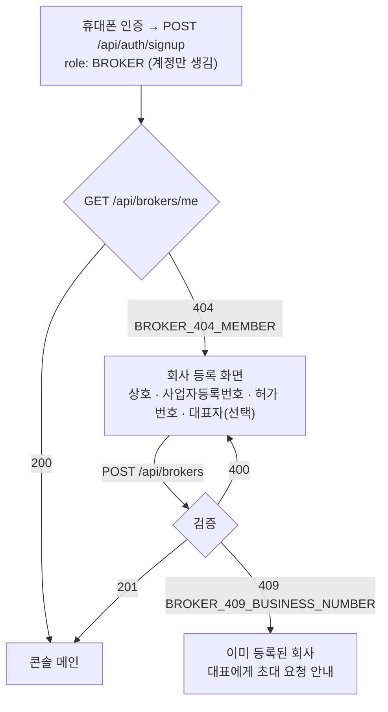
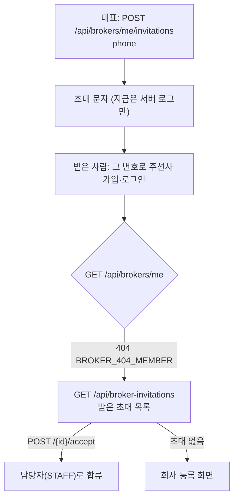

# 주선사 인계에 따른 작업 내용

[02_주선사_인계.md](02_주선사_인계.md)의 "빠진 것"을 채운 기록이다. 작업 순서대로 쌓는다.

- 요구사항: [../requirements/07_주선사.md](../requirements/07_주선사.md)
- 서버 저장소: `ieo-server`

## 진행 현황

| 인계 문서 항목 | 내용 | 상태 |
|---|---|---|
| 2-1 주선사 가입 | 회사 등록 API, 사업자등록번호 검증, 내 회사 조회 | **완료** (2026-11-03) |
| 3 CORS | 웹 콘솔 주소 허용 | **완료** (2026-11-03) |
| 2-2 담당자 관리 | 초대·수락, 직책 변경, 내보내기, 나가기 | **완료** (2026-11-03) |
| 2-3 정산 주기 설정 | 등록 때 입력, 회사 정보·정산 주기 수정, 오더 지급일 기본값 | **완료** (2026-11-04) |
| 2-4 단골 차주 연결 | 번호로 연결 요청·수락(=위치 공유 동의), 해제, 단골에게만 지정 배차 | **완료** (2026-11-04) |
| 2-5 진행 중 운행 확인 | 운행 목록(탭)·상세, 도착·출발 시각, 대기 증빙·인수증 | **완료** (2026-11-05). 위치·ETA·화주 공유 링크는 보류 (6장) |
| 2-5-1 화물 종류 목록 | 오더에 화물 종류(일반·냉동·냉장·이사·위험물) 고르기, 자세한 품목은 자유 입력 | **완료** (2026-11-05) |
| 2-6, 2-7 신뢰 지표·리포트 | P3 | 남음 |

---

## 1. 주선사 가입과 회사 등록 (BRK-001) — 2026-11-03

### 정한 것

| 질문 | 결정 |
|---|---|
| 가입과 회사 등록을 한 번에 할지 | **나눈다.** 주선사 역할로 가입만 먼저 하고, 로그인한 뒤 회사를 등록한다. 등록한 계정이 대표(`OWNER`)가 된다 |
| 이미 등록된 사업자등록번호 | **409로 막는다.** 새 회사를 만들지 않고 "대표에게 초대를 요청하라"고 안내한다. 합류는 담당자 초대(2-2)에서 만든다 |
| 운송주선사업 허가 번호 | **필수.** 없으면 회사를 등록할 수 없다 |
| 사업자등록번호 확인 수준 | 숫자 10자리 + 국세청 검증 번호 계산식까지. 실제로 있는 사업자인지는 확인하지 않는다 (아래 "남은 것") |

가입을 나눈 이유: 초대받은 담당자는 회사 등록 없이 가입 → 초대 수락으로 합류하면 되어서, 가입 API 하나로 두 경우를 모두 처리할 수 있다. 원래 `AuthService.signUp`의 주석("주선사 소속은 주선사 등록·초대에서 붙인다")과도 맞다.

### 흐름



### API

| Method | Path | 하는 일 | 응답 |
|---|---|---|---|
| `POST` | `/api/brokers` | 회사 등록. 등록한 계정이 대표가 된다 | 201 + 내 회사 |
| `GET` | `/api/brokers/me` | 내 회사와 내 직책 | 200. 소속이 없으면 404 `BROKER_404_MEMBER` |

요청 (`POST /api/brokers`):

```json
{
  "name": "한빛로지스",
  "businessNumber": "123-45-67891",
  "licenseNumber": "제2026-001호",
  "representativeName": "김대표"
}
```

- `businessNumber`는 하이픈·띄어쓰기가 있어도 된다. 숫자만 남겨 저장한다.
- `representativeName`은 비워도 된다.

응답 (두 API 공통):

```json
{
  "id": 1,
  "name": "한빛로지스",
  "businessNumber": "1234567891",
  "licenseNumber": "제2026-001호",
  "representativeName": "김대표",
  "settlementDays": 30,
  "position": "OWNER",
  "positionLabel": "대표",
  "createdAt": "2026-11-03T04:00:00Z"
}
```

콘솔은 `position`으로 대표 전용 메뉴(대기비 정책 바꾸기, 담당자 관리 등)를 보여 줄지 정한다.

### 오류

| 상황 | 응답 | 코드 |
|---|---|---|
| 사업자등록번호 형식 또는 검증 번호가 틀림 | 400 | `BROKER_400_BUSINESS_NUMBER` |
| 허가 번호가 없거나 공백뿐임 | 400 | `COMMON_400` (`fieldErrors`에 `licenseNumber`) |
| 이미 등록된 사업자등록번호 | 409 | `BROKER_409_BUSINESS_NUMBER` |
| 이미 회사에 소속된 계정이 또 등록 | 409 | `BROKER_409_MEMBER` |
| 차주 계정 | 403 | `BROKER_403_ROLE` |
| 회사 소속이 없는데 `GET /me` | 404 | `BROKER_404_MEMBER` |
| 탈퇴한 계정 | 404 | `USER_404` |
| 로그인하지 않음 | 401 | `COMMON_401` |

같은 사업자등록번호로 동시에 등록하면 `brokers.business_number` 유니크 제약이 하나만 남기고, 늦은 쪽은 409를 받는다.

### 사업자등록번호 검증 번호

앞 9자리에 가중치 `1 3 7 1 3 7 1 3 5`를 곱해 더하고, 9번째 자리 × 5의 십의 자리를 한 번 더 더한다. `(10 − 합 % 10) % 10`이 10번째 자리와 같아야 한다. `Broker.normalizeBusinessNumber`에 있다.

### 바뀐 코드 (ieo-server)

| 파일 | 내용 |
|---|---|
| `domain/broker/controller/BrokerController.java` | 새로 만듦. `POST /api/brokers`, `GET /api/brokers/me` |
| `domain/broker/service/BrokerService.java` | 새로 만듦. 회사 등록(`register`), 내 회사 조회(`getMine`) |
| `domain/broker/dto/CreateBrokerRequest.java`, `MyBrokerResponse.java` | 새로 만듦 |
| `domain/broker/entity/Broker.java` | `create`에서 사업자등록번호 정리·검증, 허가 번호 필수 확인 |
| `domain/broker/enums/BrokerMemberPosition.java` | 화면 표기 `label` 추가 (대표 / 담당자) |
| `global/error/ErrorCode.java` | `BROKER_*` 오류 코드 6개 추가 |

**테스트 데이터 변경:** 기존 테스트 11개 파일이 쓰던 사업자등록번호 `1234567890`, `9876543210`은 검증 번호가 맞지 않아서 `1234567891`, `9876543215`로 바꿨다. 기능 변경은 없다.

---

## 2. CORS — 2026-11-03

웹 콘솔이 다른 주소에서 API를 부를 수 있게 했다.

| 환경 | 허용 주소 |
|---|---|
| `local` | `http://localhost:5173` (Vite 기본 포트) |
| `dev`, `prod` | 환경변수 `CORS_ALLOWED_ORIGINS`. 쉼표로 여러 개. 비우면 아무 주소도 허용하지 않는다 |
| `test` | `http://localhost:5173` |

- 설정 키: `ieo.cors.allowed-origins` (`global/config/CorsProperties.java`)
- 적용 범위 `/api/**`, 메서드 GET·POST·PUT·PATCH·DELETE·OPTIONS, 헤더 `Authorization`·`Content-Type`·`X-Poll-Secret`
- 토큰은 쿠키가 아니라 `Authorization` 헤더로 오가므로 자격 증명(쿠키)은 허용하지 않는다.
- 브라우저의 사전 요청(OPTIONS)에는 토큰이 없어서, `AuthInterceptor`가 사전 요청은 통과시키도록 고쳤다.

---

## 3. 담당자 관리 (BRK-001 담당자 여러 명) — 2026-11-03

### 정한 것

| 질문 | 결정 |
|---|---|
| 초대 전달 | **번호로 초대 → 그 번호로 로그인한 계정이 콘솔에서 수락.** 링크·코드 방식은 쓰지 않는다 (링크가 넘어가면 다른 사람이 합류할 수 있어서) |
| 초대 유효기간 | 7일. 대표는 취소, 받은 사람은 거절할 수 있다 |
| 대표 수 | 여러 명 허용. **마지막 대표는 강등·내보내기·나가기·탈퇴할 수 없다** |
| 내보낸 담당자 | 기록은 남기고 `removedAt`만 찍는다. 그 계정은 다른 회사에 다시 들어갈 수 없다 (탈퇴 후 다시 가입) |
| 스스로 나가기 | 허용. 처리는 내보내기와 같다 |
| 담당자 수 제한 | 지금은 없음. 요금제(12)를 만들 때 붙인다 (무료 1명, 정회원 10명) |

내보낸 담당자 기록을 지우지 않는 이유: 오더가 등록한 담당자(`Order.createdBy`)를 참조하고, 담당자 기록이 계정당 한 줄(`BrokerMember`의 PK = `users.id`)이라 회사 이력을 여러 개 둘 수 없다. 회사를 옮길 수 있게 하려면 PK를 바꿔야 하고, 담당자를 쓰는 오더·대기비 정책 코드를 모두 고쳐야 한다.

### 흐름



### API

**우리 회사 (`/api/brokers/me`)** — 보기는 담당자 모두, 바꾸기는 대표만

| Method | Path | 하는 일 | 권한 |
|---|---|---|---|
| `GET` | `/members` | 지금 소속된 담당자 (이름, 번호, 직책, 합류일, `me`) | 담당자 |
| `PATCH` | `/members/{userId}` | 직책 변경 `{ "position": "OWNER" \| "STAFF" }` | 대표 |
| `POST` | `/members/{userId}/remove` | 내보내기 | 대표 |
| `POST` | `/leave` | 스스로 나가기 | 담당자 |
| `GET` | `/invitations` | 수락을 기다리는 초대 (만료 제외) | 담당자 |
| `POST` | `/invitations` | 번호로 초대 `{ "phone": "01012345678" }` → 201 | 대표 |
| `POST` | `/invitations/{id}/cancel` | 초대 취소 | 대표 |

**받은 초대 (`/api/broker-invitations`)** — 아직 소속이 없는 주선사 계정

| Method | Path | 하는 일 |
|---|---|---|
| `GET` | `/api/broker-invitations` | 내 번호로 온, 수락을 기다리는 초대 (회사 이름, 만료 시각) |
| `POST` | `/api/broker-invitations/{id}/accept` | 수락. 담당자(STAFF)가 되고 내 회사 정보(`MyBrokerResponse`)를 돌려준다 |
| `POST` | `/api/broker-invitations/{id}/decline` | 거절 |

### 오류

| 상황 | 응답 | 코드 |
|---|---|---|
| 대표가 아닌데 초대·직책 변경·내보내기·초대 취소 | 403 | `BROKER_403_OWNER` |
| 마지막 대표를 강등·내보내기·나가기·탈퇴 | 409 | `BROKER_409_LAST_OWNER` |
| 같은 번호로 대기 중인 초대가 이미 있음 | 409 | `BROKER_INVITATION_409_DUPLICATE` |
| 이미 우리 회사 담당자인 번호를 초대 | 409 | `BROKER_INVITATION_409_MEMBER` |
| 만료·취소·이미 처리된 초대 | 409 | `BROKER_INVITATION_409_CLOSED` |
| 내 번호로 온 초대가 아님 / 다른 회사 초대 취소 | 404 | `BROKER_INVITATION_404` |
| 다른 회사 담당자를 바꾸거나 내보냄 | 404 | `BROKER_MEMBER_404` |
| 차주로 가입된 번호가 수락 | 403 | `BROKER_403_ROLE` ("차주로 가입된 번호는 주선사 담당자가 될 수 없습니다.") |
| 이미 다른 회사 소속인데 수락 | 409 | `BROKER_409_MEMBER` |
| 회사에서 나온 계정이 회사 기능·수락·회사 등록 | 403 | `BROKER_403_REMOVED` |

- 초대할 때는 그 번호가 가입했는지, 차주인지, 다른 회사 소속인지 알려 주지 않는다. 주선사에게 남의 가입 정보가 새지 않게, 수락할 때 막는다.
- 직책 변경·내보내기·나가기·초대는 회사 행을 잠그고(`BrokerRepository.findByIdForUpdate`) 처리한다. 대표 둘이 동시에 서로를 내려도 대표가 0명이 되지 않는다.

### 바뀐 코드 (ieo-server)

| 파일 | 내용 |
|---|---|
| `domain/broker/entity/BrokerInvitation.java` | 새로 만듦. 초대 (회사, 번호, 초대한 대표, 상태, 응답 시각). 만료는 `createdAt + 7일`로 계산 |
| `domain/broker/enums/BrokerInvitationStatus.java` | 새로 만듦. PENDING·ACCEPTED·DECLINED·CANCELED·EXPIRED(저장 안 함) |
| `domain/broker/entity/BrokerMember.java` | `removedAt`, `isActive()`, `changePosition()`, `remove()` 추가 |
| `domain/broker/service/BrokerMemberService.java` | 새로 만듦. 담당자 목록·직책·내보내기·나가기, 초대·취소, 탈퇴 시 처리 |
| `domain/broker/service/BrokerInvitationService.java` | 새로 만듦. 받은 초대 목록·수락·거절 |
| `domain/broker/controller/BrokerMemberController.java`, `BrokerInvitationController.java` | 새로 만듦 |
| `domain/broker/repository/*` | 초대 저장소 추가, 소속 중인 담당자만 세는 메서드, 회사 행 잠금 |
| `domain/broker/service/BrokerService.java` | 나온 계정은 회사 등록·내 회사 조회에서 403 |
| `domain/dispatch/service/BrokerOrderService.java`, `domain/wait/service/WaitPolicyService.java` | 나온 담당자는 오더·대기비 정책을 쓸 수 없게 막음 |
| `domain/user/service/UserService.java` | 탈퇴 시 회사에서 나가기(마지막 대표면 탈퇴 막음), 그 번호로 온 초대 삭제 |
| `global/error/ErrorCode.java` | 오류 코드 8개 추가 |

**DB:** `broker_invitations` 테이블과 `broker_members.removed_at` 컬럼이 새로 생긴다. local·dev는 `ddl-auto: update`라 자동으로 붙는다.

---

## 4. 정산 주기와 회사 정보 수정 (BRK-003, BRK-001) — 2026-11-04

### 정산 주기가 쓰이는 곳

차주 장부의 지급 예정일(LEDG-020)이다. 결제 방식이 인수증이면 **인수증 서명일 + 정산 주기**, 선불·착불이면 운행일이다. 장부는 아래 순서로 일수를 고른다 (`LedgerRecorder.settlementDays`).

1. Ieo 오더에서 온 운행 → 오더의 `expectedPaymentDays`
2. 직접 등록한 운행에 주선사를 지정 → 그 회사의 `settlementDays`
3. 둘 다 아님 → 30일

이전에는 오더 등록 때 `expectedPaymentDays`가 필수라, 회사 정산 주기는 직접 등록한 운행에만 쓰였다.

### 정한 것

| 질문 | 결정 |
|---|---|
| 오더와 연결 | **회사 정산 주기를 오더 지급일의 기본값으로 쓴다.** 오더 등록 때 `expectedPaymentDays`를 비우면 회사 값으로 채우고, 넣으면 그 오더만 그 값을 쓴다 |
| 처음 입력 | 회사 등록(`POST /api/brokers`) 때 `settlementDays`를 **선택**으로 받는다. 비우면 30일 |
| 수정 권한·범위 | **대표만**, 0~365일 (오더 지급일 범위와 같다). 0일은 인수증 받은 날 지급 |
| 이미 만들어진 장부 | **소급하지 않는다.** 지급 예정일이 계산된 장부는 그대로 두고, 아직 인수증 서명 전인 운행은 서명할 때의 값으로 계산된다 |
| 회사 정보 수정 | 정산 주기와 묶어 `PATCH /api/brokers/me` 하나로 만든다 (콘솔 "회사 설정" 화면). 사업자등록번호는 바꿀 수 없다 |

DSP-001은 지급 예정일을 오더 필수 항목으로 적고 있다. API에서는 선택이 됐지만, 비우면 회사 값이 들어가서 저장되는 오더에는 항상 값이 있다.

### API

| Method | Path | 하는 일 | 권한 |
|---|---|---|---|
| `POST` | `/api/brokers` | 회사 등록. `settlementDays` 선택 (비우면 30) | 주선사 계정 |
| `PATCH` | `/api/brokers/me` | 회사 정보·정산 주기 수정. 보낸 항목만 바꾼다 | 대표 |
| `POST` | `/api/broker/orders` | 오더 등록. `expectedPaymentDays`를 비우면 회사 정산 주기 | 담당자 |

요청 (`PATCH /api/brokers/me`, 모두 선택):

```json
{
  "name": "한빛물류",
  "licenseNumber": "제2026-009호",
  "representativeName": "김대표",
  "settlementDays": 45
}
```

- 보내지 않은(null) 항목은 그대로 둔다.
- 상호·허가 번호는 빈 값으로 바꿀 수 없다. 대표자 이름은 빈 문자열(`""`)을 보내면 지운다.
- `businessNumber`를 보내도 무시한다.
- 응답은 `GET /api/brokers/me`와 같은 `MyBrokerResponse`다.

### 오류

| 상황 | 응답 | 코드 |
|---|---|---|
| 정산 주기가 0~365일 밖 (등록·수정) | 400 | `BROKER_400_SETTLEMENT_DAYS` |
| 상호를 빈 값으로 | 400 | `COMMON_400` |
| 허가 번호를 빈 값으로 | 400 | `BROKER_400_LICENSE` |
| 담당자(STAFF)가 수정 | 403 | `BROKER_403_OWNER` |

### 바뀐 코드 (ieo-server)

| 파일 | 내용 |
|---|---|
| `domain/broker/entity/Broker.java` | 정산 주기를 받는 `create`, `rename`·`changeLicenseNumber`·`changeRepresentativeName` 추가, 정산 주기 0~365일 검사 (이전에는 음수만 막고 `IllegalArgumentException`) |
| `domain/broker/dto/CreateBrokerRequest.java` | `settlementDays` (선택) |
| `domain/broker/dto/UpdateBrokerRequest.java` | 새로 만듦 |
| `domain/broker/service/BrokerService.java`, `controller/BrokerController.java` | `PATCH /api/brokers/me` (대표만) |
| `domain/dispatch/service/BrokerOrderService.java` | 오더 지급일을 비우면 회사 정산 주기로 채움 |
| `global/error/ErrorCode.java` | `BROKER_400_SETTLEMENT_DAYS` |

---

## 5. 단골 차주 연결 (BRK-002) — 2026-11-04

### 무엇인가

주선사가 자주 일하는 차주를 "단골"로 묶어 두는 기능이다. 친구 요청처럼 주선사가 요청하고 차주가 한 번 수락하면 연결된다. **위치와는 상관없이** 차주가 차량 앱을 켰을 때(정차 중) 받은 요청이 보인다.

연결되면 두 가지가 생긴다.

1. **지정 배차:** 그 차주 한 명에게만 보이는 오더를 보낼 수 있다 (DSP-006).
2. **위치 공유:** 그 차주가 **우리 회사 운행을 하는 동안** 콘솔에서 위치를 볼 수 있다 (진행 중 운행, 2-5에서 만든다).

단골이 아니어도 오더 마켓에 공개로 올린 오더는 누구나 보고 요청할 수 있다. 단골은 일을 잡기 위한 조건이 아니다.

### 정한 것

| 질문 | 결정 |
|---|---|
| 동의 방식 | **수락 = 그 회사에 대한 위치·운행 정보 공유 동의.** 수락 화면에 "○○물류 일을 하는 동안 내 위치와 도착 예정 시각이 ○○물류에 공유돼요"를 보여 주고, 수락 시각(`linkedAt`)을 동의 기록으로 남긴다. 가입 때의 `BROKER_SHARE` 동의와는 별개 |
| 미가입 번호 | **허용.** 요청을 번호로 저장하고, 그 번호로 가입한 차주에게 보인다. 주선사에게는 언제나 "요청했어요"만 보여, 그 번호가 가입했는지·차주인지 알 수 없다 (담당자 초대와 같은 원칙) |
| 요청 유효기간 | 7일. 주선사는 취소, 차주는 거절할 수 있다 |
| 누가 요청·해제 | 회사 담당자 누구나 (대표만이 아님). 오더 등록처럼 매일 하는 일이라서 |
| 해제 | **주선사·차주 모두 언제든.** 이미 확정된 배차와 진행 중인 운행은 그대로. 해제 뒤에는 새 지정 배차가 막히고 위치도 안 보인다. 다시 요청하면 다시 연결할 수 있다 |
| 지정 배차 | **단골 차주에게만.** 없는 차주와 단골 아닌 차주를 같은 오류로 막는다. 이미 올린 지정 오더는 해제해도 그대로 |
| 위치 공개 범위 (2-5에서 적용) | ① 단골이 우리 운행 중 → 위치 + 상태 + ETA. ② 단골이 다른 회사 일 중 → 아무것도 안 보임. ③ 단골 아닌 차주가 마켓 오더로 우리 운행 중 → 상태 + ETA만, 위치는 안 보임 (BRK-002 "연결된 차주의 위치만") |
| 탈퇴 | 차주가 탈퇴하면 그 번호의 요청과 연결을 지운다. 확정된 배차·운행은 오더와 운행에 남는다 |

### 흐름

```
주선사 콘솔                                   차량 앱 (김기사, 정차 중)
POST /api/brokers/me/driver-invitations  ─▶  GET /api/driver-links/invitations
  {"phone": "01012345678"}                      "한빛로지스에서 단골 차주로 연결을 요청했어요"
                                                 [수락] [거절]
                                          ◀─  POST /api/driver-links/invitations/{id}/accept
GET /api/brokers/me/drivers                     (수락 = 한빛로지스에 위치 공유 동의)
  → 김기사, 경기82사1234, 5톤 카고
POST /api/broker/orders                    ─▶  김기사에게만 보이는 지정 오더
  {"targetDriverId": 김기사 userId, ...}
```

### 상태

`PENDING`(대기 중) → `LINKED`(연결됨) / `DECLINED`(거절) / `CANCELED`(취소), `LINKED` → `UNLINKED`(해제). `EXPIRED`(만료)는 저장하지 않고 요청 시각 + 7일로 판단한다. 요청과 연결을 테이블 하나(`broker_driver_links`)에 둔다. 다시 연결하면 새 행이 생긴다.

### API

주선사 콘솔 (회사 담당자):

| Method | Path | 하는 일 | 응답 |
|---|---|---|---|
| `GET` | `/api/brokers/me/drivers` | 단골 차주 목록. 기본 차량(번호판·톤수·차종) 포함. `driverUserId`를 오더 `targetDriverId`로 쓴다 | 200 |
| `POST` | `/api/brokers/me/drivers/{linkId}/unlink` | 단골 해제 | 204 |
| `GET` | `/api/brokers/me/driver-invitations` | 보낸 요청 중 대기 중인 것 | 200 |
| `POST` | `/api/brokers/me/driver-invitations` | 번호로 연결 요청 `{"phone": "01012345678"}`. 미가입 번호여도 201 | 201 |
| `POST` | `/api/brokers/me/driver-invitations/{linkId}/cancel` | 요청 취소 | 204 |
| `POST` | `/api/broker/orders` | `targetDriverId`가 단골이 아니면 400 `ORDER_400_TARGET` | — |

차량 앱 (차주 계정):

| Method | Path | 하는 일 | 응답 |
|---|---|---|---|
| `GET` | `/api/driver-links/invitations` | 내 번호로 온 요청 (회사 이름, 만료 시각) | 200 |
| `POST` | `/api/driver-links/invitations/{linkId}/accept` | 수락 → 연결 | 200 + 연결 |
| `POST` | `/api/driver-links/invitations/{linkId}/decline` | 거절 | 204 |
| `GET` | `/api/driver-links` | 내가 연결된 회사 | 200 |
| `POST` | `/api/driver-links/{linkId}/unlink` | 해제 | 204 |

### 오류

| 상황 | 응답 | 코드 |
|---|---|---|
| 같은 번호로 대기 중인 요청이 있음 | 409 | `DRIVER_LINK_409_DUPLICATE` |
| 이미 우리 단골인 차주 | 409 | `DRIVER_LINK_409_LINKED` |
| 만료·거절·취소된 요청을 처리, 이미 해제된 연결을 해제 | 409 | `DRIVER_LINK_409_CLOSED` |
| 다른 회사의 요청·연결, 내 번호로 온 게 아닌 요청 | 404 | `DRIVER_LINK_404` |
| 차주가 아닌 계정이 차량 앱 API 호출 | 403 | `DRIVER_LINK_403_ROLE` |
| 단골이 아닌(또는 없는) 차주를 지정 배차 | 400 | `ORDER_400_TARGET` |

### 차량 앱 쪽 (2026-11-05 반영됨)

- 정차 중(주행 화면이 아닐 때)에 받은 요청을 홈에 창으로 띄우고 수락·거절·나중에를 고른다. 주행 중에는 창을 감추고, 주행이 끝나면 다시 받는다.
- 수락 창 문구: "○○ 일을 하는 동안 내 위치와 도착 예정 시각이 ○○에 공유돼요. 연결되면 ○○가 나에게만 보이는 배차를 보낼 수 있어요. 설정에서 언제든 해제할 수 있어요." 그리고 수락 기한.
- 설정 탭 "단골 주선사" 칸: 받은 요청(다시 열기)과 연결된 회사(해제, 확인 창).
- 코드: 차량 앱 `ui/links/`, `domain/link/`, `data/link/` (docs/design/05_차량앱_구조.md)

### 바뀐 코드 (ieo-server)

| 파일 | 내용 |
|---|---|
| `domain/broker/entity/BrokerDriverLink.java` | 새로 만듦. 요청·수락·거절·취소·해제, 7일 만료 |
| `domain/broker/enums/DriverLinkStatus.java` | 새로 만듦 |
| `domain/broker/repository/BrokerDriverLinkRepository.java` | 새로 만듦 |
| `domain/broker/service/BrokerDriverService.java`, `controller/BrokerDriverController.java` | 새로 만듦. 주선사 쪽 |
| `domain/broker/service/DriverLinkService.java`, `controller/DriverLinkController.java` | 새로 만듦. 차주 쪽 |
| `domain/broker/dto/InviteDriverRequest.java`, `SentDriverInvitationResponse.java`, `LinkedDriverResponse.java`, `DriverLinkResponse.java` | 새로 만듦 |
| `domain/dispatch/service/BrokerOrderService.java` | 지정 배차는 단골 차주에게만 |
| `domain/user/service/UserService.java` | 탈퇴할 때 그 번호의 요청·연결 삭제 |
| `global/error/ErrorCode.java` | `DRIVER_LINK_*` 5개, `ORDER_400_TARGET` |

---

## 6. 진행 중 운행 확인 (BRK-020, 021) — 2026-11-05

### 무엇인가

콘솔의 "지금 우리 일을 하고 있는 차들" 화면이다. 화주가 "어디쯤이에요?"라고 물으면 담당자가 운행 상태와 상하차지 도착·출발 시각을 보고 답하고, 운행이 끝나면 대기 증빙과 전자인수증을 받아 간다.

### 정한 것

| 질문 | 결정 |
|---|---|
| 위치·ETA | **보류.** 응답에 칸(`location`, `etaAt`)만 두고 항상 null. 원작자 쪽에서 위치 전송·ETA가 생기면 채운다 (아래 "보류한 것") |
| 보여 줄 운행 | **우리 회사 오더로 배차된 운행(`IEO_DISPATCH`)만.** 차주가 직접 등록하면서 우리 회사를 고른 운행은 뺀다 (아래 "열린 질문") |
| 목록 탭 | 진행 중(기본) · 예정 · 끝남(완료·취소). 최근 배차 순, 페이지. 필요한 값은 콘솔을 만들면서 더한다 |
| 도착·작업 시작·출발 시각 | **바로 보인다.** 진행 상황이라서 |
| 대기 시간·대기비 | **차주가 대기 증빙 링크를 만든 뒤에만.** 차주가 시각을 고치기 전에 금액이 먼저 보이면 다툼이 생길 수 있다 |
| 전자인수증 | **수하인이 서명했거나 차주가 종이 인수증 사진을 올린 뒤에만** |
| 내려받기 | 증빙(`/w/토큰`)·인수증(`/r/토큰`) 페이지 경로를 준다. 콘솔에서 인쇄하기 좋은 페이지로 열고 브라우저에서 PDF로 저장. 서버 PDF는 나중에 |
| 위치·번호 공개 | 2-4 규칙 그대로. **단골 차주일 때만** `locationVisible`·`driverPhone`. 단골이 아니면 상태와 시각만 |
| 화주 공유 링크 (BRK-022) | **위치가 들어온 뒤에 만든다.** 링크의 핵심이 위치·ETA라서, 지금 만들면 빈 링크가 된다. 그 전에는 대기 증빙 링크를 화주에게 그대로 보낼 수 있다 |

### 대기 기록이 콘솔까지 오는 흐름

```
차량 앱 (자동)                              서버                         콘솔
상하차지 반경 안 3분 정차 ─ arrive ─▶  WaitRecord.arrivedAt  ─────▶  도착 시각 (바로)
"상차 시작" (음성·버튼) ── work-start ▶  workStartedAt       ─────▶  작업 시작 (바로)
반경 밖·시속 20km 1분 ─── depart ───▶  departedAt          ─────▶  출발 시각 (바로)
"대기 증빙 보내" ──────── proof ────▶  WaitProof(/w/토큰)  ─────▶  대기 시간·대기비·증빙 링크
```

차량 앱은 GPS로 도착·떠남을 **앱 안에서** 판단하고 서버에는 시각만 보낸다. 그래서 대기 측정은 되지만 "지금 어디쯤"은 서버도 콘솔도 모른다.

### API

| Method | Path | 하는 일 | 응답 |
|---|---|---|---|
| `GET` | `/api/brokers/me/trips?tab=IN_PROGRESS\|SCHEDULED\|FINISHED&page=0&size=20` | 우리 회사 운행 목록. tab 기본 `IN_PROGRESS`, size 최대 100 | 200 `{items, totalCount, page, size}` |
| `GET` | `/api/brokers/me/trips/{tripId}` | 운행 하나 (목록 항목과 같은 모양) | 200 |

응답 항목 (목록·상세 같음):

| 필드 | 내용 |
|---|---|
| `id`, `orderId`, `status`, `statusLabel` | 운행·오더 번호, 상태 (출발 전, 상차지로 이동 중, 상차지 도착, 운송 중, 하차지 도착, 완료, 취소) |
| `driverUserId`, `driverName`, `driverPhone`, `linkedDriver` | 차주. 번호는 단골일 때만 |
| `plateNumber`, `tonnage`, `tonnageLabel` | 운행에 쓴 차량 |
| `locationVisible`, `location`, `etaAt` | 위치를 볼 수 있는 차주인지(단골). `location`·`etaAt`은 지금 항상 null |
| `fare`, `paymentType`, `paymentTypeLabel` | 오더 운임·결제 방식 |
| `pickup`, `dropoff` | 상하차지 이름·주소·좌표·예정 시각, `waitStatus`(WAITING·WORKING·DONE), `arrivedAt`·`workStartedAt`·`departedAt`, `edited`(차주가 시각을 고침), `waitProof`(증빙을 만든 뒤에만: `path`, `issuedAt`, `expiresAt`, 대기·대기비 대상·작업·체류 분, `chargeableAmount`) |
| `receipt` | 서명 또는 종이 사진 뒤에만: `status`(SIGNED·PHOTO·DELIVERED), `signerName`, `signedAt`, `hasPaperPhoto`, `issueNote`, `path`, `expiresAt`(운행 완료 7일 뒤) |
| `startedAt`, `completedAt`, `canceledAt`, `createdAt` | 시각 |

### 오류

| 상황 | 응답 | 코드 |
|---|---|---|
| 다른 회사 운행, 직접 등록 운행, 없는 운행 | 404 | `TRIP_404` |
| 회사 소속이 없는 계정 (차주 포함) | 404 | `BROKER_404_MEMBER` |
| 회사에서 나온 담당자 | 403 | `BROKER_403_REMOVED` |

### 보류한 것: 위치·ETA (원작자와 맞출 것)

주선사가 위치를 못 보는 게 전제는 아니다. 요구사항(BRK-020, 07 목적)과 2-4 동의 설계는 위치를 보는 걸 전제로 한다. 아직 아래 셋이 없을 뿐이다.

1. **차량 앱:** 운행 중 현재 위치를 서버로 보내기 (GPS는 이미 읽고 있다)
2. **서버:** 받은 위치 저장 (`LocationPoint`, 01 운행 데이터)
3. **콘솔:** 지도에 표시 (응답 칸은 만들어 둠)

원작자에게 물어볼 것:

- [ ] 위치를 얼마나 자주 보낼지 (예: 1~2분마다, 진행 중 운행에서만)
- [ ] 위치 기록을 쌓을지, 마지막 위치만 둘지. 쌓는다면 보관 기간
- [ ] ETA를 앱에서 계산해 보낼지(TRIP-020: 내비 남은 시간 + 휴게), 서버에서 계산할지
- [ ] 탈퇴할 때 위치 기록 삭제 (`UserService.withdraw`에 TODO로 남아 있음)
- [ ] 대기 증빙의 위치 이력 지도(WAIT-020)도 같은 위치 데이터를 쓴다
- [ ] 위치 받는 서버 API를 주선사 쪽에서 먼저 만들어 둘지 (앱은 부르기만 하면 됨)

위치가 들어오면 할 일: `BrokerTripResponse`의 `location`·`etaAt` 채우기(단골만 위치), 화주 공유 링크(BRK-022, TRIP-023처럼 하차 24시간 뒤 만료).

### 열린 질문: 차주가 직접 등록한 운행

차주가 다른 앱·전화로 받은 일을 직접 등록하면서 Ieo 주선사를 고를 수 있다(`CreateTripRequest.brokerId`). 지금 콘솔에서 빼 둔 이유:

- 직접 등록은 주선사가 있는지만 확인한다. 거래한 적 없는 회사를 골라도 등록되므로, 보여 주면 배차하지 않은 운행이 콘솔에 섞인다.
- 운임·결제 방식은 차주가 장부용으로 적은 값이라 주선사가 아는 값과 다를 수 있고, 주선사가 볼 거라고 차주가 예상하지 못한다.

넣는다면 후보: **단골 차주**가 **그 회사를 골라** 등록한 운행만, **운임은 숨기고** 보여 준다. 직접 등록은 원작자 영역이라 같이 정한다.

### 바뀐 코드 (ieo-server)

| 파일 | 내용 |
|---|---|
| `domain/broker/controller/BrokerTripController.java`, `service/BrokerTripService.java` | 새로 만듦. 목록·상세, 대기 기록·증빙·인수증을 묶음 조회 |
| `domain/broker/dto/BrokerTripResponse.java`, `BrokerTripStopResponse.java`, `BrokerTripPageResponse.java` | 새로 만듦 |
| `domain/broker/enums/BrokerTripTab.java` | 새로 만듦. 탭별 운행 상태 |
| `domain/trip/repository/TripRepository.java` | 회사·출처·상태로 운행 페이지 조회 |
| `domain/wait/repository/WaitRecordRepository.java`, `WaitProofRepository.java` | 여러 운행·기록 묶음 조회 |
| `domain/delivery/repository/DeliveryProofRepository.java`, `ProofPhotoRepository.java` | 여러 운행 인수증, 종이 사진 있는 인수증 묶음 조회 |

---

## 7. 화물 종류 목록 (DSP-001, REC-004 준비) — 2026-11-05

### 무엇인가

오더의 화물 종류가 자유 입력("음료 파레트", "냉동 닭", "이삿짐")이라, 차주가 "냉동·이사는 빼고"처럼 조건으로 거를 수 없었다. 화물 종류를 **정해진 목록에서 고르는 칸**(`cargoCategory`)으로 새로 두고, 자세한 품목은 지금의 자유 입력(`cargoType`)에 그대로 적는다.

```
cargoCategory: COLD (냉동·냉장)   ← 거르는 데 쓴다
cargoType:     "냉동 닭 300박스"   ← 사람이 읽는 품목. 인수증에 나온다
```

### 정한 것

| 질문 | 결정 |
|---|---|
| 목록 | 일반(`GENERAL`), 냉동·냉장(`COLD`), 이사(`MOVING`), 위험물(`HAZARDOUS`). 처음에는 작게, 필요하면 늘린다 |
| 자유 입력 | `cargoType` 이름 그대로, 필수 그대로. 인수증 품목(POD-004)에 쓰고, 차량 앱·인수증 페이지를 고치지 않아도 된다 |
| 냉동·냉장과 차종 | 화물이 냉동·냉장이면 차종도 냉동·냉장(`REFRIGERATED`)이어야 한다. 아니면 400. 냉동 차에 일반 화물은 허용 |
| 위험물 | 표시만. 차주 운송 자격 확인 기능이 없어서 |
| 기존 오더 | 컬럼 기본값으로 **일반**을 채운다 (`@ColumnDefault`). 로컬·개발 DB는 `ddl-auto: update`라 자동으로 컬럼이 생긴다 |
| 응답 | `cargoCategory`와 `cargoCategoryLabel`("냉동·냉장")을 같이 준다 |
| 업계 비교 | 화물맨도 일반·이사 같은 큰 구분 + 화물 정보 자유 입력이라 같은 구조. 냉동·냉장은 차종과 겹쳐 보이지만, 차종은 **차**, 이 값은 **짐**이라 남긴다 (냉동 차로 일반 화물을 나르는 오더가 있고, 냉동 화물만 빼고 싶은 차주가 있다) |
| 거르기 | 아직 쓰는 곳이 없다. 배차 추천의 "제외 화물"(`DriverPreference.excludedCargoTypes`, REC-004)을 만들 때 이 값으로 거른다 |

### API

| Method | Path | 바뀐 점 |
|---|---|---|
| `POST` | `/api/broker/orders` | `cargoCategory` 필수 추가. 빠지면 400 `ORDER_400`, 냉동·냉장인데 차종이 냉동·냉장이 아니면 400 `ORDER_400` |
| `GET` | 오더 응답 전부 (주선사 목록·상세, 차주 오더 마켓) | `cargoCategory`, `cargoCategoryLabel` 추가 |

### 차량 앱 쪽 (원작자)

- 오더 목록에 화물 종류를 보여 줄지 정한다. 예: "냉동·냉장 · 냉동 닭 300박스 · 4.2톤 · 지게차". 지금은 `cargoType`만 보여 준다.
- 제외 화물 설정 화면은 배차 추천 선호 조건을 만들 때.

### 바뀐 코드 (ieo-server)

| 파일 | 내용 |
|---|---|
| `domain/dispatch/enums/CargoCategory.java` | 새로 만듦 |
| `domain/dispatch/entity/Order.java` | `cargoCategory` 필수, 기존 행 기본값 일반, 냉동·냉장 차종 검사 |
| `domain/dispatch/dto/CreateOrderRequest.java`, `OrderResponse.java`, `service/BrokerOrderService.java` | `cargoCategory` 받고 주기 |
| `scripts/seed-local.py` | 시드 오더를 일반으로 |

---

## 테스트

`./gradlew test` 전체 262개 통과 (2026-11-05, 원작자 차대번호 테스트 포함).

| 테스트 | 확인하는 것 |
|---|---|
| `BrokerTest` | 하이픈 제거, 검증 번호 틀림·자릿수 틀림 거부, 허가 번호 필수, 등록 때 정산 주기·기본 30일·범위, 회사 정보 수정 |
| `BrokerServiceTest` | 등록하면 대표가 됨, 사업자등록번호 중복 409, 이미 소속된 계정 409, 차주 403, 탈퇴 계정, 소속 없음 404 |
| `BrokerControllerTest` | 등록 → 내 회사 조회, 잘못된 번호 400, 허가 번호 누락 400, 중복 409, 로그인 안 함 401, 차주 403, CORS 사전 요청 허용·거부, 등록 때 정산 주기, 보낸 항목만 수정·사업자등록번호 무시·대표자 지우기, 정산 주기 범위·빈 상호 400, 담당자 수정 403 |
| `BrokerMemberTest` | 정산 주기 0~365일 |
| `OrderTest` | 화물 종류 필수, 냉동·냉장 화물은 냉동·냉장 차만, 냉동 차에 일반 화물 허용 |
| `DispatchControllerTest` | 오더 화물 종류·표기 응답, 화물 종류 누락·냉동·냉장 차종 불일치 400, 오더 지급일을 비우면 회사 정산 주기, 넣으면 그 값, 단골 아닌·없는 차주 지정 400, 마켓 공개 오더는 누구나 요청, 해제 뒤 새 지정 400·기존 지정 오더 유지 |
| `BrokerInvitationTest` | 7일 뒤 만료, 처리된 초대 다시 처리 불가, 나간 담당자 직책 변경·재처리 불가 |
| `BrokerDriverLinkTest` | 요청 → 수락·수락 시각, 연결된 뒤에만 해제, 처리된 요청 재처리 불가 |
| `BrokerDriverControllerTest` | 요청 → 수락 → 양쪽 목록(차량 포함), 미가입 번호 요청이 가입 뒤 보임, 중복·이미 단골 409, 거절·취소·만료 요청 수락 불가, 남의 요청 404·주선사 계정 403, 양쪽 해제·재요청, 다른 회사 404, 탈퇴 시 정리 |
| `BrokerTripControllerTest` | 탭별 목록(진행 중·예정·끝남), 직접 등록 운행 제외·404, 단골만 위치 가능·번호, 위치·ETA 비어 있음, 도착 시각은 바로·대기비는 증빙 뒤, 인수증은 서명·종이 사진 뒤, 다른 회사 404·목록 없음, 소속 없는 계정 404 |
| `BrokerMemberControllerTest` | 초대 → 수락 → 목록, 담당자는 초대 불가, 중복·기존 담당자 초대 409, 남의 초대 404, 만료·취소된 초대 수락 불가, 차주 번호 수락 불가, 다른 회사 소속 수락 불가, 대표 여러 명·마지막 대표 강등 불가, 내보낸 담당자 차단(콘솔·오더·회사 등록), 다른 회사 담당자 404, 나가기·마지막 대표 나가기·탈퇴 불가, 탈퇴 시 소속·초대 정리 |

## 남은 것

- [ ] **사업자 실재 확인:** 지금은 계산식에 맞는 번호를 지어내도 통과한다. 출시 전에 둘 중 하나를 붙인다.
  - 국세청 사업자등록 상태조회 API(공공데이터포털): 실제 번호인지, 휴업·폐업인지 자동 확인. API 키 발급 필요
  - 사업자등록증 파일 업로드: 업로드는 기존 파일 저장 기능으로 쉽지만, 누가 보고 승인할지(운영자 화면)가 정해져야 한다
- [x] 담당자 초대로 기존 회사에 합류 (2-2)
- [ ] **초대 문자 실제 발송:** 지금은 `LogSmsSender`라 서버 로그에만 남는다. 문자 업체를 정하기 전까지는 대표가 초대 사실을 따로 알려야 한다 (09 알림)
- [ ] 담당자 수 제한 (요금제 12 뒤): 무료 1명, 정회원 10명
- [ ] 회사를 옮길 수 있게 할지: 지금은 나온 계정이 다른 회사에 못 들어간다. 필요해지면 `BrokerMember` PK를 바꾼다
- [x] 회사 정보 수정 API (상호, 허가 번호, 대표자). 대표만
- [ ] 서버 README의 API 표 갱신
- [ ] **단골 요청 문자 실제 발송:** 지금은 로그만 남아, 미가입 차주는 요청이 온 줄 모른다. 문자가 붙으면 "Ieo 가입하고 연결하세요"가 차주 유입 통로가 된다
- [ ] 단골 관리 요금제 제한 (정회원 기능, 요금제 12 뒤)
- [x] 차량 앱 단골 요청 화면 (원작자, `c683ad5`: 정차 중 수락·거절, 동의 문구, 설정에서 해제)
- [ ] **위치·ETA (2-5 보류):** 원작자와 형식을 정한 뒤 콘솔 위치·ETA와 화주 공유 링크(BRK-022). 6장 질문 목록
- [ ] **직접 등록 운행을 콘솔에 보여 줄지:** 6장 열린 질문
- [ ] 독차/혼적(짐을 차 한 대에 단독으로 싣는지)을 오더에 둘지: 필요해지면 화물 종류와 별도 칸으로 (7장)
- [ ] 콘솔이 증빙·인수증을 열면 `sentAt`(주선사에게 전달)을 채울지 (WAIT-022, POD-007)
