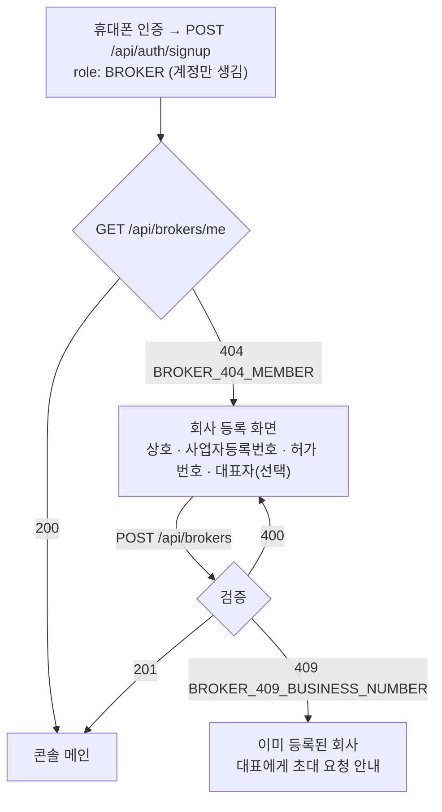

# 주선사 인계에 따른 작업 내용

[02_주선사_인계.md](02_주선사_인계.md)의 "빠진 것"을 채운 기록이다. 작업 순서대로 쌓는다.

- 요구사항: [../requirements/07_주선사.md](../requirements/07_주선사.md)
- 서버 저장소: `ieo-server`

## 진행 현황

| 인계 문서 항목 | 내용 | 상태 |
|---|---|---|
| 2-1 주선사 가입 | 회사 등록 API, 사업자등록번호 검증, 내 회사 조회 | **완료** (2026-11-03) |
| 3 CORS | 웹 콘솔 주소 허용 | **완료** (2026-11-03) |
| 2-2 담당자 관리 | 초대, 직책 변경, 내보내기 | 남음 |
| 2-3 정산 주기 설정 | API | 남음 |
| 2-4 단골 차주 연결 | `BrokerDriverLink` | 남음 |
| 2-5 진행 중 운행 확인 | 주선사용 운행 목록·상세 | 남음 (운행 담당과 위치·ETA 일정 맞춤) |
| 2-6, 2-7 신뢰 지표·리포트 | P3 | 남음 |

---

## 1. 주선사 가입과 회사 등록 (BRK-001) — 2026-11-03

### 정한 것

| 질문 | 결정 |
|---|---|
| 가입과 회사 등록을 한 번에 할지 | **나눈다.** 주선사 역할로 가입만 먼저 하고, 로그인한 뒤 회사를 등록한다. 등록한 계정이 대표(`OWNER`)가 된다 |
| 이미 등록된 사업자등록번호 | **409로 막는다.** 새 회사를 만들지 않고 "대표에게 초대를 요청하라"고 안내한다. 합류는 담당자 초대(2-2)에서 만든다 |
| 운송주선사업 허가 번호 | **필수.** 없으면 회사를 등록할 수 없다 |
| 사업자등록번호 확인 수준 | 숫자 10자리 + 국세청 검증 번호 계산식까지. 실제로 있는 사업자인지는 확인하지 않는다 (아래 "남은 것") |

가입을 나눈 이유: 초대받은 담당자는 회사 등록 없이 가입 → 초대 수락으로 합류하면 되어서, 가입 API 하나로 두 경우를 모두 처리할 수 있다. 원래 `AuthService.signUp`의 주석("주선사 소속은 주선사 등록·초대에서 붙인다")과도 맞다.

### 흐름



### API

| Method | Path | 하는 일 | 응답 |
|---|---|---|---|
| `POST` | `/api/brokers` | 회사 등록. 등록한 계정이 대표가 된다 | 201 + 내 회사 |
| `GET` | `/api/brokers/me` | 내 회사와 내 직책 | 200. 소속이 없으면 404 `BROKER_404_MEMBER` |

요청 (`POST /api/brokers`):

```json
{
  "name": "한빛로지스",
  "businessNumber": "123-45-67891",
  "licenseNumber": "제2026-001호",
  "representativeName": "김대표"
}
```

- `businessNumber`는 하이픈·띄어쓰기가 있어도 된다. 숫자만 남겨 저장한다.
- `representativeName`은 비워도 된다.

응답 (두 API 공통):

```json
{
  "id": 1,
  "name": "한빛로지스",
  "businessNumber": "1234567891",
  "licenseNumber": "제2026-001호",
  "representativeName": "김대표",
  "settlementDays": 30,
  "position": "OWNER",
  "positionLabel": "대표",
  "createdAt": "2026-11-03T04:00:00Z"
}
```

콘솔은 `position`으로 대표 전용 메뉴(대기비 정책 바꾸기, 담당자 관리 등)를 보여 줄지 정한다.

### 오류

| 상황 | 응답 | 코드 |
|---|---|---|
| 사업자등록번호 형식 또는 검증 번호가 틀림 | 400 | `BROKER_400_BUSINESS_NUMBER` |
| 허가 번호가 없거나 공백뿐임 | 400 | `COMMON_400` (`fieldErrors`에 `licenseNumber`) |
| 이미 등록된 사업자등록번호 | 409 | `BROKER_409_BUSINESS_NUMBER` |
| 이미 회사에 소속된 계정이 또 등록 | 409 | `BROKER_409_MEMBER` |
| 차주 계정 | 403 | `BROKER_403_ROLE` |
| 회사 소속이 없는데 `GET /me` | 404 | `BROKER_404_MEMBER` |
| 탈퇴한 계정 | 404 | `USER_404` |
| 로그인하지 않음 | 401 | `COMMON_401` |

같은 사업자등록번호로 동시에 등록하면 `brokers.business_number` 유니크 제약이 하나만 남기고, 늦은 쪽은 409를 받는다.

### 사업자등록번호 검증 번호

앞 9자리에 가중치 `1 3 7 1 3 7 1 3 5`를 곱해 더하고, 9번째 자리 × 5의 십의 자리를 한 번 더 더한다. `(10 − 합 % 10) % 10`이 10번째 자리와 같아야 한다. `Broker.normalizeBusinessNumber`에 있다.

### 바뀐 코드 (ieo-server)

| 파일 | 내용 |
|---|---|
| `domain/broker/controller/BrokerController.java` | 새로 만듦. `POST /api/brokers`, `GET /api/brokers/me` |
| `domain/broker/service/BrokerService.java` | 새로 만듦. 회사 등록(`register`), 내 회사 조회(`getMine`) |
| `domain/broker/dto/CreateBrokerRequest.java`, `MyBrokerResponse.java` | 새로 만듦 |
| `domain/broker/entity/Broker.java` | `create`에서 사업자등록번호 정리·검증, 허가 번호 필수 확인 |
| `domain/broker/enums/BrokerMemberPosition.java` | 화면 표기 `label` 추가 (대표 / 담당자) |
| `global/error/ErrorCode.java` | `BROKER_*` 오류 코드 6개 추가 |

**테스트 데이터 변경:** 기존 테스트 11개 파일이 쓰던 사업자등록번호 `1234567890`, `9876543210`은 검증 번호가 맞지 않아서 `1234567891`, `9876543215`로 바꿨다. 기능 변경은 없다.

---

## 2. CORS — 2026-11-03

웹 콘솔이 다른 주소에서 API를 부를 수 있게 했다.

| 환경 | 허용 주소 |
|---|---|
| `local` | `http://localhost:5173` (Vite 기본 포트) |
| `dev`, `prod` | 환경변수 `CORS_ALLOWED_ORIGINS`. 쉼표로 여러 개. 비우면 아무 주소도 허용하지 않는다 |
| `test` | `http://localhost:5173` |

- 설정 키: `ieo.cors.allowed-origins` (`global/config/CorsProperties.java`)
- 적용 범위 `/api/**`, 메서드 GET·POST·PUT·PATCH·DELETE·OPTIONS, 헤더 `Authorization`·`Content-Type`·`X-Poll-Secret`
- 토큰은 쿠키가 아니라 `Authorization` 헤더로 오가므로 자격 증명(쿠키)은 허용하지 않는다.
- 브라우저의 사전 요청(OPTIONS)에는 토큰이 없어서, `AuthInterceptor`가 사전 요청은 통과시키도록 고쳤다.

---

## 테스트

`./gradlew test` 전체 218개 통과 (2026-11-03).

| 테스트 | 확인하는 것 |
|---|---|
| `BrokerTest` | 하이픈 제거, 검증 번호 틀림·자릿수 틀림 거부, 허가 번호 필수 |
| `BrokerServiceTest` | 등록하면 대표가 됨, 사업자등록번호 중복 409, 이미 소속된 계정 409, 차주 403, 탈퇴 계정, 소속 없음 404 |
| `BrokerControllerTest` | 등록 → 내 회사 조회, 잘못된 번호 400, 허가 번호 누락 400, 중복 409, 로그인 안 함 401, 차주 403, CORS 사전 요청 허용·거부 |

## 남은 것

- [ ] **사업자 실재 확인:** 지금은 계산식에 맞는 번호를 지어내도 통과한다. 출시 전에 둘 중 하나를 붙인다.
  - 국세청 사업자등록 상태조회 API(공공데이터포털): 실제 번호인지, 휴업·폐업인지 자동 확인. API 키 발급 필요
  - 사업자등록증 파일 업로드: 업로드는 기존 파일 저장 기능으로 쉽지만, 누가 보고 승인할지(운영자 화면)가 정해져야 한다
- [ ] 담당자 초대로 기존 회사에 합류 (2-2). 지금은 409 안내까지만 있다
- [ ] 회사 정보 수정 API (상호, 허가 번호, 대표자). 대표만
- [ ] 서버 README의 API 표 갱신
